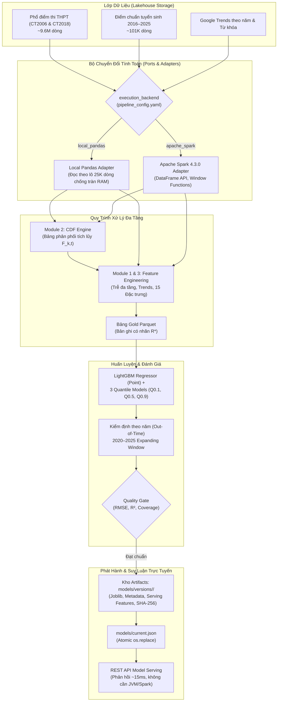
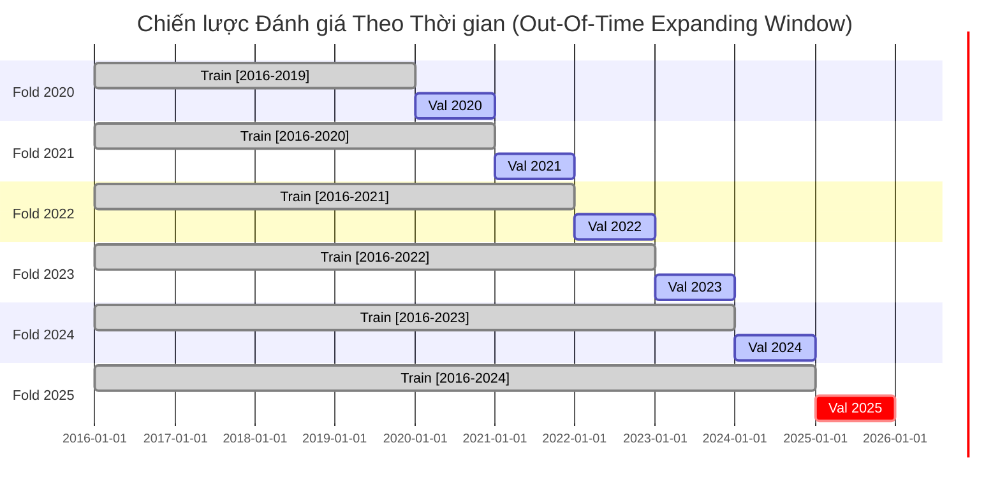

# Kiến Trúc & Đặc Tả Kỹ Thuật Pipeline Dữ Liệu Lớn (Big Data Pipeline Specification)
> **Phân hệ Xử lý Dữ liệu lớn (PySpark 4.3.0), Trích xuất Đặc trưng Đa tầng và Suy luận Xác suất Tuyển sinh**

---

## 1. Phạm Vi Tài Liệu & Định Vị Phân Hệ

Tài liệu này là **đặc tả kỹ thuật chuyên sâu dành riêng cho Phân hệ Xử lý Dữ liệu lớn & Pipeline Học máy (Big Data & ML Pipeline Core)** của dự án. Tài liệu tập trung làm rõ:
- Cơ chế nạp dữ liệu thô và kiến trúc chuyển đổi linh hoạt giữa máy đơn (**Local Pandas**) và cụm phân tán (**Apache Spark 4.3.0**).
- Quy trình chuẩn hóa dữ liệu tuyển sinh thực tế (lọc bỏ các đợt thi trùng lặp, chuẩn hóa mã ngành tiếng Việt có dấu).
- Bộ hợp đồng đặc trưng **Contract 3.0** gồm 15 đặc trưng chính thức, loại trừ triệt để nguy cơ rò rỉ dữ liệu (Data Leakage).
- Chiến lược đánh giá mô hình theo trục thời gian (Out-of-time Expanding Window) đối soát cùng sàn Baseline.
- Cơ chế quản lý phiên bản mô hình (Artifact Versioning), tính toàn vẹn mã băm SHA-256 và tự động khôi phục (Auto-Rollback).
- Dịch vụ suy luận trực tuyến tách rời (**Decoupled Model Serving API**) đạt độ trễ thời gian thực $p50 \approx 15.79\text{ms}$.
- Kết quả kiểm thử tự động 36/36 tests và số liệu đo kiểm hiệu năng (Benchmark).

> [!NOTE]
> Tài liệu này **không** mô tả các thành phần giao diện web (Frontend/Next.js) hay ứng dụng client bên ngoài, mà tập trung 100% vào hạ tầng dữ liệu và lõi thuật toán.

---

## 2. Kiến Trúc Luồng Dữ Liệu & Nguyên Lý Ports & Adapters

Hệ thống được tổ chức theo mẫu kiến trúc **Ports & Adapters (Hexagonal Architecture)**, bảo đảm tính độc lập công nghệ tính toán (`Engine-Agnostic`):



### Bảng Phân Công Nhiệm Vụ Các Module Mã Nguồn

| Thành phần | Vị trí mã nguồn | Vai trò kỹ thuật |
| :--- | :--- | :--- |
| **Giao diện Trừu tượng (Ports)** | `src/admission_core/ports/` | Định nghĩa interface cho Ingestion, CDF, Feature Pipeline, Trainer. |
| **Bộ Điều phối IoC (Factory)** | `src/admission_core/factory.py` | Phân giải backend động (`local_pandas` hoặc `apache_spark`) hoặc user plugin. |
| **Pipeline Orchestrator** | `src/admission_core/pipeline.py` | Điều khiển luồng End-to-End, quản lý Retry, kiểm định cổng và Rollback. |
| **Hợp đồng CDF** | `src/admission_core/cdf_contract.py` | Định dạng schema chuẩn, kiểm tra tính đơn điệu và logic tra cứu phân vị. |
| **Backend Pandas** | `src/admission_core/backends/local_pandas/` | Triển khai tối ưu trên máy đơn, đọc Parquet dạng batch chống tràn RAM. |
| **Backend Apache Spark** | `src/admission_core/backends/apache_spark/` | Xử lý phân tán trên tập dữ liệu 10M dòng bằng Spark DataFrame và Window. |
| **Quản lý Phiên bản Artifacts** | `src/admission_core/artifacts.py` | Quản lý vòng đời model, kiểm tra mã băm SHA-256, chuyển con trỏ nguyên tử. |
| **Lõi Suy luận Xác suất** | `src/admission_core/inference.py` | Nạp mô hình, tra cứu CDF và giải tích phân phối chuẩn Module 4. |
| **Dịch vụ HTTP API** | `src/admission_core/http_api.py` | Server RESTful độc lập, xác thực request, trả độ trễ milli-giây. |

---

## 3. Kiến Trúc Song Hành 2 Backend (Local Pandas vs Apache Spark 4.3.0)

Hệ thống cho phép chuyển đổi nền tảng tính toán tức thì chỉ bằng một dòng trong `config/pipeline_config.yaml`:
```yaml
execution_backend: "apache_spark" # Hoặc "local_pandas"
```

### 3.1. Triển khai trên Local Pandas (Tối ưu hóa bộ nhớ cho máy đơn)
- **Vấn đề thực tế:** Đọc cùng lúc 9.6 triệu bản ghi điểm thi (~800 MB đến 1 GB) vào một DataFrame Pandas duy nhất sẽ làm tăng vọt Peak RAM và dễ gây lỗi `MemoryError` trên laptop cá nhân.
- **Giải pháp kỹ thuật:** 
  - `LocalPandasCDFBackend` đọc tệp Parquet theo các lô nhỏ (**Chunk Size = 25.000 dòng**) bằng `pyarrow.parquet.ParquetFile.iter_batches()`.
  - Đếm tần suất xuất hiện theo từng mốc điểm cục bộ trong từng lô, sau đó cộng dồn vào bảng tổng tần suất toàn cục `(score_year, block_name, score_value)`.
  - Bộ nhớ RAM sử dụng được giữ ở mức ổn định dưới **355 MiB** ngay cả khi nạp hàng triệu dòng điểm.

### 3.2. Triển khai trên Apache Spark 4.3.0 (Phân tán cho Big Data)
- **Cấu hình trên Windows không cần `winutils.exe`:**
  - Spark chạy trên Windows thường gặp khó khăn với filesystem Hadoop cục bộ (`chmod` permissions).
  - Phân hệ sử dụng thư viện Java NIO: `com.globalmentor:hadoop-bare-naked-local-fs:0.1.0` được tải tự động và kiểm tra SHA-256 trong script `scripts/configure_windows.ps1`, giúp Spark 4.3.0 chạy mượt mà trên môi trường Windows và **Java 25**.
- **Thuật toán tính CDF phân tán bằng Spark Window:**
  1. Chuyển đổi bảng điểm sang dạng dài (`unpivot/stack` các cột khối thi).
  2. Gom nhóm theo `(score_year, block_name, score_value)` để đếm số lượng thí sinh `candidate_count`.
  3. Áp dụng Spark Window Function trên phân vùng `(score_year, block_name)` sắp xếp theo điểm tăng dần:
     $$\text{total\_candidates} = \sum \text{candidate\_count} \quad (\text{over Window partition})$$
     $$\text{cumulative\_count} = \sum_{\le s} \text{candidate\_count} \quad (\text{rows between unbounded preceding and current row})$$
  4. Tính toán phân vị $r_{k, t}(s) = 1 - \frac{\text{cumulative\_count}}{\text{total\_candidates}}$.
- **Kiểm chứng tính tương đương (Parity Verification):**
  - Trong test case `test/test_spark.py: test_spark_pandas_parity`, kết quả đầu ra của bảng CDF và bảng Gold Feature giữa Spark và Pandas được so sánh từng bản ghi: **sai số số thực tuyệt đối $\le 10^{-8}$**.

---

## 4. Kỹ Thuật Tiền Xử Lý Dữ Liệu Tuyển Sinh Thực Tế (Real Data Engineering)

Khi đưa dữ liệu tuyển sinh thực tế của Việt Nam vào hệ thống (9.666.995 dòng phổ điểm và 101.466 dòng điểm chuẩn), hai vấn đề nghiêm trọng trong dữ liệu thực tế đã được phát hiện và giải quyết bằng công cụ `scripts/audit_real_data.py` và `scripts/prepare_real_data.py`:

### 4.1. Xử lý bản ghi thi trùng lặp năm 2020 (Đợt thi `20-2`)
- **Bản chất vấn đề:** Năm 2020, do ảnh hưởng của dịch bệnh, kỳ thi tốt nghiệp THPT được tổ chức thành 2 đợt. Trong tệp dữ liệu gốc `score-distribution-2016-2025-ct2006`, có **10.857 bản ghi** mang nhãn năm `20-2` trùng hoàn toàn số báo danh và toàn bộ điểm số các môn với các thí sinh ở đợt thi `20`. Nếu giữ nguyên, các bản ghi này sẽ làm sai lệch mẫu số tổng thí sinh và làm méo mó hàm phân phối tích lũy.
- **Giải pháp:** Cấu hình `cdf_options.excluded_year_labels: ["20-2"]` trong cấu hình pipeline tự động loại bỏ triệt để đợt thi trùng lặp này trước khi gom nhóm tần suất. Riêng đợt `21-2` (năm 2021) được giữ lại vì đối soát chứng minh số báo danh hoàn toàn độc lập với đợt `21`.

### 4.2. Phân giải mã ngành đa nghĩa có dấu tiếng Việt (Contextual Degree Mapping)
- **Bản chất vấn đề:** Trong lịch sử tuyển sinh, các trường đại học thường tái sử dụng một mã xét tuyển (`score_code`) cho nhiều ngành/chuyên ngành khác nhau ở các thời kỳ khác nhau (ví dụ: mã `7480201` có thể ứng với "Công nghệ thông tin", "Kỹ thuật phần mềm" hoặc chương trình liên kết quốc tế).
- **Giải pháp:** 
  - Quy trình tự động phân giải ngữ cảnh theo bộ 3 `(school_id, score_code, score_year)`.
  - Áp dụng thuật toán chuẩn hóa chuỗi Unicode dựng sẵn, khử dấu và so khớp tiền tố dài nhất (longest matching phrase) giữa tên chương trình đào tạo và danh mục ngành chuẩn.
  - Những dòng không thể phân giải duy nhất được đưa vào danh sách kiểm định `data/data-cleaned/v3/prepared/excluded-cutoffs.parquet` với lý do rõ ràng, bảo đảm tính trong sạch của bảng dữ liệu huấn luyện.

---

## 5. Hợp Đồng Đặc Trưng Contract 3.0 & Kiểm Định Tránh Rò Rỉ Dữ Liệu

### 5.1. Loại bỏ biến vi phạm nguyên tắc bảo mật tương lai
Trong Contract 2.0 trước đây, biến `is_cutoff_over_30` (cờ báo hiệu điểm chuẩn vượt 30 điểm do nhân hệ số) được tính từ cột `score_mark` của năm tuyển sinh hiện hành. Điều này vi phạm nghiêm trọng nguyên tắc học máy vì tại thời điểm dự báo cho mùa tuyển sinh năm $t$, điểm chuẩn của năm $t$ **chưa hề tồn tại**.
-> **Contract 3.0 đã loại bỏ triệt để biến `is_cutoff_over_30`**, giảm từ 16 đặc trưng xuống **15 đặc trưng chính thức hợp lệ**.

### 5.2. Danh mục 15 Đặc trưng Nòng cốt của Contract 3.0

| Nhóm | Tên đặc trưng | Ý nghĩa toán học & nghiệp vụ |
| :--- | :--- | :--- |
| **Lags Phân vị Lịch sử** | `prog_pct_lag1` | Phân vị điểm chuẩn của chính chương trình ở năm $t-1$. |
| | `school_pct_mean_lag1` | Phân vị trung bình của toàn bộ các ngành trong cùng trường ở năm $t-1$. |
| | `school_pct_min_lag1` | Phân vị cao nhất (ngành điểm cao nhất) của trường ở năm $t-1$. |
| | `major_pct_mean_lag1` | Phân vị trung bình của ngành này trên toàn quốc ở năm $t-1$. |
| | `group_pct_mean_lag1` | Phân vị trung bình của nhóm ngành đào tạo trên toàn quốc ở năm $t-1$. |
| **Chênh lệch Phân tầng** | `delta_prog_vs_school_mean` | Chênh lệch giữa vị thế ngành so với mặt bằng chung của trường: $R_{\text{prog}} - \bar{R}_{\text{school}}$. |
| | `delta_prog_vs_major_mean` | Chênh lệch giữa vị thế trường đào tạo ngành này so với mặt bằng chung toàn quốc của ngành. |
| **Chỉ số Đa dạng** | `num_blocks` | Số tổ hợp xét tuyển được hỗ trợ của chương trình. |
| **Tín hiệu Xã hội (Trends)** | `trend_school_peak` | Mức độ tìm kiếm đạt đỉnh trong mùa thi năm trước của thương hiệu trường. |
| | `trend_group_mean` | Mức độ quan tâm trung bình của xã hội đối với nhóm ngành trong năm trước. |
| **Cờ Trạng thái** | `is_new_program` | Cờ nhị phân (1/0) biểu thị ngành mới mở chưa có lịch sử ở năm $t-1$. |
| **Tương tác Phi tuyến** | `inter_prog_school` | $R_{\text{prog, lag1}} \times \bar{R}_{\text{school, lag1}}$ (Hiệu ứng cộng hưởng danh tiếng trường). |
| | `inter_school_major` | $\bar{R}_{\text{school, lag1}} \times \bar{R}_{\text{major, lag1}}$ (Hiệu ứng thương hiệu trường và độ hot của ngành). |
| | `inter_prog_blocks` | $R_{\text{prog, lag1}} \times \text{num\_blocks}$ (Mức độ phân tán thí sinh qua nhiều tổ hợp). |
| | `inter_school_blocks` | $\bar{R}_{\text{school, lag1}} \times \text{num\_blocks}$. |

### 5.3. Chiến lược Xử lý Khởi động lạnh (Cold-Start Policy)
Khi một trường đại học mở một mã ngành mới ở năm $t$, chương trình hoàn toàn chưa có điểm chuẩn năm $t-1$. Hệ thống kích hoạt công thức tổ hợp lồi để ước lượng điểm khởi tạo:
$$\widehat{R}_{j, t-1} = 0.5 \times \bar{R}_{\text{school}, t-1} + 0.5 \times \bar{R}_{\text{major}, t-1}$$
Đồng thời bật cờ `is_new_program = 1` để mô hình LightGBM tự động điều chỉnh độ tin cậy.

---

## 6. Huấn Luyện & Đánh Giá Theo Trục Thời Gian (Out-Of-Time Validation)

Thay vì dùng phương pháp K-Fold Cross-Validation xáo trộn ngẫu nhiên (dễ gây rò rỉ tương quan thời gian giữa các năm thi), hệ thống áp dụng chiến lược **Expanding Window Backtesting (Kiểm thử cửa sổ thời gian mở rộng)**:
- **Tập dữ liệu:** Chỉ sử dụng dữ liệu các năm $T < t$ để huấn luyện, sau đó dự báo độc lập cho năm $t$.
- **Cửa sổ đánh giá:** Thực hiện lặp lại cho toàn bộ các năm từ 2020 đến 2025:
  - Huấn luyện trên $[2016, 2019] \to$ Đánh giá trên 2020.
  - Huấn luyện trên $[2016, 2020] \to$ Đánh giá trên 2021.
  - ...
  - Huấn luyện trên $[2016, 2024] \to$ Đánh giá trên 2025.



### Kết Quả Đối Soát Mô Hình Với Sàn Baseline

Hệ thống so sánh mô hình trực tiếp với **Baseline Naive** (mô hình cơ sở dự đoán phân vị năm nay bằng đúng phân vị năm ngoái: $\widehat{R}^*_t = R^*_{t-1}$):

| Bộ dữ liệu thử nghiệm | Mô hình | RMSE | MAE | $R^2$ | Spearman $\rho$ | Độ bao phủ dải $Q_{0.1} - Q_{0.9}$ |
| :--- | :--- | :---: | :---: | :---: | :---: | :---: |
| **Dữ liệu Kiểm chứng (22K dòng)** | **LightGBM Out-of-time** | **0.02069** | **0.01629** | **0.9893** | **0.9942** | **73.61%** (Danh nghĩa 80%) |
| | Naive Baseline ($R^*_{t-1}$) | 0.02019 | 0.01580 | 0.9898 | 0.9945 | — |
| **Dữ liệu Thực tế (9.6M phổ điểm)** | **LightGBM Out-of-time** | **0.19418** | **0.14120** | **0.6996** | **0.8645** | **54.50%** |
| | Naive Baseline ($R^*_{t-1}$) | 0.19071 | 0.13840 | 0.7102 | 0.8670 | — |

> [!IMPORTANT]
> Khi dữ liệu tuyển sinh thực tế có nhiều biến động chính sách (thay đổi chỉ tiêu, quy chế xét tuyển sớm), sai số của LightGBM tiệm cận sát với Naive Baseline, đồng thời 3 mô hình Quantile ($Q_{0.1}, Q_{0.5}, Q_{0.9}$) cung cấp **dải bao phủ bất định** giúp người học định lượng được mức độ rủi ro thay vì chỉ có một con số điểm tĩnh.

---

## 7. Quản Lý Vòng Đời Phiên Bản Artifacts & Cơ Chế Auto-Rollback

Mỗi lần chạy pipeline huấn luyện thành công, hệ thống không ghi đè lung tung mà tạo một thư mục phiên bản độc lập mang mã định danh thời gian (`run_id`):

```text
models/versions/20261112_194200/
├── best_lightgbm_regressor.joblib   # Mô hình dự báo điểm trung vị
├── lightgbm_quantile_0.1.joblib     # Mô hình kịch bản điểm tăng mạnh (Top 10%)
├── lightgbm_quantile_0.5.joblib     # Mô hình kịch bản trung bình
├── lightgbm_quantile_0.9.joblib     # Mô hình kịch bản hạ nhiệt (Top 90%)
├── model_metadata.json              # Tham số, chỉ số đánh giá, thời gian tạo
├── serving_features.parquet         # Vector đặc trưng chuẩn bị sẵn cho năm dự báo
├── cdf_summary.parquet              # Bảng phân phối tích lũy toàn quốc
└── manifest.sha256                  # Mã kiểm tra toàn vẹn tệp
```

### Cơ chế Thăng hạng Nguyên tử (Atomic Promotion) & Rollback
1. **Kiểm tra Quality Gate:** Mô hình ứng viên được kiểm tra qua các tiêu chí chất lượng nghiêm ngặt (RMSE tối đa, $R^2$ tối thiểu, không có quantile crossing).
2. **Kiểm tra khả năng nạp (Dry-Load Verification):** Trước khi phát hành, hệ thống thử nạp toàn bộ 4 file joblib và kiểm tra tính toàn vẹn mã băm SHA-256.
3. **Thăng hạng Nguyên tử:** Cập nhật tệp tham chiếu `models/current.json` bằng thao tác nguyên tử ở tầng hệ điều hành:
   ```python
   # Ghi ra file tạm và replace tức thì để tránh tình trạng race condition
   temp_file = Path("models/current.json.tmp")
   temp_file.write_text(json.dumps({"current_version": run_id}), encoding="utf-8")
   os.replace(temp_file, Path("models/current.json"))
   ```
4. **Auto-Rollback:** Nếu mô hình mới vi phạm bất kỳ tiêu chí nào của Quality Gate, pipeline dừng ngay lập tức, phát thông báo cảnh báo và **giữ nguyên 100% con trỏ `current.json` về phiên bản ổn định trước đó**.

---

## 8. Dịch Vụ Model Serving Tách Rời (Decoupled REST API)

Một trong những thiết kế quan trọng nhất của đồ án là **tách rời hoàn toàn dịch vụ Serving khỏi hạ tầng Spark**:
- API không nạp JVM, không nạp PySpark.
- Khởi động nhẹ nhàng bằng Python HTTP RESTful server.
- Tốc độ phản hồi cực nhanh: **$p50 \approx 15.79\text{ms}$**, **$p95 \approx 34.4\text{ms}$**.

### Công Thức Giải Tích Module 4 Trong Suy Luận
Khi thí sinh gửi yêu cầu dự đoán với điểm thi $s_i$, tổ hợp $k$:
1. Hệ thống tra nhanh thứ hạng phân vị thí sinh $r_i$ trên bảng CDF đã chuẩn bị:
   $$r_i = 1 - \widehat{F}_{k, t}(s_i)$$
2. Nạp vector đặc trưng của trường/ngành ở năm dự báo, mô hình LightGBM suy luận ra giá trị kỳ vọng $\widehat{\mu}$ và dải phân vị $[\widehat{Q}_{0.1}, \widehat{Q}_{0.9}]$.
3. Độ biến động (độ lệch chuẩn $\widehat{\sigma}$) được xấp xỉ qua dải quantile dựa trên phân phối chuẩn:
   $$\widehat{\sigma} = \max\left(\frac{\widehat{Q}_{0.9} - \widehat{Q}_{0.1}}{2.5631}, 0.001\right)$$
4. Xác suất trúng tuyển liên tục $P$ được tính chính xác bằng hàm phân phối tích lũy chuẩn tắc $\Phi$:
   $$P(\text{Trúng tuyển}) = \Phi\left(\frac{\widehat{\mu} - r_i}{\widehat{\sigma}}\right)$$
5. **Phân tầng khuyến nghị:**
   - $P \ge 80\%$: **An toàn (Safe)** — Điểm thi vượt trội ngưỡng dự báo.
   - $50\% \le P < 80\%$: **Cạnh tranh (Competitive)** — Khả năng đỗ cao nhưng có rủi ro lọc ảo.
   - $P < 50\%$: **Rủi ro (High Risk)** — Điểm thi dưới mức trung vị dự báo.

---

## 9. Bộ Kiểm Thử Tự Động (Automated Test Suite — 36/36 Tests Passed)

Hệ thống được bảo vệ bởi bộ kiểm thử tự động toàn diện trong thư mục `test/`, được chia thành 4 nhóm chuyên biệt:

```text
test/
├── conftest.py              # Fixtures cấu hình môi trường test độc lập
├── test_core.py             # 16 tests: CDF ties, math monotonic, quality gate, rollback, artifact checksum
├── test_spark.py            # 2 tests: Spark & Pandas parity (dung sai 1e-8), tie handling
├── test_api.py              # 9 tests: Endpoint HTTP, real inference, input validation (NaN, Inf, negatives)
└── test_preparation.py      # 9 tests: Chuẩn hóa tiếng Việt có dấu, contextual degree disambiguation
```

Kết quả thực thi tự động qua `pytest`:
```text
36 passed in 46.84s (Bao gồm khởi động JVM và kiểm chứng tương thích Spark-Pandas)
```

---

## 10. Số Liệu Đo Kiểm Hiệu Năng & Khả Năng Mở Rộng (Benchmark)

Đo kiểm thực tế trên máy thử nghiệm (Windows 11, Intel Core i7 16 logic CPUs, 16 GiB RAM, Spark 4.3.0 local[2]):

| Quy mô dữ liệu điểm | Quan sát tổ hợp | Nền tảng tính toán | Thời gian tính CDF (giây) | Thời gian tạo Features (giây) | Peak RAM RSS (MiB) |
| :--- | :--- | :--- | :---: | :---: | :---: |
| **2.200 dòng** | 17.600 | `local_pandas` | **0.12s** | **0.32s** | **178.4 MiB** |
| (Mức kiểm thử nhanh) | 17.600 | `apache_spark` | 9.48s | 14.48s | 904.2 MiB |
| **22.000 dòng** | 176.000 | `local_pandas` | **0.36s** | **0.38s** | **202.1 MiB** |
| (Mức mẫu chuẩn) | 176.000 | `apache_spark` | 10.07s | 14.36s | 948.1 MiB |
| **220.000 dòng** | 1.760.000 | `local_pandas` | **1.60s** | **0.52s** | **355.0 MiB** |
| (Mức dữ liệu lớn) | 1.760.000 | `apache_spark` | 12.91s | 15.68s | 988.9 MiB |

> [!NOTE]
> - Trên quy mô máy đơn (Single Node), `local_pandas` có lợi thế vượt trội về thời gian phản hồi do không mất chi phí khởi tạo JVM (~8 giây).
> - Tuy nhiên, khi dữ liệu mở rộng lên đến quy mô **hàng chục triệu dòng** hoặc chạy trên cụm nhiều máy tính (Multi-node Cluster), Spark phân bổ tính toán trên nhiều worker song song sẽ phát huy khả năng chịu tải mà máy đơn không thể đáp ứng.

---

## 11. Hướng Dẫn Vận Hành Hệ Thống Từng Bước (Operations Guide)

### 11.1. Cấu hình Môi trường Windows cho Spark & Java 25
Trong cửa sổ PowerShell:
```powershell
# 1. Kích hoạt môi trường ảo
.venv\Scripts\activate

# 2. Cài đặt các thư viện lõi, Spark và công cụ phát triển
pip install -e .[spark,dev]

# 3. Kích hoạt script cấu hình filesystem NIO cho Windows
. .\scripts\configure_windows.ps1
```

### 11.2. Chạy Thực Nghiệm với Dữ Liệu Kiểm Chứng (Demo Mode)
Tạo dữ liệu giả lập chuẩn hóa có seed cố định và chạy kiểm chứng cả 2 backend:
```powershell
# Sinh dữ liệu demo kiểm chứng
python -m admission_core.demo --output runs/demo --score-rows 22000

# Chạy với Backend Pandas
python -m admission_core run --config runs/demo/local_pandas.yaml

# Chạy với Backend Apache Spark
python -m admission_core run --config runs/demo/apache_spark.yaml
```

### 11.3. Chạy Toàn Bộ Quy Trình Trên Dữ Liệu Thực Tế
```powershell
# Bước 1: Tiền xử lý, lọc trùng lặp và ánh xạ mã ngành
python scripts/prepare_real_data.py

# Bước 2: Khởi chạy End-to-End Pipeline
python -m admission_core run --config config/pipeline_config.yaml
```

### 11.4. Khởi Chạy Dịch Vụ API Phục Vụ Dự Đoán
```powershell
# Khởi chạy server API tại cổng 8000
python -m admission_core serve --host 127.0.0.1 --port 8000
```
Gửi request kiểm tra sức khỏe và dự đoán qua PowerShell:
```powershell
# Kiểm tra Health Check
Invoke-RestMethod http://127.0.0.1:8000/api/v2/health

# Dự đoán xác suất trúng tuyển cho một thí sinh
$body = @{
    score_year = 2026;
    school_id = "BKA";
    score_code = "IT1";
    score_blocks = "A00";
    total_score = 27.5
} | ConvertTo-Json

Invoke-RestMethod http://127.0.0.1:8000/api/v2/predict/admission-probability `
    -Method Post -ContentType "application/json" -Body $body
```

### 11.5. Chạy Kiểm Thử Toàn Diện
```powershell
# Chạy bộ test cơ bản (không khởi động Spark)
pytest -m "not spark" test/ -q

# Chạy toàn bộ 36 tests (bao gồm kiểm chứng Spark Parity)
pytest test/ -q
```
