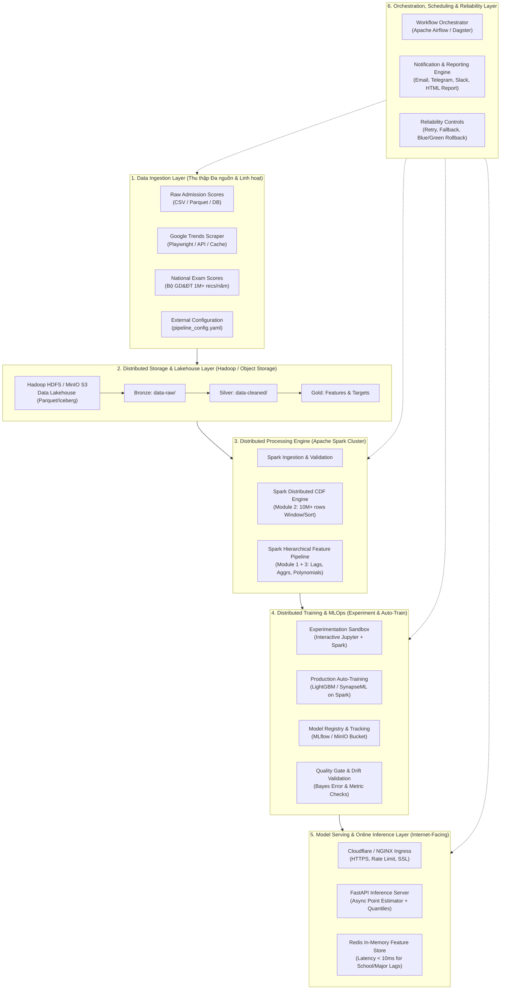
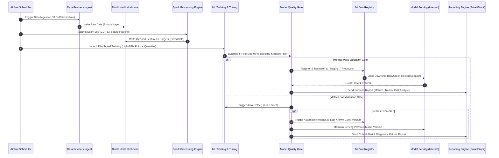
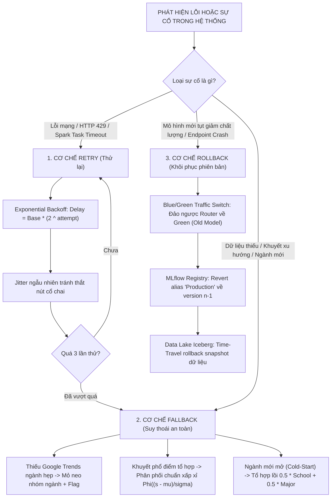
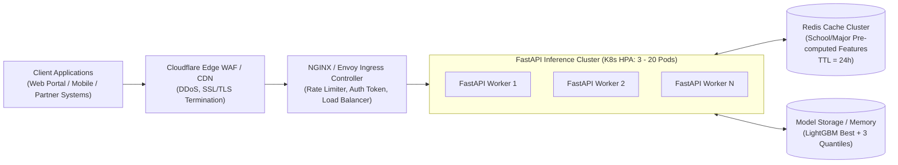
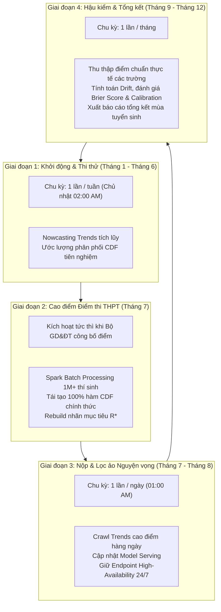
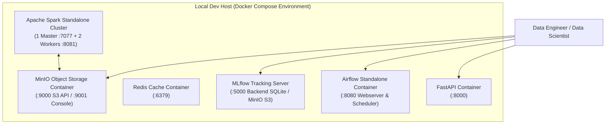
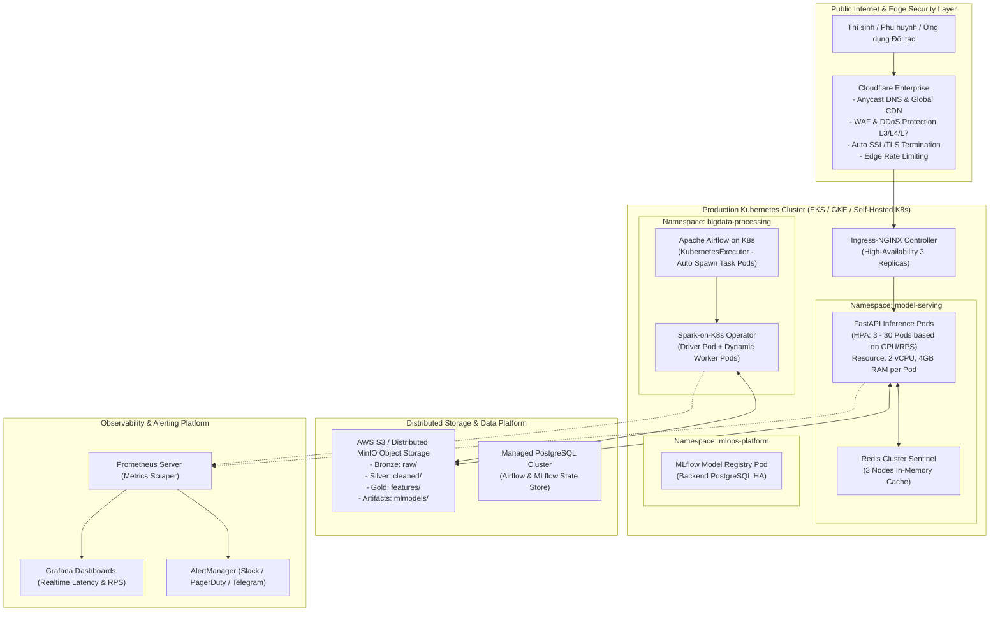

# Kế Hoạch Triển Khai Framework Dự Đoán Tuyển Sinh Trên Nền Tảng Dữ Liệu Lớn (Big Data Processing Implementation Plan)

Tài liệu này đặc tả toàn diện kế hoạch kiến trúc, thiết kế kỹ thuật, lộ trình triển khai và hướng dẫn vận hành cho hệ thống **Dự đoán Xác suất Trúng tuyển Đại học theo Phân vị Cân bằng Động (Dynamic Percentile-Equilibrated University Admission Framework)** trên các nền tảng xử lý dữ liệu lớn (Big Data Distributed Platforms).

Tài liệu được xây dựng dựa trên sự liên kết chặt chẽ với:
- [Đặc tả bài toán và mô hình toán 4 thành phần](file:///d:/UNIDOCS/IS405.R11-Big-Data/docs/problem-specification.md) (`docs/problem-specification.md`)
- [Hợp đồng dữ liệu và cấu trúc schema chuẩn](file:///d:/UNIDOCS/IS405.R11-Big-Data/docs/data-contract.md) (`docs/data-contract.md`)
- [Hiện thực mô hình học máy cơ sở và siêu tham số tối ưu](file:///d:/UNIDOCS/IS405.R11-Big-Data/scripts-processing/notebooks/model-training.ipynb) (`scripts-processing/notebooks/model-training.ipynb` & `models/model_metadata.json`)

---

## MỤC LỤC TỔNG QUAN

1. [Bối Cảnh Nghiệp Vụ & Động Lực Chuyển Đổi Lên Nền Tảng Big Data](#1-bối-cảnh-nghiệp-vụ--động-lực-chuyển-đổi-lên-nền-tảng-big-data)
2. [Kiến Trúc Tổng Thể Hệ Thống (System High-Level Architecture)](#2-kiến-trúc-tổng-thể-hệ-thống-system-high-level-architecture)
3. [Phân Tách Môi Trường: Thí Nghiệm (Experimentation) vs Vận Hành (Production)](#3-phân-tách-môi-trường-thí-nghiệm-experimentation-vs-vận-hành-production)
4. [Khung Cấu Hình Động & Đa Dạng Nguồn Dữ Liệu Đầu Vào (Dynamic Configuration Framework)](#4-khung-cấu-hình-động--đa-dạng-nguồn-dữ-liệu-đầu-vào-dynamic-configuration-framework)
5. [Tận Dụng Tối Đa Khả Năng Xử Lý Phân Tán (Distributed Big Data Processing)](#5-tận-dụng-tối-đa-khả-năng-xử-lý-phân-tán-distributed-big-data-processing)
6. [Bảng So Sánh & Lựa Chọn Công Nghệ Nòng Cốt (Technology Trade-off Matrix)](#6-bảng-so-sánh--lựa-chọn-công-nghệ-nòng-cốt-technology-trade-off-matrix)
7. [Thiết Kế Cơ Chế Vận Hành Sản Xuất: Tự Động Hóa, Độ Tin Cậy & Khôi Phục](#7-thiết-kế-cơ-chế-vận-hành-sản-xuất-tự-động-hóa-độ-tin-cậy--khôi-phục)
8. [Kiến Trúc Endpoint Phục Vụ Dự Đoán Trực Tuyến (Model Serving & Inference API)](#8-kiến-trúc-endpoint-phục-vụ-dự-đoán-trực-tuyến-model-serving--inference-api)
9. [Cơ Chế Lập Lịch Định Kỳ & Kích Hoạt Theo Mùa Tuyển Sinh (Scheduler System)](#9-cơ-chế-lập-lịch-định-kỳ--kích-hoạt-theo-mùa-tuyển-sinh-scheduler-system)
10. [Đề Xuất Hạ Tầng Triển Khai Chi Tiết (Local vs Production Internet-Facing)](#10-đề-xuất-hạ-tầng-triển-khai-chi-tiết-local-vs-production-internet-facing)
11. [Đề Xuất Tái Cấu Trúc Thư Mục Repository Chuẩn MLOps & Big Data Đa Môi Trường](#11-đề-xuất-tái-cấu-trúc-thư-mục-repository-chuẩn-mlops--big-data-đa-môi-trường)
12. [Lộ Trình Triển Khai Từng Bước (Implementation Roadmap & Milestones)](#12-lộ-trình-triển-khai-từng-bước-implementation-roadmap--milestones)

---

## 1. BỐI CẢNH NGHIỆP VỤ & ĐỘNG LỰC CHUYỂN ĐỔI LÊN NỀN TẢNG BIG DATA

### 1.1 Tóm tắt Bài toán & 4 Module Cốt lõi
Hệ thống giải quyết bài toán cốt lõi: **Ước lượng hàm xác suất trúng tuyển liên tục $P(\text{Trúng tuyển}_{i, j, t}) = \mathbb{P}(S_{i, k, t} \ge C_{j, k, t})$** của thí sinh $i$ với mức điểm $S_{i, k, t}$ vào ngành $j$, tổ hợp $k$ ở năm $t$. Kiến trúc được module hóa theo 4 cấu phần:
- **Module 1 (Google Trends - Nowcasting Nhu cầu Xã hội):** Trích xuất chuỗi thời gian tìm kiếm cấp trường ($s$), ngành ($m$) và nhóm ngành ($g$) nhằm tạo vector lực cầu $\mathbf{D}_{j, t}$ và biến thiên $\Delta \mathbf{D}_{j, t}$.
- **Module 2 (Phổ điểm Thi THPT & CDF Engine):** Chuyển đổi điểm thi thô sang thứ hạng phân vị chuẩn hóa $\text{RankPct}_{k, t}(s) = 1 - \hat{F}_{k, t}(s)$. Đóng vai trò là "nhà máy tạo nhãn" cho Module 3 và cung cấp vị trí $r_{i, k, t}$ cho Module 4.
- **Module 3 (Học máy Dự đoán Phân vị Điểm chuẩn $R^*_{j, t}$):** Lõi học máy giám sát kết hợp LightGBM Point Regressor và Quantile Regressors ($\tau \in \{0.1, 0.5, 0.9\}$) để ước lượng phân phối điều kiện $R^*_{j, t} \sim \mathcal{N}(\mu_{j, t}, \sigma_{j, t}^2)$ cùng 3 kịch bản tin cậy.
- **Module 4 (Ước lượng Xác suất Đỗ & Phân tầng Quyết định):** Suy luận tích phân xác suất $P = \Phi\left(\frac{\mu_{j, t} - r_{i, k, t}}{\sigma_{j, t}}\right)$ và phân tầng khuyến nghị chiến lược (Vùng An toàn $\ge 80\%$, Vùng Cạnh tranh $50\% - 80\%$, Vùng Rủi ro $< 50\%$).

### 1.2 Những Nút Thắt Dữ Liệu Lớn (Big Data Bottlenecks) Khi Mở Rộng
Khi triển khai trên môi trường máy đơn (Single-node Pandas/Jupyter):
1. **Dữ liệu Phổ điểm Toàn quốc Tăng trưởng Cực nhanh:** Mỗi năm có từ 1.000.000 đến 1.200.000 thí sinh dự thi. Dữ liệu lịch sử 10 năm (2016–2025) đạt hơn 10 triệu dòng bản ghi chi tiết từng môn thi, tổ hợp môn thi (Format CT2006 và CT2018). Việc tính toán Empirical CDF, sắp xếp mảng điểm phân tán và nội suy phân vị trên máy đơn gây tràn RAM (OOM) hoặc tốn kém thời gian CPU.
2. **Feature Engineering Phân cấp Phức tạp (Hierarchical Aggregations & Lags):** Ma trận đặc trưng yêu cầu tính toán trượt chuỗi thời gian, trung bình, trung vị, giá trị nhỏ nhất/lớn nhất, phương sai quá khứ theo từng cấp bậc: Chương trình đào tạo ($> 24.000$ mã), Trường ($> 300$ trường), Ngành ($> 450$ ngành), Nhóm ngành ($37$ nhóm) và ghép nối chuỗi thời gian Google Trends ($> 240.000$ dòng tháng).
3. **Mở rộng Đa nguồn & Tính Tự động Hóa Sản Xuất:** Cần một pipeline chuẩn hóa, cho phép thu thập tự động, huấn luyện định kỳ, thẩm định chất lượng tự động, phát hành model serving không gián đoạn, tự phục hồi khi có sự cố và cung cấp API ra Internet cho hàng trăm ngàn lượt tra cứu cùng lúc trong mùa tuyển sinh.

---

## 2. KIẾN TRÚC TỔNG THỂ HỆ THỐNG (SYSTEM HIGH-LEVEL ARCHITECTURE)

Hệ thống được thiết kế theo kiến trúc **Modern Lakehouse & MLOps Pipeline**, phân chia thành 6 tầng rõ rệt:



---

## 3. PHÂN TÁCH MÔI TRƯỜNG: THÍ NGHIỆM (EXPERIMENTATION) VS VẬN HÀNH (PRODUCTION)

Để bảo đảm an toàn dữ liệu, tính linh hoạt khi nghiên cứu và sự ổn định 99.9% của hệ thống trực tuyến, hệ thống phân tách nghiêm ngặt 2 môi trường:

```mermaid
graph LR
    subgraph ENV_EXP["MÔI TRƯỜNG THÍ NGHIỆM (Experimentation / Dev)"]
        direction TB
        E1["JupyterLab & PySpark Session"]
        E2["Khám phá EDA, PACF, ANOVA F-test"]
        E3["Hyperparameter Search (Optuna/Randomized)"]
        E4["MLflow Tracking (Thử nghiệm vô hạn version)"]
        E5["Local / Scratch Data Lake Sandbox"]
    end

    subgraph ENV_PROD["MÔI TRƯỜNG SẢN XUẤT (Production / Live)"]
        direction TB
        P1["Airflow Scheduled DAGs (Non-interactive)"]
        P2["Automated Spark Submit Cluster Jobs"]
        P3["Strict CI/CD & Automated Model Validation"]
        P4["Production Model Registry (Staging -> Prod)"]
        P5["High Availability Serving API on Internet"]
        P6["Autonomous Retry - Fallback - Rollback"]
    end

    ENV_EXP -- "Promote Code & Pipeline Config via Git" --> ENV_PROD
    ENV_EXP -- "Register Validated Model Artifacts" --> ENV_PROD
```



### So sánh Đặc tính Kỹ thuật Giữa Hai Môi Trường

| Tiêu chí | Môi trường Thí nghiệm (Experimentation) | Môi trường Vận hành Sản xuất (Production) |
| :--- | :--- | :--- |
| **Mục đích** | R&D thuật toán, Feature Selection, EDA, thử nghiệm mô hình mới. | Thu thập tự động, huấn luyện định kỳ, sinh báo cáo, phục vụ API Internet. |
| **Hình thức tương tác** | Tương tác trực tiếp (Interactive) qua Web Notebook, PySpark shell. | Không tương tác (Headless), tự động hóa 100% qua Scheduler / Airflow / K8s Job. |
| **Quy mô Cụm Tính toán** | Cụm nhỏ (1 Node local hoặc Spark Standalone 2 Workers) tiết kiệm chi phí. | Cụm Spark phân tán phân tán (Spark on YARN/K8s) tự co giãn (Dynamic Allocation). |
| **Nạp dữ liệu** | Cho phép dev nạp data thử nghiệm tùy biến, upload CSV/Parquet cục bộ. | Nạp qua Data Lakehouse chuẩn (S3/HDFS), phân quyền IAM/Ranger chặt chẽ. |
| **Theo dõi Mô hình** | MLflow Tracking Server ghi nhận mọi lần chạy (Runs), metric biểu đồ linh hoạt. | MLflow Model Registry quản lý trạng thái (`Staging`, `Production`, `Archived`). |
| **Cơ chế An toàn** | Cảnh báo lỗi trên màn hình Notebook; không yêu cầu rollback. | Bắt buộc có: **Retry tự động $\to$ Fallback suy giảm $\to$ Rollback phiên bản cũ**. |
| **Serving Endpoint** | Localhost Swagger Docs (`http://127.0.0.1:8000/docs`) để test nhanh. | Multi-replica Public URL (`https://api.admission-prediction.edu.vn`) có CDN/WAF. |

---

## 4. KHUNG CẤU HÌNH ĐỘNG & ĐA DẠNG NGUỒN DỮ LIỆU ĐẦU VÀO (DYNAMIC CONFIGURATION FRAMEWORK)

Hệ thống được thiết kế theo nguyên lý **Decoupled Architecture** (Mã nguồn lõi tách rời hoàn toàn khỏi cấu hình và nguồn cấp dữ liệu). Người dùng, Data Engineer hoặc MLOps Engineer có thể điều phối toàn bộ pipeline thông qua tệp cấu hình bên ngoài (`config/pipeline_config.yaml`).

### 4.1 Cấu trúc Tệp Cấu Hình Động (`pipeline_config.yaml`)

```yaml
# ==============================================================================
# PIPELINE CONFIGURATION: BIG DATA ADMISSION SYSTEM
# ==============================================================================
version: "2.1"
environment: "production" # "experimentation" | "production"

# 1. Quản lý Chế độ Nạp Dữ liệu (Ingestion Strategy)
data_ingestion:
  # Chế độ: 'direct_data' (nạp trực tiếp data) hoặc 'fetch_script' (chạy script cào)
  mode: "fetch_script"
  
  # Cấu hình nạp trực tiếp (Áp dụng khi mode: direct_data)
  direct_sources:
    cutoff_scores:
      format: "parquet"
      uri: "hdfs://namenode:8020/data/raw/admission/cutoff-scores.parquet"
    score_distribution_ct2006:
      format: "parquet"
      uri: "s3a://admission-datalake/raw/score-distribution/2016-2025-ct2006.parquet"
    score_distribution_ct2018:
      format: "parquet"
      uri: "s3a://admission-datalake/raw/score-distribution/2025-ct2018.parquet"
    google_trends:
      format: "json"
      uri: "hdfs://namenode:8020/data/raw/trends/trends.json"
    majors:
      format: "parquet"
      uri: "s3a://admission-datalake/raw/metadata/majors.parquet"
    score_blocks:
      format: "parquet"
      uri: "s3a://admission-datalake/raw/metadata/score-blocks.parquet"

  # Cấu hình kích hoạt script fetch tùy biến (Áp dụng khi mode: fetch_script)
  fetch_scripts:
    trends_collector:
      entrypoint: "scripts-fetching/unit-scripts/get_trends.py"
      args:
        geo: "VN"
        date_range: "all"
        cache_backend: "sqlite" # "sqlite" | "redis"
        max_retries: 5
        rate_limit_delay_sec: 3.5
    admission_crawler:
      entrypoint: "scripts-fetching/unit-scripts/crawl_admissions.py"
      enabled: false

# 2. Cấu hình Tham số Tính toán Phân tán Apache Spark
spark_engine:
  app_name: "Admission-BigData-Distributed-Engine"
  master: "yarn" # "local[*]" | "yarn" | "k8s://https://k8s-apiserver:6443"
  deploy_mode: "cluster" # "client" | "cluster"
  driver_memory: "4g"
  executor_memory: "8g"
  executor_cores: 4
  num_executors: 10
  dynamic_allocation:
    enabled: true
    min_executors: 2
    max_executors: 30
  sql:
    shuffle_partitions: 200
    adaptive_query_execution: true

# 3. Cấu hình Pipeline Tiền Xử lý & Trích xuất Đặc trưng
feature_pipeline:
  target_feature: "R_star"
  training_years:
    start_year: 2018
    end_year: 2025
  historical_lags:
    program_lags: [1, 2, 3]
    school_lags: [1, 2]
    major_lags: [1, 2]
    group_lags: [1]
  selected_features:
    - "prog_pct_lag1"
    - "school_pct_mean_lag1"
    - "school_pct_min_lag1"
    - "major_pct_mean_lag1"
    - "group_pct_mean_lag1"
    - "delta_prog_vs_school_mean"
    - "delta_prog_vs_major_mean"
    - "num_blocks"
    - "trend_school_peak"
    - "trend_group_mean"
    - "is_cutoff_over_30"
    - "is_new_program"
    - "inter_prog_school"
    - "inter_school_major"
    - "inter_prog_blocks"
    - "inter_school_blocks"

# 4. Cấu hình Huấn luyện Mô hình & MLOps
model_training:
  algorithm: "LightGBM" # "LightGBM" | "CatBoost"
  hyperparameters:
    learning_rate: 0.07
    max_depth: 8
    num_leaves: 45
    n_estimators: 180
    subsample: 0.95
    colsample_bytree: 0.95
    reg_alpha: 1.0
    reg_lambda: 1.0
  quantiles: [0.1, 0.5, 0.9]
  validation_criteria:
    max_rmse: 0.160
    min_r2: 0.78
    max_bayes_gap_mse: 0.005 # Không vượt trần sàn Bayes quá 0.005 MSE

# 5. Cấu hình Lập lịch Tự động (Optional Scheduling)
scheduler:
  enabled: true
  cron_expression: "0 2 1 * *" # 02:00 AM ngày đầu tiên mỗi tháng
  high_frequency_season:
    enabled: true
    start_date: "07-01"
    end_date: "08-31"
    cron_expression: "0 1 * * *" # Hàng ngày lúc 01:00 AM trong mùa cao điểm

# 6. Cấu hình Báo cáo & Độ tin cậy (Reporting & Reliability)
reliability:
  retry_policy:
    max_attempts: 3
    initial_backoff_sec: 10
    backoff_multiplier: 2.0
  fallback_rules:
    on_trends_missing: "use_group_anchor_and_flag"
    on_distribution_missing: "parametric_normal_approximation"
    on_cold_start: "convex_combination_school_major"
  rollback_policy:
    auto_rollback_on_gate_failure: true
    previous_active_versions_to_keep: 3
  reporting:
    channels:
      email:
        enabled: true
        recipients: ["admissions-team@edu.vn", "mlops-lead@edu.vn"]
      slack_webhook:
        enabled: true
        channel: "#mlops-admissions-alerts"
```

### 4.2 Cơ chế Nạp Dữ liệu Linh hoạt (Ingestion Flexibility)
- **Kịch bản 1: Người dùng nạp thẳng dữ liệu (Direct Data Injection):** Khi đã có sẵn các file Parquet/CSV từ kho nội bộ hoặc dữ liệu đối tác, hệ thống bỏ qua bước crawl, đọc trực tiếp theo URI (HDFS/S3/Local) được định cấu hình và chạy kiểm tra schema validation.
- **Kịch bản 2: Người dùng nạp Script Fetch Data (Fetch Script Injection):** Khi cần cập nhật dữ liệu mới từ nguồn sống (Google Trends, web tuyển sinh Bộ GD&ĐT), hệ thống gọi runner trung gian để kích hoạt script khai báo trong `fetch_scripts`, quản lý tiến trình, ghi log và lưu kết quả vào Data Lake.

---

## 5. TẬN DỤNG TỐI ĐA KHẢ NĂNG XỬ LÝ PHÂN TÁN (DISTRIBUTED BIG DATA PROCESSING)

Để giải quyết bài toán quy mô hàng triệu thí sinh và hàng chục ngàn mã tuyển sinh, hệ thống chuyển dịch toàn bộ logic từ Pandas máy đơn sang **Apache Spark (PySpark)** với các thuật toán phân tán tối ưu.

### 5.1 Phân Tán Tính Toán Module 2: Empirical CDF & Rank Percentile Toàn Quốc
Trong quy chế thi THPT, mỗi năm có hơn 1 triệu thí sinh với hàng loạt tổ hợp môn (`KhoiA`, `KhoiA1`, `KhoiB`, `KhoiC`, `KhoiD`,...). 
- **Cách tiếp cận tuần tự cũ:** Lưu toàn bộ vào RAM, dùng `np.sort` và `np.searchsorted` đơn luồng.
- **Cách tiếp cận phân tán trên Spark:** Sử dụng Spark Window Functions phân vùng song song theo `(score_year, block_name)`. Spark phân chia các partition độc lập lên các Executor trên toàn bộ cụm, tính toán thứ hạng phân vị tích lũy (Survival Function: $1 - \hat{F}(s)$) với độ phức tạp phân tán $O\left(\frac{N \log N}{P}\right)$ ($P$ là số core của cụm).

```python
# Minh họa mã PySpark phân tán tính toán bảng phân vị CDF cho hàng triệu thí sinh
from pyspark.sql import SparkSession
from pyspark.sql import functions as F
from pyspark.sql.window import Window

spark = SparkSession.builder.appName("Distributed-CDF-Engine").getOrCreate()

# 1. Đọc dữ liệu phổ điểm phân tán từ Data Lake
df_dist = spark.read.parquet("hdfs:///data/raw/score-distribution/*.parquet")

# 2. Unpivot các khối thi để chuẩn hóa luồng xử lý phân tán
blocks = ['KhoiA', 'KhoiA1', 'KhoiB', 'KhoiC', 'KhoiD', 'KhoiA02', 'KhoiC01', 'KhoiD07']
unpivot_expr = "stack(8, 'KhoiA', KhoiA, 'KhoiA1', KhoiA1, 'KhoiB', KhoiB, 'KhoiC', KhoiC, " \
               "'KhoiD', KhoiD, 'KhoiA02', KhoiA02, 'KhoiC01', KhoiC01, 'KhoiD07', KhoiD07) as (block_name, mark)"

df_stacked = df_dist.select("score_year", F.expr(unpivot_expr)).filter("mark IS NOT NULL AND mark > 0")

# 3. Tính toán Empirical CDF sử dụng Window Function phân tán
# percent_rank() cho biết tỷ lệ thí sinh có điểm nhỏ hơn điểm hiện tại
w_cdf = Window.partitionBy("score_year", "block_name").orderBy("mark")
df_ranked = df_stacked.withColumn("cdf", F.cume_dist().over(w_cdf)) \
                      .withColumn("survival_rank_pct", F.lit(1.0) - F.col("cdf"))

# 4. Xuất bảng tham chiếu phân vị chuẩn hóa lưu vào Silver Layer (Phân vùng theo Năm và Khối)
df_ranked.select("score_year", "block_name", "mark", "survival_rank_pct") \
         .distinct() \
         .write.mode("overwrite") \
         .partitionBy("score_year", "block_name") \
         .parquet("hdfs:///data/cleaned/score-distribution-cdf/")
```

### 5.2 Phân Tán Tính Toán Module 3: Hierarchical Lags & Polynomial Feature Matrix
Việc tính toán biến trễ và độ lệch vị thế tương đối trên toàn bộ danh mục trường, ngành, nhóm ngành qua nhiều năm đòi hỏi kỹ thuật Shuffling và Aggregation quy mô lớn:
- **Phân tán Aggregations đa tầng:** Spark thực thi song song các câu lệnh `groupBy("school_id", "score_year")`, `groupBy("major_name", "score_year")`, `groupBy("major_group_name", "score_year")` trên các Executor độc lập để tính toán đồng thời `mean`, `median` (xấp xỉ phân vị hoặc chính xác qua `percentile_approx`), `min`, `max`, `std`.
- **Broadcast Join cho Dữ liệu Metadata:** Danh mục ngành (`majors.parquet`), tổ hợp môn (`score-blocks.parquet`) và Google Trends tổng hợp theo năm (`trend_annual.parquet`) là các bảng kích thước nhỏ ($< 50\text{MB}$), được Spark tự động áp dụng `BroadcastHashJoin`. Kỹ thuật này loại bỏ hoàn toàn chi phí Network Shuffle tốn kém, cho phép ghép bảng với tốc độ gần như tức thì.

### 5.3 Phân Tán Huấn Luyện & Tối Ưu Hóa Siêu Tham Số (Distributed Training & Tuning)
- **Tuning song song:** Phân phối các thử nghiệm siêu tham số (Hyperparameter Configurations) của LightGBM lên cụm tính toán thông qua Apache Spark kết hợp **Hyperopt/Optuna (Joblib Spark Backend)**. Thay vì chạy 15 cấu hình x 5 folds = 75 lần huấn luyện tuần tự (mất nhiều thời gian), Spark chạy song song hàng chục fold cùng một lúc trên các Worker nodes, rút ngắn thời gian tinh chỉnh từ hàng giờ xuống vài phút.
- **Tập dữ liệu huấn luyện:** Tập dữ liệu bảng sau khi tổng hợp đặc trưng ($N \approx 33.000$ quan sát, $16$ đặc trưng) có dung lượng nhỏ gọn ($< 50\text{MB}$), cho phép nạp trực tiếp vào bộ nhớ các Executor để huấn luyện cây quyết định LightGBM với hiệu suất cao nhất.

---

## 6. BẢNG SO SÁNH & LỰA CHỌN CÔNG NGHỆ NÒNG CỐT (TECHNOLOGY TRADE-OFF MATRIX)

Dưới đây là các bảng phân tích, so sánh chi tiết ưu - nhược điểm của các công nghệ nổi tiếng trong từng tầng kiến trúc, kèm đề xuất công nghệ tối ưu nhất cho bài toán.

### 6.1 Tầng Lưu Trữ Dữ Liệu Phân Tán (Distributed Storage / Data Lake)

| Công nghệ | Ưu điểm cốt lõi | Nhược điểm / Hạn chế | Mức độ phù hợp | Đề xuất lựa chọn |
| :--- | :--- | :--- | :---: | :--- |
| **Apache HDFS** | Chuẩn công nghiệp truyền thống, chịu lỗi cao, tích hợp sâu với Hadoop YARN, đọc ghi khối lớn (block sequential) cực tốt. | Kiến trúc NameNode đơn lẻ dễ thành bottleneck; quản lý tệp nhỏ (small files) kém; khó triển khai trên môi trường Cloud thuần túy. | Khá cao (Thích hợp On-Premise) | **Lựa chọn cho cụm On-Premise truyền thống**. |
| **MinIO / AWS S3 (Object Storage)** | Tương thích chuẩn S3 API, kiến trúc Cloud-native, phân tách hoàn toàn Compute và Storage, lưu trữ không giới hạn, chi phí vận hành thấp. | Độ trễ thao tác metadata (list, rename) cao hơn HDFS nếu không dùng Table Format trung gian; phụ thuộc băng thông mạng. | **Tối ưu nhất (Rất cao)** | **ĐỀ XUẤT CHÍNH:** Dùng MinIO (cho Local / Private Cloud) hoặc AWS S3 (cho Public Cloud) kết hợp Parquet. |
| **Apache Ozone** | Giải quyết triệt để vấn đề tệp nhỏ của HDFS, kiến trúc phân tán hiện đại, hỗ trợ cả S3 API và Hadoop FileSystem interface. | Cộng đồng hỗ trợ còn non trẻ hơn HDFS/S3, tài liệu hướng dẫn và kinh nghiệm production ít hơn. | Trung bình | Dự phòng cho tương lai dài hạn. |
| **Ceph** | Lưu trữ hợp nhất (Block, Object, File), hiệu năng cao, mã nguồn mở mạnh mẽ cho hạ tầng Bare-metal. | Cấu hình, bảo trì và quản trị hạ tầng phần cứng vô cùng phức tạp, đòi hỏi đội ngũ Sysadmin chuyên trách. | Trung bình | Không khuyến nghị cho dự án này do overhead quản trị cao. |

### 6.2 Tầng Định Dạng Bảng Dữ Liệu Hồ Dữ Liệu (Lakehouse Table Format)

| Công nghệ | Ưu điểm cốt lõi | Nhược điểm / Hạn chế | Mức độ phù hợp | Đề xuất lựa chọn |
| :--- | :--- | :--- | :---: | :--- |
| **Apache Iceberg** | Độc lập hoàn toàn với engine (Spark, Trino, Flink), phân vùng ẩn (Hidden Partitioning), Schema Evolution chuẩn xác, Time Travel mạnh mẽ. | Tốc độ write có độ trễ nhẹ do phải commit metadata tệp JSON/Avro; hệ sinh thái công cụ quản trị UI đang hoàn thiện. | **Tối ưu nhất (Rất cao)** | **ĐỀ XUẤT CHÍNH:** Chuẩn bảng cho Silver & Gold Layer để hỗ trợ Time Travel Rollback khi data lỗi. |
| **Delta Lake** | Tích hợp hoàn hảo với Spark, ACID transactions, hiệu năng cực cao trên Databricks/Spark, Time Travel và compaction tốt. | Phụ thuộc sâu vào hệ sinh thái Spark/Databricks; mở rộng sang các engine khác (như Presto/Trino) không linh hoạt bằng Iceberg. | Rất cao | Lựa chọn tương đương nếu hệ thống chỉ dùng Spark. |
| **Apache Hudi** | Tối ưu hóa đặc biệt cho dữ liệu Streaming Ingestion và ghi đè cấp bản ghi (Record-level Upsert / Delete) với tốc độ cao. | Cấu hình phức tạp; tối ưu hóa cho bài toán CDC (Change Data Capture) thời gian thực, không thực sự cần thiết cho dữ liệu dạng mảng tuyển sinh. | Trung bình | Không tối ưu cho bài toán Batch điểm chuẩn tuyển sinh. |
| **Raw Parquet Files** | Đơn giản, siêu nhẹ, không cần metadata catalog phức tạp, nén Snappy/ZSTD tuyệt vời, tương thích 100% mọi thư viện. | Không có ACID Transaction; không hỗ trợ Time Travel tự động; khi ghi đè dễ phát sinh xung đột đọc/ghi (dirty reads). | Cao | Dùng cho Bronze Layer (Raw Archive). |

### 6.3 Tầng Tính Toán Phân Tán (Distributed Compute Engine)

| Công nghệ | Ưu điểm cốt lõi | Nhược điểm / Hạn chế | Mức độ phù hợp | Đề xuất lựa chọn |
| :--- | :--- | :--- | :---: | :--- |
| **Apache Spark** | Xử lý In-Memory tốc độ cao, hệ sinh thái cực lớn (Spark SQL, PySpark, Spark MLlib, GraphX), hỗ trợ tối đa xử lý mảng và Window Functions. | Chiếm dụng bộ nhớ RAM lớn; khởi tạo JVM context có độ trễ (latency vài giây, không hợp cho Real-time Micro-queries). | **Tối ưu nhất (Rất cao)** | **ĐỀ XUẤT BẮT BUỘC:** Lõi xử lý phân tán cho toàn bộ Pipeline tính toán CDF, Feature Engineering và Tuning. |
| **Apache Flink** | Xử lý dòng (Stream Processing) thời gian thực chuẩn xác đến từng milli-giây, quản lý trạng thái (Stateful Stream) đỉnh cao. | Xử lý tác vụ Batch mảng lịch sử (như tính toán trễ chuỗi thời gian nhiều năm) kém trực quan và tốn tài nguyên hơn Spark. | Trung bình | Không cần thiết vì nghiệp vụ tuyển sinh là theo đợt (Batch/Point-in-Time). |
| **Ray / Dask** | Viết thuần Python (Python-native), quản lý tài nguyên linh hoạt, cực kỳ mạnh mẽ cho phân tán huấn luyện Deep Learning/RL. | Khả năng quản lý siêu dữ liệu bảng (SQL Data Catalog, Partition Pruning, Shuffling quy mô TB) kém hơn Spark SQL; cộng đồng Enterprise nhỏ hơn. | Khá cao | Phù hợp làm engine phân tán huấn luyện phụ trợ, nhưng không thay thế được Spark cho Data Lakehouse. |
| **Hadoop MapReduce** | Siêu bền bỉ, chạy được trên phần cứng cũ, xử lý batch lớn không sợ tràn RAM (ghi đĩa liên tục). | Tốc độ quá chậm do ghi đĩa giữa các pha Map/Reduce; lập trình phức tạp; đã lỗi thời so với Spark. | Thấp | Không sử dụng cho tính toán (chỉ giữ HDFS làm tầng lưu trữ nếu cần). |

### 6.4 Tầng Điều Phối Quy Trình & Lên Lịch (Workflow Orchestrator & Scheduling)

| Công nghệ | Ưu điểm cốt lõi | Nhược điểm / Hạn chế | Mức độ phù hợp | Đề xuất lựa chọn |
| :--- | :--- | :--- | :---: | :--- |
| **Apache Airflow** | Tiêu chuẩn số 1 thế giới về Data Orchestration; hệ sinh thái Provider khổng lồ (Spark, HDFS, S3, Docker, K8s); UI trực quan mạnh mẽ. | Định nghĩa DAG bằng code Python có thể nặng nếu viết logic xử lý data trực tiếp trong DAG; cấu hình Celery/K8s Executor phức tạp. | **Tối ưu nhất (Rất cao)** | **ĐỀ XUẤT CHÍNH:** Điều phối toàn bộ vòng đời tự động từ Ingestion $\to$ Spark Processing $\to$ ML Training $\to$ Deployment. |
| **Dagster** | Thiết kế hướng tài sản dữ liệu (Data-Asset-Centric), kiểm thử cục bộ (Unit Test DAGs) cực kỳ xuất sắc, Type-checking mạnh. | Cộng đồng và tài liệu giải quyết lỗi ít hơn Airflow; số lượng Provider tích hợp sẵn cho hệ sinh thái Big Data truyền thống hạn chế hơn. | Rất cao | Lựa chọn thay thế sáng giá nếu đội ngũ ưu tiên phong cách Data Mesh. |
| **Prefect** | Viết code dạng Decorator Python linh hoạt (`@task`, `@flow`), UI hiện đại, hỗ trợ Dynamic Workflows tự nhiên. | Bản thương mại (Prefect Cloud) đẩy mạnh hơn bản Open-source tự host; tính ổn định giữa phiên bản 1 và phiên bản 2 có sự phân mảnh. | Khá cao | Lựa chọn tốt nếu hạ tầng hoàn toàn triển khai trên nền tảng Cloud nhỏ gọn. |
| **Argo Workflows** | Cloud-native thuần túy chạy trực tiếp trên Kubernetes (mỗi task là một container K8s độc lập), tối ưu hóa tài nguyên tuyệt đối. | Cấu hình hoàn toàn bằng tệp YAML dài dòng; không thân thiện với Data Scientist bằng Python-native; thiếu logic Data Awareness. | Khá cao | Rất mạnh nếu toàn bộ hệ sinh thái công ty đã chạy Kubernetes. |

### 6.5 Tầng Theo Dõi Thí Nghiệm & Quản Lý Mô Hình (Experiment Tracking & Model Registry)

| Công nghệ | Ưu điểm cốt lõi | Nhược điểm / Hạn chế | Mức độ phù hợp | Đề xuất lựa chọn |
| :--- | :--- | :--- | :---: | :--- |
| **MLflow** | Mã nguồn mở hoàn toàn, hỗ trợ đầy đủ 4 cấu phần (Tracking, Projects, Models, Model Registry), tích hợp 1 dòng lệnh với LightGBM/Spark. | Bản Open-source UI không có sẵn phân quyền người dùng nâng cao (RBAC) nếu không dùng reverse proxy phụ trợ. | **Tối ưu nhất (Rất cao)** | **ĐỀ XUẤT CHÍNH:** Quản lý toàn bộ thí nghiệm, tham số, metric và lưu trữ artifact mô hình phục vụ Rollback. |
| **Weights & Biases (W&B)** | Giao diện trực quan hóa biểu đồ đẹp nhất, cộng đồng ML/DL ưa chuộng, chia sẻ báo cáo (Reports) cực kỳ mạnh mẽ. | Là dịch vụ SaaS thương mại đóng; chi phí bản quyền doanh nghiệp đắt đỏ; rủi ro bảo mật khi đẩy metadata ra ngoài mạng nội bộ. | Trung bình | Không tối ưu cho hệ thống tự host On-Premise/Private Cloud. |
| **DVC (Data Version Control)** | Quản lý phiên bản dữ liệu và mô hình trực tiếp qua Git, kết nối linh hoạt với S3/HDFS/SSH. | Thiếu Model Registry dạng Web GUI trực quan để đội ngũ nghiệp vụ duyệt trạng thái mô hình (`Promote to Prod`). | Khá cao | Kết hợp cùng MLflow để quản lý version dữ liệu lớn nếu cần. |

### 6.6 Tầng Phục Vụ Dự Đoán Trực Tuyến (Model Serving & Inference API)

| Công nghệ | Ưu điểm cốt lõi | Nhược điểm / Hạn chế | Mức độ phù hợp | Đề xuất lựa chọn |
| :--- | :--- | :--- | :---: | :--- |
| **FastAPI + Uvicorn** | Nhẹ, hiệu năng cao (Asynchronous ASGI), tự động sinh OpenAPI/Swagger tài liệu, linh hoạt code logic nghiệp vụ tuyển sinh 4 Module. | Lập trình viên phải tự quản lý Batching động và scale nhiều worker nếu không kết hợp với Container Orchestrator (Docker/K8s). | **Tối ưu nhất (Rất cao)** | **ĐỀ XUẤT CHÍNH:** Đóng gói Serving Gateway cho API suy luận thời gian thực trên Internet. |
| **Triton Inference Server** | Tối ưu hóa GPU/CPU cực hạn từ NVIDIA, Dynamic Batching, hỗ trợ đa framework (ONNX, TensorRT, PyTorch, LightGBM qua Treelite). | Cấu hình model repository rất phức tạp; nặng nề cho các mô hình dạng bảng nhẹ (Tabular Gradient Boosting) vốn chỉ cần CPU. | Trung bình | Phù hợp hơn nếu mô hình là Deep Learning / LLM quy mô khổng lồ. |
| **Ray Serve** | Cloud-native, tích hợp mạnh với Ray ecosystem, tự động phân phối pipeline suy luận đa bước (Multi-stage Pipeline) cực mượt. | Overhead tài nguyên nền tảng Ray khá lớn; phức tạp trong khâu cấu hình mạng public ra Internet nếu thiếu API Gateway. | Khá cao | Lựa chọn tốt nếu sau này hệ thống mở rộng sang Deep Learning. |
| **BentoML** | Chuyên biệt hóa đóng gói Container cho ML, hỗ trợ Adaptive Micro-batching, Runner architecture độc lập. | Hệ sinh thái phát triển nhanh dẫn đến thay đổi API liên tục giữa các version chính; cần học thêm chuẩn định nghĩa Bento. | Cao | Lựa chọn thay thế xuất sắc cho FastAPI. |

---

## 7. THIẾT KẾ CƠ CHẾ VẬN HÀNH SẢN XUẤT: TỰ ĐỘNG HÓA, ĐỘ TIN CẬY & KHÔI PHỤC

Để vận hành trên môi trường Production bền bỉ và không gián đoạn, hệ thống thiết kế trọn vẹn quy trình tự động hóa khép kín:



### 7.1 Quy Trình Tự Động Thu Thập Dữ Liệu (Automated Ingestion)
- **Cơ chế thu thập thích ứng:** Dựa theo cấu hình `pipeline_config.yaml`, fetcher tự động gọi script Playwright/Google Trends API với cơ chế Circuit Breaker và xoay vòng User-Agent / Proxy.
- **Bộ đệm SQLite/Redis trung gian:** Toàn bộ payload HTTP thô được ghi vào cache đệm trước khi phân tích nhằm chống mất dữ liệu khi bị giới hạn tần suất gọi (HTTP 429).
- **Hồ hóa dữ liệu (Data Lake Sink):** Dữ liệu thu thập được tự động đồng bộ lên MinIO S3 bucket hoặc HDFS (`/data/raw/...`) dưới định dạng nén Parquet/JSON.

### 7.2 Quy Trình Tự Động Huấn Luyện & Thẩm Định Chất Lượng (Quality Gate)
Mô hình sau khi huấn luyện trên Spark không được đẩy thẳng ra Production mà bắt buộc phải vượt qua **Cổng Kiểm Định Nghiêm Ngặt (Quality Gate)**:
1. **Kiểm tra Sàn Sai số Bayes (Bayes Error Floor Check):** 
   $$\text{MSE}_{\text{model}} \le \text{MSE}_{\text{Bayes Floor}} + \Delta_{\text{tolerance}} \quad (\text{với } \text{MSE}_{\text{Bayes}} \approx 0.02283, \, \Delta = 0.005)$$
2. **Kiểm tra Ngưỡng Hiệu năng Tối thiểu (Minimum Performance Criteria):**
   - $R^2 \ge 0.78$ trên kiểm định chéo phân tầng 5 Folds.
   - $\text{RMSE} \le 0.160$ và $\text{MAE} \le 0.110$.
   - Độ chính xác quyết định tuyển sinh $\text{Decision Accuracy (Top 20%)} \ge 85\%$, $\text{ROC AUC} \ge 0.90$.
3. **Kiểm tra Độ ổn định Kịch bản Hồi quy Phân vị (Quantile Monotonicity):**
   - Đảm bảo tính đơn điệu toán học không bị giao cắt: $\hat{R}^*_{0.1} \le \hat{R}^*_{0.5} \le \hat{R}^*_{0.9}$ trên tối thiểu 99.5% mẫu kiểm thử.

### 7.3 Báo Cáo Tự Động Toàn Diện (Automated Reporting System)
Ngay sau khi quá trình huấn luyện và thẩm định hoàn tất, hệ thống tự động xuất báo cáo dưới 2 định dạng:
- **Executive HTML/PDF Report:** Gửi trực tiếp đến hội đồng tuyển sinh và đội ngũ MLOps qua Email:
  - Bảng tổng hợp các metric đánh giá (MSE, RMSE, R2, MAE, Spearman $\rho$).
  - Biểu đồ Learning Curves và khoảng cách tiệm cận sàn sai số Bayes.
  - Ma trận đặc trưng quan trọng nhất (Feature Importance - MDI từ cây quyết định).
  - Phân tích độ lệch phân phối dữ liệu (Data Drift / Covariate Shift) so với mùa tuyển sinh trước.
- **Instant Messaging Webhook:** Gửi tin nhắn thông báo tóm tắt trạng thái sang Slack/Telegram (`Status: SUCCESS | Version: v2.3.1 | RMSE: 0.1537 | Action: Model Promoted to Production`).

### 7.4 Cơ Chế Độ Tin Cậy: Retry, Fallback & Rollback



#### Chi tiết Kỹ thuật Cơ chế:
1. **Cơ chế Thử lại (Retry Policy):**
   - Thuật toán Exponential Backoff kết hợp Full Jitter: $T_{\text{sleep}} = \text{random}(0, \, \min(M, \, B \times 2^{\text{attempt}}))$.
   - Áp dụng trên: Gọi API Google Trends, truy vấn Spark JDBC, tải trọng mạng phân tán.
2. **Cơ chế Suy thoái An toàn (Graceful Fallback Strategy):**
   - **Fallback Trends:** Khi ngành hẹp $m$ không có dữ liệu tìm kiếm ($x_{m} = 0$), tự động chuyển sang chỉ số của nhóm ngành cấp 1 ($x_g$) và kích hoạt cờ `is_trend_missing = 1`.
   - **Fallback Phổ điểm (Module 2):** Khi tổ hợp mới hoặc tổ hợp ít thí sinh không đủ xây dựng bảng tần suất thực nghiệm, xấp xỉ hàm phân phối tích lũy bằng Phân phối Chuẩn: $\hat{F}(s) \approx \Phi\left(\frac{s - \mu}{\sigma}\right)$.
   - **Fallback Khởi đầu Lạnh (Module 3):** Ngành mới mở chưa có lịch sử điểm chuẩn ($R^*_{j, t-1} = \text{NaN}$), ước lượng bằng: $\hat{R}^*_{j, t-1} = 0.5 R^*_{\text{school}} + 0.5 R^*_{\text{major}}$, bật cờ `is_new_program = 1`.
3. **Cơ chế Hoàn nguyên Tự động (Automated Rollback Mechanism):**
   - **Ở Tầng Phục Vụ (Serving Layer):** Triển khai Blue/Green Deployment. Khi mô hình phiên bản mới (Blue) gặp lỗi HTTP 500 hoặc độ trễ vượt trần ($> 200\text{ms}$), API Gateway tự động ngắt kết nối và chuyển 100% traffic về phiên bản cũ (Green) trong vòng 3 giây.
   - **Ở Tầng Lưu Trữ (Data Layer):** Tận dụng tính năng Apache Iceberg Table Snapshots / Delta Lake Time-Travel để rollback về Snapshot trước đó nếu batch nạp dữ liệu bị nhiễm độc hoặc sai cấu trúc.

---

## 8. KIẾN TRÚC ENDPOINT PHỤC VỤ DỰ ĐOÁN TRỰC TUYẾN (MODEL SERVING & INFERENCE API)

Hệ thống cung cấp giao diện RESTful API chuẩn quốc tế cho phép các ứng dụng cổng thông tin tuyển sinh, website trường đại học và app di động gửi truy vấn và nhận kết quả suy luận tức thì.

### 8.1 Sơ Đồ Khối Luồng Phục Vụ Suy Luận (Inference Serving Architecture)



### 8.2 Đặc Tả Chi Tiết API Endpoint

#### 1. Endpoint Dự đoán Trực tiếp cho Thí sinh (Online Single-Student Prediction)
- **Giao thức & Phương thức:** `POST /api/v2/predict/admission-probability`
- **Mục tiêu:** Nhận điểm thi và thông tin nguyện vọng, thực hiện trích xuất đặc trưng nhanh qua Redis Cache, suy luận mô hình và trả về xác suất đỗ cùng phân tầng khuyến nghị.
- **Request Body (JSON):**
```json
{
  "student_id": "TS2025_001928",
  "score_year": 2025,
  "school_id": "BKA",
  "score_code": "IT1",
  "score_blocks": "A00",
  "raw_scores": {
    "Toan": 9.2,
    "VatLy": 8.75,
    "HoaHoc": 8.5
  },
  "total_score": 26.45,
  "point_in_time_month": 7
}
```
- **Response Schema (JSON):**
```json
{
  "status": "success",
  "timestamp": "2026-10-30T09:45:00Z",
  "prediction_id": "pred_9f8d7c6b-5a4e",
  "student_percentile": {
    "block": "A00",
    "calculated_rank_pct": 0.0245,
    "rank_interpretation": "Thí sinh đứng trong Top 2.45% toàn quốc tổ hợp A00"
  },
  "admission_percentile_forecast": {
    "expected_percentile_mean": 0.0195,
    "expected_percentile_variance": 0.00045,
    "confidence_scenarios_80pct": {
      "intense_competition_scenario_q10": 0.0120,
      "base_expected_scenario_q50": 0.0195,
      "cooling_down_scenario_q90": 0.0280
    }
  },
  "admission_probability": {
    "probability_value": 0.7285,
    "probability_percentage": "72.85%",
    "decision_tier": "Cạnh tranh (Competitive)",
    "recommendation_guidance": "Điểm của thí sinh nằm sát kịch bản trung vị của ngành. Cơ hội trúng tuyển khả quan nhưng có rủi ro lọc ảo; cần đặt thêm các nguyện vọng dự phòng an toàn phía sau."
  },
  "model_metadata": {
    "model_version": "v2.1.0-lightgbm",
    "inference_latency_ms": 11.4
  }
}
```

#### 2. Endpoint Chấm điểm Hàng Loạt (Batch Scoring API)
- **Giao thức & Phương thức:** `POST /api/v2/predict/batch-admission-scoring`
- **Mục tiêu:** Tiếp nhận danh sách tối đa 10.000 hồ sơ thí sinh từ đề án của các trường đại học, phân bổ tính toán vector hóa và trả về kết quả JSON / Parquet download link.

#### 3. Endpoint Kiểm tra Trạng thái Sức khỏe & Thông tin Mô hình (Health & Metadata)
- `GET /api/v2/health`: Trả về `{"status": "UP", "redis": "connected", "model_loaded": true}` phục vụ K8s Liveness/Readiness Probe.
- `GET /api/v2/models/current-metadata`: Cung cấp thông tin phiên bản mô hình hiện hành, ngày huấn luyện và các chỉ số validation (RMSE, R2).

---

## 9. CƠ CHẾ LẬP LỊCH ĐỊNH KỲ & KÍCH HOẠT THEO MÙA TUYỂN SINH (SCHEDULER SYSTEM)

Tính năng lên lịch (Scheduler) được tích hợp dưới dạng **Cấu hình Tùy Chọn (Optional Component)**: có thể kích hoạt tự động hoàn toàn hoặc tắt để chạy thủ công theo lệnh (Manual Trigger / CI/CD Webhook).

### 9.1 Lịch Trình Tự Động Thích Ứng Theo Mùa Tuyển Sinh (Season-Aware Workflow)



### 9.2 Định Nghĩa DAG trên Apache Airflow (`admission_bigdata_orchestrator.py`)
Quy trình điều phối được cấu trúc thành các Task độc lập, cho phép bật/tắt hoặc bỏ qua (Short-circuit) tùy cấu hình:
1. `check_scheduler_enabled`: Kiểm tra cờ `scheduler.enabled` trong `pipeline_config.yaml`. Nếu `false`, dừng chu kỳ.
2. `ingest_raw_data_task`: Kích hoạt bộ thu thập Trends hoặc kiểm tra sự hiện diện của file dữ liệu mới.
3. `spark_cdf_calculation_task`: Submit Spark job tính toán CDF phổ điểm toàn quốc.
4. `spark_feature_engineering_task`: Submit Spark job kết hợp ma trận trễ đa tầng và tương tác bậc 2.
5. `train_and_validate_model_task`: Huấn luyện LightGBM và kiểm tra Quality Gate.
6. `deploy_serving_model_task`: Cập nhật Model Registry và reload serving pod không downtime.
7. `generate_and_send_report_task`: Xuất biểu đồ và gửi báo cáo qua Email/Slack.

---

## 10. ĐỀ XUẤT HẠ TẦNG TRIỂN KHAI CHI TIẾT (LOCAL VS PRODUCTION INTERNET-FACING)

Nhằm tối ưu hóa chi phí đầu tư ban đầu mà vẫn đảm bảo năng lực mở rộng vô hạn khi triển khai thực tế, hệ thống đưa ra 2 cấu hình hạ tầng chuẩn hóa:

### 10.1 Hạ Tầng Môi Trường Local (Development / Testing / Staging)
Được đóng gói hoàn toàn thông qua **Docker Compose** và **Minikube / MicroK8s**, cho phép lập trình viên chạy toàn bộ hệ thống trên một máy tính cá nhân hoặc máy chủ trạm (Workstation) nội bộ.



#### Cấu hình Phần cứng Local Khuyến nghị:
- **CPU:** Tối thiểu 8 Cores (Khuyến nghị 12–16 Cores Intel i7/i9 hoặc AMD Ryzen 7/9/Apple Silicon).
- **RAM:** Tối thiểu 16 GB (Khuyến nghị 32 GB để cấp phát mượt mà cho 2 Spark Workers và MinIO).
- **Ổ cứng (Storage):** 100 GB SSD NVMe còn trống.
- **Hệ điều hành:** Linux Ubuntu 22.04 LTS / macOS / Windows 11 với WSL2 (Ubuntu).

---

### 10.2 Hạ Tầng Môi Trường Production (Internet-Facing High-Availability)
Môi trường Production được thiết kế để chịu tải cao, có khả năng phục vụ hàng triệu lượt tra cứu trực tuyến trên Internet từ thí sinh và phụ huynh trong mùa tuyển sinh.



#### Chi tiết Triển khai Server Hosting Model trên Internet:
1. **Tên miền & Chứng chỉ Bảo mật (Domain & SSL):**
   - Đăng ký tên miền chính thức: `https://api.tuyensinh-ai.vn` (hoặc subdomain trường).
   - Chứng chỉ SSL/TLS tự động cấp và gia hạn qua Let's Encrypt / Cloudflare Edge Certificate (TLS 1.3, HSTS Enabled).
2. **Bảo vệ Cổng kết nối & Chống Tấn công (WAF & DDoS):**
   - Cloudflare WAF chặn các truy vấn độc hại, SQL Injection, Botnet cào dữ liệu trái phép.
   - Giới hạn tần suất gọi (Rate Limiting): Tối đa 60 requests/phút đối với IP thông thường; cấp API Key chuyên biệt cho các cổng trường đại học đối tác.
3. **Cơ chế Tự động Co giãn (Horizontal Pod Autoscaler - HPA):**
   - Bình thường (Tháng 1 - Tháng 6): Duy trì 3 Pods phục vụ tra cứu thông thường.
   - Mùa tuyển sinh cao điểm (Cuối tháng 7 - Đầu tháng 8): HPA tự động nâng lên 20–30 Pods khi mức sử dụng CPU trung bình vượt $70\%$ hoặc lượng truy vấn $> 1.000$ RPS.
4. **Độ trễ Suy luận (Inference Latency):**
   - Nhờ lưu trữ trước các đặc trưng biến trễ của trường, ngành vào Redis In-Memory Cluster, thời gian xử lý suy luận của FastAPI đạt mức trung bình $\approx 10 - 25\text{ms}$/request, đáp ứng tiêu chuẩn thời gian thực.

---

---

## 11. ĐỀ XUẤT TÁI CẤU TRÚC THƯ MỤC REPOSITORY CHUẨN MLOPS & BIG DATA ĐA MÔI TRƯỜNG

### 11.1 Đánh Giá Hạn Chế Của Cấu Trúc Hiện Tại
Hiện tại, cấu trúc thư mục của repository được thiết kế theo phong cách nghiên cứu thử nghiệm sơ khởi (Data Science Research Lab):
- **Gắn chặt với đường dẫn cục bộ (Hard-coded Local Paths):** `config/dirs.yaml` khai báo các đường dẫn tệp trực tiếp trong máy tính, thiếu khả năng ánh xạ sang các URI phân tán như `hdfs://` hoặc `s3a://`.
- **Phân mảnh giữa Notebooks và Unit Scripts:** Thư mục `scripts-fetching/` và `scripts-processing/` phân chia thành `notebooks/` và `unit-scripts/` thông qua helper `export_to_script.py`. Cách tiếp cận này khiến logic xử lý bị phân mảnh, viết theo phong cách kịch bản thủ tục (procedural scripts), không thể đóng gói thành thư viện Python chuẩn (`pip install -e .`) để tái sử dụng xuyên suốt giữa Airflow Worker, Spark Executor và FastAPI Server.
- **Thiếu các cấu phần chuẩn của Production:** Chưa có thư mục phục vụ API (`serving/`), chưa có thư mục điều phối luồng tự động (`orchestration/`), chưa có các tệp hạ tầng khai báo (Docker, Kubernetes, Helm) và chưa có bộ kiểm thử tự động (`tests/`).

---

### 11.2 Sơ Đồ Cấu Trúc Repository Đề Xuất (Target Multi-Environment Layout)

Dưới đây là sơ đồ cấu trúc thư mục quy chuẩn công nghiệp (Production-Grade Big Data & MLOps Structure):

```text
IS405.R11-Big-Data/
├── .github/                                  # CI/CD Pipelines & Automation
│   └── workflows/
│       ├── ci-lint-test.yaml                 # Chạy linter, format (Ruff) và unit tests
│       ├── build-serving-image.yaml          # Build và push Docker image FastAPI lên Registry
│       └── deploy-prod.yaml                  # Kích hoạt deploy Helm/K8s sang Production
│
├── config/                                   # Quản trị Cấu hình Đa Môi trường
│   ├── base.yaml                             # Cấu hình chung: Model hyperparameters, selected features
│   ├── env.dev.yaml                          # Môi trường Local Dev: Local paths, SQLite, Standalone Spark
│   ├── env.staging.yaml                      # Môi trường Staging: Test MinIO, Minikube K8s, sample data
│   ├── env.prod.yaml                         # Môi trường Production: AWS S3/HDFS, K8s cluster, Redis HA
│   └── dirs.yaml                             # Adapter giữ tương thích ngược với legacy code
│
├── data/                                     # Kho lưu trữ Sandbox Dữ liệu Cục bộ (Được Git ignore)
│   ├── raw/                                  # Bronze Layer (Admission, Trends, Score distributions)
│   ├── cleaned/                              # Silver Layer (Normalized Parquet tables)
│   └── gold/                                 # Gold Layer (Ma trận đặc trưng huấn luyện & CDF tables)
│
├── deploy/                                   # Infrastructure as Code (IaC) & Deployment Manifests
│   ├── docker/                               # Định nghĩa Dockerfile cho từng dịch vụ
│   │   ├── Dockerfile.serving                # Container đóng gói FastAPI Inference Server
│   │   ├── Dockerfile.spark                  # Container Spark với PySpark & LightGBM pre-installed
│   │   └── Dockerfile.airflow                # Container Airflow kèm các custom providers
│   ├── docker-compose/                       # Chạy Full-stack tại Local Dev & Test
│   │   ├── docker-compose.local.yaml         # MinIO + Spark Standalone + Redis + FastAPI
│   │   └── docker-compose.monitoring.yaml    # Prometheus + Grafana + AlertManager
│   └── k8s/                                  # Triển khai Kubernetes cho Staging & Production
│       ├── base/                             # Kustomize base manifests
│       │   ├── serving-deployment.yaml
│       │   ├── serving-service.yaml
│       │   ├── serving-hpa.yaml
│       │   └── ingress.yaml
│       └── overlays/
│           ├── staging/                      # Cấu hình tài nguyên nhỏ cho Staging
│           └── production/                   # Cấu hình HA, SSL Cloudflare, Replicas lớn cho Prod
│
├── docs/                                     # Tài liệu Kỹ thuật, Hợp đồng Dữ liệu & Kiến trúc
│   ├── data-contract.md                      # Đặc tả Data Contract chi tiết
│   ├── problem-specification.md              # Đặc tả bài toán & công thức toán 4 module
│   └── big-data-processing-implement-plan.md # Kế hoạch triển khai Big Data & MLOps
│
├── models/                                   # Quản lý Artifact Mô hình Cục bộ / Fallback Storage
│   ├── best_lightgbm_regressor.joblib        # Mô hình điểm chính thức
│   ├── lightgbm_quantile_0.1.joblib          # Mô hình kịch bản hạ nhiệt
│   ├── lightgbm_quantile_0.5.joblib          # Mô hình kịch bản cơ sở
│   ├── lightgbm_quantile_0.9.joblib          # Mô hình kịch bản cạnh tranh khốc liệt
│   └── model_metadata.json                   # Metadata mô hình, siêu tham số và chỉ số đánh giá
│
├── notebooks/                                # MÔI TRƯỜNG THÍ NGHIỆM (Experimentation Sandbox)
│   ├── 01_eda_and_trends_exploration.ipynb   # Khảo sát dữ liệu thô & Google Trends PACF
│   ├── 02_score_distribution_cdf.ipynb       # Khảo sát phổ điểm CT2006 & CT2018
│   ├── 03_feature_analysis_anova_f.ipynb     # Phân tích tương quan & kiểm định ANOVA F-test
│   └── 04_model_prototyping_bayes.ipynb      # Thử nghiệm mô hình học máy & sàn sai số Bayes
│
├── orchestration/                            # MÔI TRƯỜNG TỰ ĐỘNG HÓA SẢN XUẤT (Workflow Scheduling)
│   ├── dags/                                 # Apache Airflow DAGs
│   │   ├── admission_monthly_pipeline_dag.py # DAG chạy định kỳ hàng tháng
│   │   ├── admission_peak_season_dag.py      # DAG chạy hàng ngày trong mùa cao điểm tuyển sinh
│   │   └── data_drift_monitoring_dag.py      # DAG kiểm tra drift dữ liệu và gửi report
│   └── plugins/                              # Custom Airflow Operators / Hooks
│       └── spark_k8s_submit_hook.py          # Hook submit job trực tiếp lên Kubernetes
│
├── serving/                                  # MODEL HOSTING & INTERNET-FACING ENDPOINT (FastAPI)
│   ├── app/
│   │   ├── api/                              # Tầng Routing HTTP
│   │   │   ├── v1/                           # API Version 1
│   │   │   ├── v2/                           # API Version 2 (Chuẩn hoá theo Module 4)
│   │   │   │   ├── endpoints/
│   │   │   │   │   ├── predict.py            # POST /predict/admission-probability
│   │   │   │   │   ├── batch.py              # POST /predict/batch-admission-scoring
│   │   │   │   │   └── metadata.py           # GET /models/current-metadata
│   │   │   │   └── router.py
│   │   │   └── deps.py                       # Dependency Injection (Redis, Model Manager)
│   │   ├── core/                             # Cấu hình Server, Security, Middlewares
│   │   │   ├── config.py                     # Đọc ENV variables
│   │   │   └── security.py                   # API Key validation & Rate limit
│   │   ├── schemas/                          # Pydantic Schemas (Data Contract validation)
│   │   │   ├── student_request.py            # Schema thông tin thí sinh nộp vào
│   │   │   └── prediction_response.py        # Schema kết quả xác suất và phân tầng
│   │   ├── services/                         # Nghiệp vụ Suy luận & Tích hợp Bộ đệm
│   │   │   ├── inference_service.py          # Tính toán công thức Module 4 Phi((mu - r)/sigma)
│   │   │   ├── redis_feature_service.py      # Lấy biến trễ trường/ngành cực nhanh từ Redis
│   │   │   └── fallback_service.py           # Kích hoạt suy thoái mềm khi lỗi dữ liệu
│   │   └── main.py                           # Điểm khởi chạy ứng dụng FastAPI ASGI
│   └── tests/                                # Test riêng cho Serving API
│       ├── test_predict_endpoint.py
│       └── test_health_check.py
│
├── src/                                      # CORE REUSABLE PYTHON PACKAGE (Thư viện dùng chung)
│   └── admission_core/                       # Đóng gói thành package `admission-core`
│       ├── __init__.py
│       ├── config/                           # Module nạp và validate YAML config
│       │   └── config_parser.py
│       ├── ingestion/                        # Thu thập dữ liệu (Trends API, Crawlers, File Loader)
│       │   ├── trends_crawler.py
│       │   ├── file_loader.py
│       │   └── lakehouse_writer.py
│       ├── processing/                       # Engine Xử lý Phân tán Apache Spark
│       │   ├── spark_session.py              # Quản lý Spark Context & K8s connector
│       │   ├── cdf_engine.py                 # Module 2: Tính toán Empirical CDF phân tán
│       │   └── feature_pipeline.py           # Module 1 & 3: Tính toán Hierarchical Lags & Interactions
│       ├── training/                         # Huấn luyện Mô hình Phân tán & Tối ưu Siêu tham số
│       │   ├── lgbm_point_trainer.py
│       │   ├── quantile_trainer.py
│       │   └── hyperparameter_tuner.py
│       ├── validation/                       # Cổng Kiểm Định Chất Lượng & Drift
│       │   ├── quality_gate.py               # Kiểm tra sàn Bayes, R2, RMSE
│       │   └── drift_detector.py             # Kiểm tra PSI / KS-test độ lệch phân phối
│       ├── reporting/                        # Xuất Báo Cáo & Gửi Thông Báo Tự Động
│       │   ├── report_generator.py           # Render biểu đồ HTML/PDF
│       │   └── notifier.py                   # Gửi Webhook sang Slack/Telegram/Email
│       └── utils/                            # Các hàm phụ trợ Unicode, Math, I/O
│           ├── text_normalizer.py
│           └── math_cdf.py
│
├── tests/                                    # Automated Test Suites của Dự án
│   ├── unit/                                 # Unit tests cho từng hàm trong `src/`
│   ├── integration/                          # Test tích hợp Pipeline trên cụm Spark nhỏ
│   └── data_contract/                        # Test kiểm định dữ liệu với Great Expectations
│
├── pyproject.toml                            # Quản lý build và cài đặt Core Package (`pip install -e .`)
├── requirements/                             # Phân tách Dependencies theo từng môi trường
│   ├── base.txt                              # Thư viện nền tảng (pandas, pyyaml, pydantic, joblib)
│   ├── dev.txt                               # Môi trường dev (jupyter, ruff, black, pytest)
│   ├── spark.txt                             # Môi trường xử lý lớn (pyspark, pyarrow, fastparquet)
│   └── serving.txt                           # Môi trường API (fastapi, uvicorn, redis, httpx)
├── .env.example                              # File mẫu khai báo biến môi trường (Secrets, API Keys)
├── .gitignore                                # Loại trừ data/, models/*.joblib lớn, checkpoint, cache
└── README.md                                 # Hướng dẫn khởi tạo và vận hành dự án
```

---

### 11.3 Ma Trận Ánh Xạ Chuyển Đổi (Migration Mapping Matrix)

Bảng đối chiếu dưới đây chỉ rõ vị trí hiện tại của mã nguồn và vị trí quy hoạch tương ứng trong cấu trúc mới:

| Cấu phần hiện tại | Vị trí cấu trúc mới | Mục đích & Lợi ích sau chuyển đổi |
| :--- | :--- | :--- |
| `config/dirs.yaml` | `config/base.yaml` & `config/env.*.yaml` | Tách cấu hình theo từng môi trường; hỗ trợ cả đường dẫn local, S3 và HDFS thay vì chỉ có local path. |
| `scripts-fetching/notebooks/` | `notebooks/` | Giữ nguyên để phục vụ nghiên cứu thử nghiệm (Experimentation Sandbox). |
| `scripts-fetching/unit-scripts/` | `src/admission_core/ingestion/` | Chuẩn hóa thành các Python class/functions có type-hinting, tái sử dụng được trong Airflow tasks. |
| `scripts-processing/notebooks/` | `notebooks/` | Lưu trữ lịch sử phân tích; phục vụ Data Scientist khảo sát trực quan. |
| `scripts-processing/unit-scripts/` | `src/admission_core/processing/` | Viết lại bằng PySpark API để chạy phân tán trên cụm máy chủ lớn thay vì Pandas đơn luồng. |
| `scripts-processing/notebooks/model-training.ipynb` | `src/admission_core/training/` | Đóng gói logic train, k-fold cross-validation, quantile regression và MLflow logging thành module độc lập. |
| `helpers/` | `src/admission_core/utils/` | Loại bỏ sự lộn xộn; gom toàn bộ helper về một package dùng chung. |
| _Chưa có (Mới hoàn toàn)_ | `serving/` | Thư mục chuyên trách phục vụ API Internet, phân tách hoàn toàn khỏi luồng huấn luyện dữ liệu. |
| _Chưa có (Mới hoàn toàn)_ | `orchestration/` | Thư mục chứa Airflow DAGs và plugins điều phối pipeline tự động. |
| _Chưa có (Mới hoàn toàn)_ | `deploy/` | Quản lý tập trung toàn bộ Dockerfiles, Docker Compose và Kubernetes manifests. |
| _Chưa có (Mới hoàn toàn)_ | `requirements/*.txt` | Giảm dung lượng container: Pod Serving chỉ cài `serving.txt`, Worker Spark chỉ cài `spark.txt`. |

---

### 11.4 Thiết Kế Vận Hành Theo Từng Môi Trường Cụ Thể

#### 1. Môi Trường Thí Nghiệm (Experimentation / Dev Environment)
- **Tập trung tại:** Thư mục `notebooks/`, `src/admission_core/`, cấu hình `config/env.dev.yaml`.
- **Cách thức hoạt động:**
  - Data Scientist kích hoạt Virtualenv hoặc chạy Jupyter container qua `deploy/docker-compose/docker-compose.local.yaml`.
  - Cài đặt package lõi ở chế độ chỉnh sửa trực tiếp: `pip install -e .[dev]`.
  - Kết nối tới cụm Spark Standalone (1 Master, 1 Worker) chạy nội bộ hoặc Spark local mode (`local[*]`).
  - Dữ liệu đọc/ghi trực tiếp vào thư mục `data/` trên ổ cứng máy tính hoặc MinIO local bucket.

#### 2. Môi Trường Kiểm Thử & Tiền Vận Hành (Staging / Pre-Production Environment)
- **Tập trung tại:** Thư mục `tests/`, `deploy/k8s/overlays/staging/`, cấu hình `config/env.staging.yaml`.
- **Cách thức hoạt động:**
  - Được kích hoạt tự động qua GitHub Actions khi tạo Pull Request vào nhánh `main`.
  - Chạy toàn bộ Unit Tests, Data Contract Validation Tests với dữ liệu mẫu (Sample Dataset).
  - Khởi tạo cụm K8s tạm thời (hoặc namespace `staging`), deploy bản preview của FastAPI Serving để kiểm tra tích hợp API và đo đạc độ trễ trước khi phát hành.

#### 3. Môi Trường Vận Hành Sản Xuất (Production Environment)
- **Tập trung tại:** Thư mục `orchestration/dags/`, `serving/`, `deploy/k8s/overlays/production/`, cấu hình `config/env.prod.yaml`.
- **Cách thức hoạt động:**
  - **Tách biệt hoàn toàn mã nguồn Serving và Pipeline Data:** Serving API chạy trong namespace riêng (`model-serving`) với quyền hạn bảo mật tối thiểu (Read-Only access to models/redis).
  - **Pipeline Dữ liệu Lớn:** Airflow chạy trong namespace `bigdata-processing`, submit PySpark jobs theo cơ chế container ngắn hạn (Ephemeral Pods), tự động xóa pod khi job hoàn tất để giải phóng tài nguyên.
  - **Quản lý Secrets & Credentials:** Tuyệt đối không lưu mật khẩu trong Git; sử dụng Kubernetes Secrets / HashiCorp Vault gắn trực tiếp vào Environment Variables.

---

## 12. LỘ TRÌNH TRIỂN KHAI TỪNG BƯỚC (IMPLEMENTATION ROADMAP & MILESTONES)

Kế hoạch triển khai được chia làm 5 giai đoạn tuần tự trong vòng 10 tuần:

| Giai đoạn | Thời gian | Tác vụ trọng tâm | Sản phẩm đầu ra (Deliverables) |
| :---: | :---: | :--- | :--- |
| **Pha 1** | Tuần 1 – 2 | **Tái Cấu Trúc Repository & Khung Cấu Hình Đa Môi Trường:**<br>- Tổ chức lại thư mục theo cấu trúc chuẩn `src/`, `config/env.*.yaml`, `serving/`.<br>- Đóng gói mã nguồn dùng chung thành package `admission-core` (`pyproject.toml`).<br>- Dựng cụm MinIO S3 / HDFS lưu trữ 3 tầng Bronze/Silver/Gold.<br>- Tách module fetch data và nạp trực tiếp. | - Cấu trúc thư mục mới hoàn chỉnh.<br>- Package `admission-core` cài đặt thành công.<br>- File cấu hình đa môi trường sẵn sàng.<br>- Data Lakehouse kết nối thông suốt. |
| **Pha 2** | Tuần 3 – 4 | **Chuyển Đổi Sang Apache Spark Engine:**<br>- Viết lại logic Module 2 tính CDF phân tán bằng Spark Window Functions trong `src/admission_core/processing/cdf_engine.py`.<br>- Phân tán Feature Pipeline Module 1 & 3 trên Spark DataFrame.<br>- Kiểm tra tính toàn vẹn kết quả so với code Pandas gốc. | - Script `cdf_engine.py` hoàn thiện.<br>- Script `feature_pipeline.py` hoàn thiện.<br>- Dataset Gold đạt độ khớp 100% với baseline. |
| **Pha 3** | Tuần 5 – 6 | **Tự Động Hóa Huấn Luyện & Tích Hợp MLOps:**<br>- Tích hợp MLflow Tracking & Model Registry trong `src/admission_core/training/`.<br>- Xây dựng Cổng kiểm định chất lượng (Quality Gate) tự động tại `src/admission_core/validation/`.<br>- Hiện thực các hàm Fallback, Retry và Rollback. | - Pipeline huấn luyện tự động.<br>- Quality Gate validator script.<br>- MLflow lưu trữ mô hình phiên bản hóa. |
| **Pha 4** | Tuần 7 – 8 | **Xây Dựng & Triển Khai Model Serving Lên Internet:**<br>- Phát triển FastAPI RESTful Endpoint theo chuẩn Module 4 trong `serving/app/`.<br>- Tích hợp Redis Cache tăng tốc truy vấn.<br>- Cấu hình Docker, Kubernetes Deployment (`deploy/k8s/`), NGINX Ingress, Cloudflare SSL. | - Container image Serving Server.<br>- Public URL API hoạt động an toàn trên Internet.<br>- Swagger docs hoàn chỉnh. |
| **Pha 5** | Tuần 9 – 10 | **Tích Hợp Airflow Scheduler, Báo Cáo & Tải Thực Tế:**<br>- Viết Airflow DAGs trong `orchestration/dags/` điều phối toàn bộ chu trình.<br>- Tích hợp Email/Slack reporting engine tại `src/admission_core/reporting/`.<br>- Kiểm thử tải (Load Testing với Locust / k6) mô phỏng 5.000 concurrent users. | - Airflow DAG hoàn chỉnh.<br>- Báo cáo kiểm thử tải đạt chuẩn latency.<br>- Bàn giao tài liệu vận hành và nghiệm thu. |

---

## TỔNG KẾT & CAM KẾT CHẤT LƯỢNG

Kế hoạch triển khai trên đây chuyển hóa trọn vẹn mô hình nghiên cứu khoa học tại `model-training.ipynb` thành một hệ thống **Dữ Liệu Lớn Chuẩn Doanh Nghiệp (Enterprise Big Data & MLOps Platform)**:
1. **Tuân thủ tuyệt đối các nguyên lý toán học** được chứng minh trong `problem-specification.md` (khử nhiễu đề thi bằng phân vị sống sót, nowcasting Trends, kẹp trần 30 điểm, xấp xỉ phân phối chuẩn).
2. **Khai thác triệt để sức mạnh phân tán của Apache Spark** giúp giảm thời gian xử lý hàng triệu bản ghi từ hàng giờ xuống vài phút.
3. **Cung cấp tính năng vận hành tự động, tự phục hồi (Self-Healing)** với cơ chế Retry - Fallback - Rollback đảm bảo hệ thống không bao giờ bị gián đoạn trước người dùng.
4. **Cấu trúc mã nguồn chuẩn hóa theo phong cách Enterprise MLOps**, phân định ranh giới rõ ràng giữa Thí nghiệm (Experimentation), Kiểm thử (Staging) và Vận hành Sản xuất (Production).
5. **Sẵn sàng đưa vào phục vụ cộng đồng trên Internet** với chi phí tối ưu, độ trễ thấp và độ tin cậy bảo mật cao nhất.

