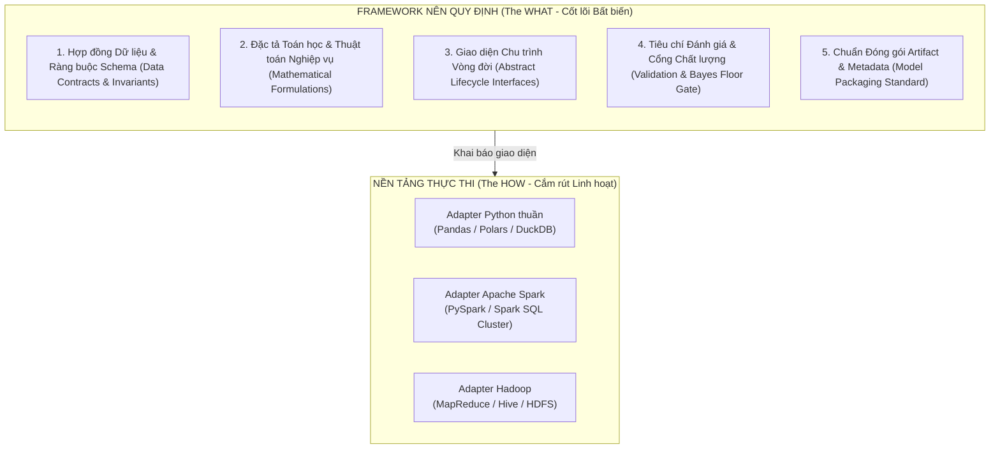
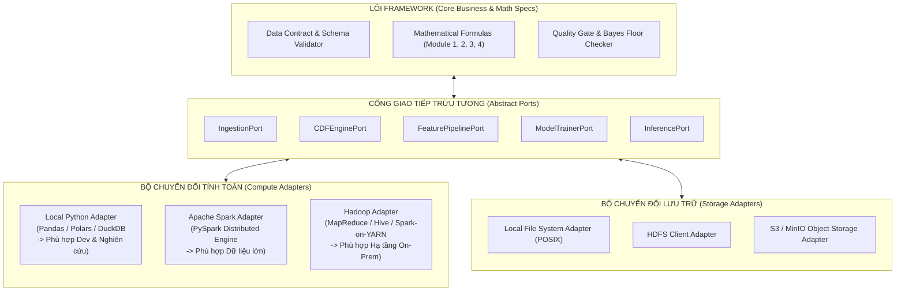
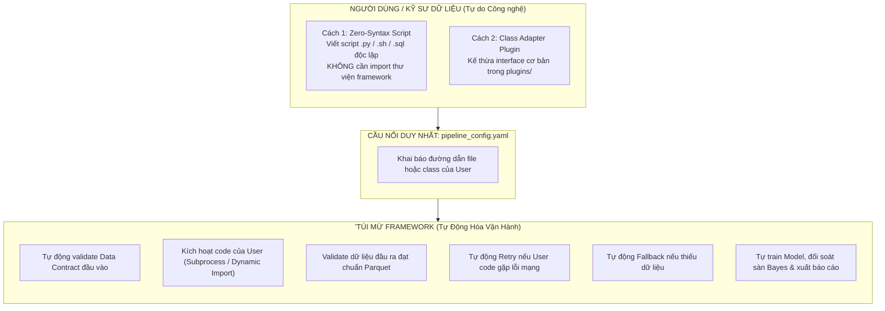
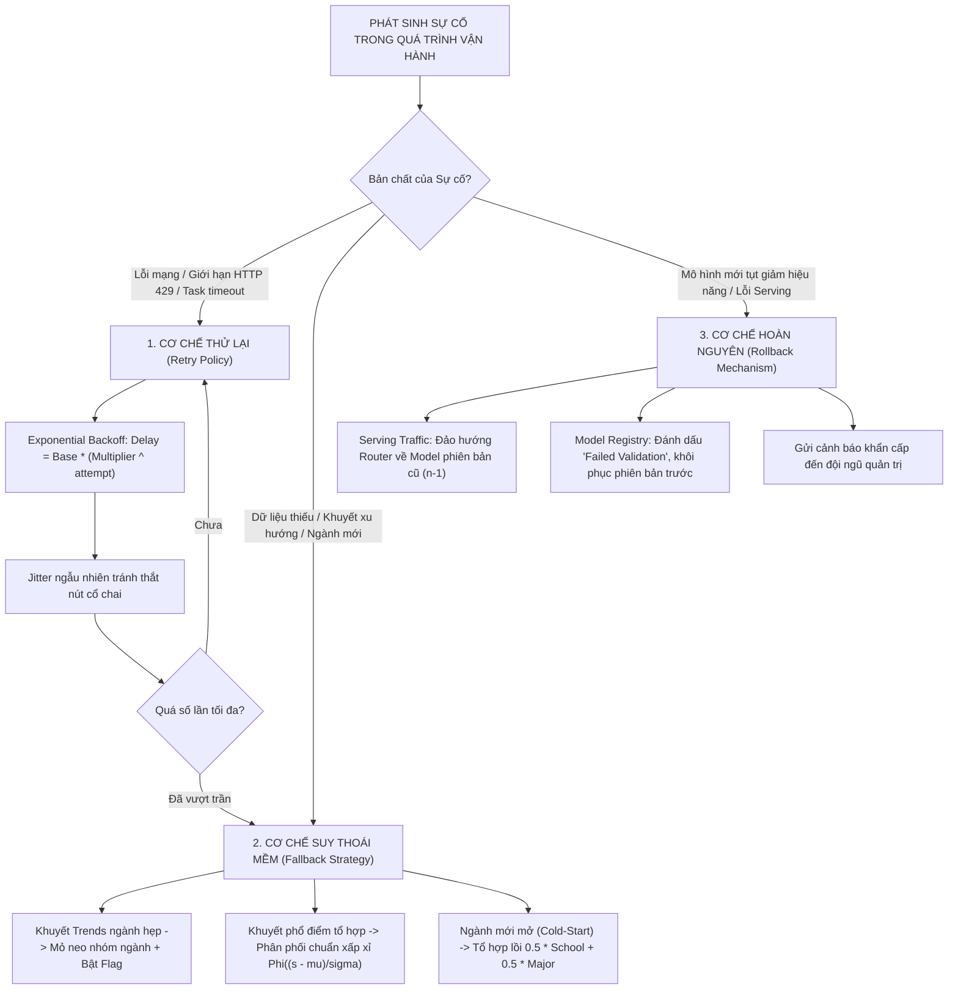
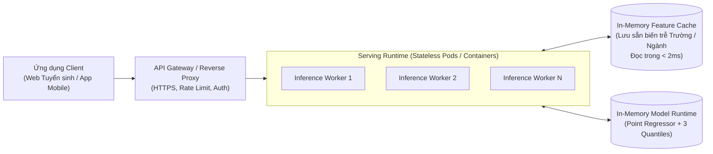
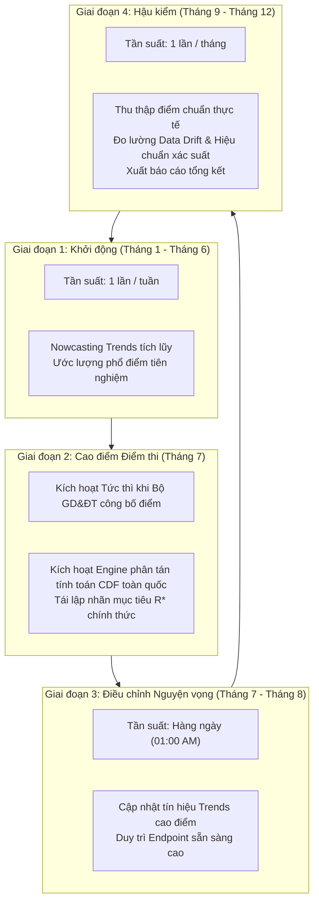

# Kế Hoạch Triển Khai Framework Dự Đoán Tuyển Sinh Trên Nền Tảng Dữ Liệu Lớn (Flexible & Engine-Agnostic Big Data Implementation Plan)

Tài liệu này đặc tả toàn diện kiến trúc kỹ thuật, thiết kế trừu tượng hóa và kế hoạch triển khai cho hệ thống **Dự đoán Xác suất Trúng tuyển Đại học theo Phân vị Cân bằng Động (Dynamic Percentile-Equilibrated University Admission Framework)**.

Trọng tâm cốt lõi của tài liệu này là xây dựng một **Khung làm việc Mềm dẻo (Flexible Framework)**:
- **Độc lập với nền tảng tính toán (Engine-Agnostic):** Cho phép triển khai và hoán đổi linh hoạt giữa các môi trường tính toán (từ Python thuần trên máy đơn đến các cụm dữ liệu lớn phân tán như Apache Spark, Hadoop MapReduce/Hive, hay Ray/DuckDB) mà không làm biến đổi logic nghiệp vụ và toán học cốt lõi.
- **Kiến trúc phân tách tuyệt đối (Decoupled Architecture):** Phân định rạch ròi giữa *Quy định của Framework (The WHAT)* và *Cách thức hiện thực của từng Nền tảng (The HOW)*.
- **Liên kết chặt chẽ với cơ sở khoa học:**
  - [Đặc tả bài toán và mô hình toán 4 thành phần](file:///d:/UNIDOCS/IS405.R11-Big-Data/docs/problem-specification.md) (`docs/problem-specification.md`)
  - [Hợp đồng dữ liệu và cấu trúc schema chuẩn](file:///d:/UNIDOCS/IS405.R11-Big-Data/docs/data-contract.md) (`docs/data-contract.md`)
  - [Thực nghiệm mô hình cơ sở và kiểm định thống kê](file:///d:/UNIDOCS/IS405.R11-Big-Data/scripts-processing/notebooks/model-training.ipynb) (`scripts-processing/notebooks/model-training.ipynb`)

---

## MỤC LỤC TỔNG QUAN

1. [Bối Cảnh Nghiệp Vụ & Triết Lý Thiết Kế Mềm Dẻo (Flexible Philosophy)](#1-bối-cảnh-nghiệp-vụ--triết-lý-thiết-kế-mềm-dẻo-flexible-philosophy)
2. [Quy Định Của Framework: "Nên Quy Định" vs "Không Nên Quy Định"](#2-quy-định-của-framework-nên-quy-định-vs-không-nên-quy-định)
3. [Kiến Trúc Tổng Thể Dạng Cổng & Bộ Chuyển Đổi (Ports & Adapters)](#3-kiến-trúc-tổng-thể-dạng-cổng--bộ-chuyển-đổi-ports--adapters)
4. [Hợp Đồng Dữ Liệu & Quy Trình Xử Lý Phân Tán (Distributed Processing Contract)](#4-hợp-đồng-dữ-liệu--quy-trình-xử-lý-phân-tán-distributed-processing-contract)
5. [Khung Cấu Hình Động & Đa Dạng Nguồn Cấp (Dynamic Configuration Framework)](#5-khung-cấu-hình-động--đa-dạng-nguồn-cấp-dynamic-configuration-framework)
6. [Hướng Dẫn Dành Cho Người Dùng: Cơ Chế "Hộp Đen / Túi Mù" & Khởi Động Hệ Thống](#6-hướng-dẫn-dành-cho-người-dùng-cơ-chế-hộp-đen--túi-mù--khởi-động-hệ-thống)
7. [Phân Tách Hai Môi Trường: Thí Nghiệm (Experimentation) vs Vận Hành (Production)](#7-phân-tách-hai-môi-trường-thí-nghiệm-experimentation-vs-vận-hành-production)
8. [Cơ Chế Vận Hành Tin Cậy: Retry - Fallback - Rollback](#8-cơ-chế-vận-hành-tin-cậy-retry---fallback---rollback)
9. [Kiến Trúc Endpoint Phục Vụ Dự Đoán Trực Tuyến (Decoupled Serving Endpoint)](#9-kiến-trúc-endpoint-phục-vụ-dự-đoán-trực-tuyến-decoupled-serving-endpoint)
10. [Cơ Chế Lập Lịch Tùy Chọn & Thích Ứng Theo Mùa (Optional Scheduling System)](#10-cơ-chế-lập-lịch-tùy-chọn--thích-ứng-theo-mùa-optional-scheduling-system)
11. [Đề Xuất Tái Cấu Trúc Thư Mục Repository Chuẩn MLOps Đa Môi Trường](#11-đề-xuất-tái-cấu-trúc-thư-mục-repository-chuẩn-mlops-đa-môi-trường)
12. [Lộ Trình Triển Khai Từng Bước (Implementation Roadmap)](#12-lộ-trình-triển-khai-từng-bước-implementation-roadmap)

---

## 1. BỐI CẢNH NGHIỆP VỤ & TRIẾT LÝ THIẾT KẾ MỀM DẺO (FLEXIBLE PHILOSOPHY)

### 1.1 Tóm tắt Bài toán Tuyển sinh & 4 Module Cốt lõi
Hệ thống giải quyết bài toán: **Ước lượng xác suất trúng tuyển liên tục $P(\text{Trúng tuyển}_{i, j, t}) = \mathbb{P}(S_{i, k, t} \ge C_{j, k, t})$** của thí sinh $i$ với mức điểm $S_{i, k, t}$ vào chương trình $j$, tổ hợp $k$ ở năm $t$. Chu trình nghiệp vụ được chuẩn hóa thành 4 module độc lập:
- **Module 1 (Nhu cầu Xã hội - Google Trends):** Trích xuất vector lực cầu $\mathbf{D}_{j, t}$ (Mean, Median, Peak) và biến thiên $\Delta \mathbf{D}_{j, t}$ ở 3 cấp bậc: Trường ($s$), Ngành ($m$), Nhóm ngành ($g$) theo phương pháp Nowcasting điểm rơi thời gian (Point-in-Time).
- **Module 2 (Phổ điểm Thi & Hàm Phân phối Tích lũy CDF):** Chuyển đổi điểm số thô ($S \in [0, 30]$) sang không gian phân vị xác suất tích lũy chuẩn hóa thông qua hàm sống sót:
  $$\text{RankPct}_{k, t}(s) = 1 - \hat{F}_{k, t}(s)$$
  Đóng vai trò là "nhà máy tạo nhãn" cho Module 3 và cung cấp vị trí phân vị $r_{i, k, t}$ của thí sinh cho Module 4.
- **Module 3 (Học máy Dự đoán Phân vị Điểm chuẩn $R^*_{j, t}$):** Lõi học máy giám sát ước lượng kỳ vọng và phương sai phân vị trúng tuyển $R^*_{j, t} \sim \mathcal{N}(\mu_{j, t}, \sigma_{j, t}^2)$ dựa trên vector đặc trưng tổng hợp $\mathbf{Z}_{j, t}$ (quán tính quá khứ đa tầng, vị thế tương đối và lực cầu xã hội), đồng thời xuất bộ 3 phân vị kịch bản $[\hat{R}^*_{0.1}, \hat{R}^*_{0.5}, \hat{R}^*_{0.9}]$ qua hồi quy phân vị (Quantile Regression).
- **Module 4 (Ước lượng Xác suất Đỗ & Phân tầng Quyết định):** Suy luận xác suất dạng đóng:
  $$P(\text{Pass}) = \Phi\left(\frac{\mu_{j, t} - r_{i, k, t}}{\sigma_{j, t}}\right)$$
  và phân tầng khuyến nghị 3 lớp: Vùng An toàn ($P \ge 80\%$), Vùng Cạnh tranh ($50\% \le P < 80\%$), Vùng Rủi ro ($P < 50\%$).

### 1.2 Động lực Cần Tính Mềm Dẻo (Why Engine-Agnostic?)
Trong nghiên cứu khoa học và triển khai thực tế, dữ liệu có sự phân cấp quy mô rõ rệt:
1. **Quy mô Cực lớn (Heavy Big Data):** Dữ liệu phổ điểm toàn quốc (Module 2) với hơn 1 triệu thí sinh mỗi năm ($> 10$ triệu bản ghi 10 năm) đòi hỏi khả năng xử lý song song phân tán (Apache Spark hoặc Hadoop cluster) để không bị tràn bộ nhớ (OOM).
2. **Quy mô Dạng bảng Tinh gọn (Tabular Small/Medium Data):** Dữ liệu sau khi trích xuất đặc trưng (Module 3) chỉ có $\approx 33.000$ quan sát dạng bảng. Việc huấn luyện mô hình Gradient Boosting (LightGBM/CatBoost) trên tập dữ liệu này chạy trên máy đơn chỉ mất vài giây; nếu gượng ép dùng cụm tính toán phân tán nặng nề sẽ gây lãng phí tài nguyên và tạo độ trễ không cần thiết.
3. **Quy mô Thời gian thực Siêu tốc (Low-Latency Serving):** Phục vụ thí sinh tra cứu điểm trên Internet (Module 4) yêu cầu phản hồi trong vòng $10 - 20\text{ms}$. Việc khởi tạo context tính toán phân tán ở bước này là một sai lầm kiến trúc (Anti-pattern).

$\to$ **Do đó, Framework phải là một lớp trừu tượng (Abstraction Layer), cho phép người dùng chạy Python thuần (Pandas/DuckDB) khi nghiên cứu nhỏ/demo và chuyển sang Apache Spark / Hadoop khi xử lý dữ liệu lớn mà không phải viết lại thuật toán.**

---

## 2. QUY ĐỊNH CỦA FRAMEWORK: "NÊN QUY ĐỊNH" VS "KHÔNG NÊN QUY ĐỊNH"

Để framework vừa chặt chẽ về khoa học vừa mềm dẻo về hạ tầng, ranh giới thiết kế được xác lập theo nguyên lý **Inversion of Control (IoC)**:



### 2.1 Những Gì Framework BẮT BUỘC PHẢI QUY ĐỊNH (Strictly Enforced)

1. **Hợp đồng Dữ liệu (Data Contracts):**
   - Tên thuộc tính, kiểu dữ liệu chuẩn logic, miền giá trị và các cờ nhị phân bắt buộc (ví dụ: `score_mark` $\in [0, 30]$, `R_star` $\in [0, 1]$, `is_new_program` $\in \{0, 1\}$).
   - Danh sách 16 đặc trưng chính thức đã vượt qua kiểm định thống kê ANOVA F-test (`prog_pct_lag1`, `school_pct_mean_lag1`,...).
2. **Công thức Toán học Cốt lõi (Mathematical Specifications):**
   - Định nghĩa hàm phân phối tích lũy thực nghiệm $\hat{F}(s)$ và hàm phân vị sống sót $\text{RankPct}(s) = 1 - \hat{F}(s)$.
   - Công thức giải quyết khởi đầu lạnh cho ngành mới: $\hat{R}^*_{j, t-1} = 0.5 R^*_{\text{school}} + 0.5 R^*_{\text{major}}$.
   - Công thức tích phân suy luận xác suất Module 4.
3. **Giao diện Vòng đời Đường ống (Pipeline Lifecycle Interfaces):**
   - Framework định nghĩa các Cổng giao tiếp trừu tượng (Abstract Ports): `IngestionPort`, `CDFEnginePort`, `FeaturePipelinePort`, `TrainerPort`, `ServingPort`.
   - Mỗi bước nhận vào đối tượng cấu hình chuẩn và trả về kết quả chuẩn hóa (Result Object).
4. **Tiêu chuẩn Kiểm định Chất lượng (Quality Gate Protocol):**
   - Quy chuẩn đo lường: RMSE, MAE, R2, Spearman $\rho$.
   - Điều kiện bắt buộc để mô hình được chấp thuận phát hành: Sai số $\text{MSE}_{\text{model}} \le \text{MSE}_{\text{Bayes Floor}} + 0.005$ ($\text{MSE}_{\text{Bayes}} \approx 0.0228$).
5. **Chuẩn Đóng gói Metadata (Metadata Packaging Standards):**
   - Mọi mô hình khi xuất xưởng bắt buộc phải có tệp `model_metadata.json` mô tả: phiên bản, ngày huấn luyện, danh sách đặc trưng, siêu tham số và các ngưỡng kiểm định.

---

### 2.2 Những Gì Framework TUYỆT ĐỐI KHÔNG NÊN QUY ĐỊNH (Left Completely Flexible)

1. **KHÔNG quy định kiểu Dataframe cụ thể trong Giao diện cốt lõi:**
   - *Không ép buộc:* Không viết hàm `def process(df: pyspark.sql.DataFrame)` hay `def process(df: pd.DataFrame)`.
   - *Giải pháp:* Giao diện chỉ làm việc với URI trừu tượng (`input_uri`, `output_uri`) hoặc trao đổi dữ liệu bộ nhớ qua chuẩn công nghiệp trung lập **Apache Arrow / PyArrow Table**.
2. **KHÔNG quy định Nền tảng Lưu trữ Cụ thể (Storage Lock-in):**
   - Không gán cứng đường dẫn cục bộ (C:, D:) hay giao thức cố định. Hệ thống đọc ghi qua chuẩn URI trừu tượng: `file://`, `hdfs://`, `s3a://`, `gs://`. Adapter tầng dưới sẽ tự nạp driver tương ứng.
3. **KHÔNG quy định Framework Model Serving bên trong Lõi Thuật toán:**
   - Thuật toán suy luận chỉ là một hàm toán học thuần túy: $f(\mathbf{x}) \to P$. Không ràng buộc code thuật toán vào FastAPI, Flask hay Triton. Việc đóng gói thành REST API, gRPC hay Batch Job là trách nhiệm của lớp vỏ ứng dụng bên ngoài.
4. **KHÔNG quy định Công cụ Lập lịch & Điều phối (Orchestration Engine):**
   - Framework không phụ thuộc vào Apache Airflow, Prefect hay Cron. Mọi tác vụ đều có thể kích hoạt độc lập qua giao diện dòng lệnh (CLI: `admission-cli run-pipeline --config ...`). Công cụ điều phối bên ngoài chỉ đóng vai trò kích hoạt CLI.

---

## 3. KIẾN TRÚC TỔNG THỂ DẠNG CỔNG & BỘ CHUYỂN ĐỔI (PORTS & ADAPTERS)

Hệ thống được thiết kế theo kiến trúc Lục giác (Hexagonal Architecture / Ports & Adapters). Logic nghiệp vụ và khoa học nằm ở trung tâm (Core Domain), giao tiếp với thế giới công nghệ bên ngoài thông qua các Cổng (Ports). Các nền tảng tính toán đóng vai trò là các Bộ chuyển đổi (Adapters) có thể cắm rút linh hoạt:



### Minh họa Hiện thực Mã Nguồn Trừu tượng (Abstract Port Example)
```python
# src/admission_core/ports/cdf_port.py
from abc import ABC, abstractmethod
from typing import Dict, Any

class CDFEnginePort(ABC):
    """
    Giao diện chuẩn hóa cho Module 2: Tính toán Empirical CDF và hàm sống sót.
    Mọi nền tảng (Python thuần, Spark, Hadoop) đều phải tuân theo giao diện này.
    """
    @abstractmethod
    def calculate_survival_rank(
        self, 
        input_scores_uri: str, 
        output_cdf_uri: str, 
        config: Dict[str, Any]
    ) -> str:
        """
        Đọc điểm thi thô, tính toán 1 - F(s) cho từng tổ hợp môn qua các năm,
        ghi kết quả chuẩn hóa ra output_cdf_uri và trả về đường dẫn đích.
        """
        pass
```

Khi muốn chạy trên môi trường máy đơn, hệ thống gọi `PandasDuckDBAdapter`. Khi cấu hình chỉ định môi trường cụm dữ liệu lớn, hệ thống tự động kích hoạt `SparkClusterAdapter` mà không thay đổi bất kỳ dòng mã nào ở tầng ứng dụng.

---

## 4. HỢP ĐỒNG DỮ LIỆU & QUY TRÌNH XỬ LÝ PHÂN TÁN (DISTRIBUTED PROCESSING CONTRACT)

### 4.1 Cơ Chế Phân Tán Trong Module 2 (Empirical CDF Engine)
Trong bài toán phổ điểm với hơn 10 triệu bản ghi thí sinh (Format CT2006 và CT2018):
- **Bản chất tính toán:** Hàm phân phối tích lũy thực nghiệm $\hat{F}_{k, t}(s)$ độc lập theo từng cặp `(Năm tuyển sinh, Tổ hợp môn)`.
- **Nguyên tắc phân chia dữ liệu:**
  - **Tự động hóa của nền tảng:** Khi nạp tệp lớn, nền tảng phân tán tự động chia tệp thành các khối logic (Partitions/Blocks).
  - **Quy định cấu hình của người dùng (Optimization Control):** Để tránh việc truyền dữ liệu qua mạng (Network Shuffle) khi tính toán, framework quy định chỉ thị phân vùng theo khóa nghiệp vụ:
    $$\text{Partition Key} = (\text{score\_year}, \, \text{block\_name})$$
  - Khi dữ liệu đã được gom về đúng partition, từng Worker Node sẽ tính toán sắp xếp và tính hàm sống sót $1 - \hat{F}(s)$ song song hoàn toàn với độ phức tạp phân tán $O\left(\frac{N \log N}{P}\right)$ ($P$ là số lượng vi xử lý).

### 4.2 Cơ Chế Xử Lý Trong Module 1 & 3 (Feature Pipeline)
- **Tập hợp trễ đa tầng (Hierarchical Lags Aggregations):** Các phép toán `mean`, `median`, `min`, `max`, `std` theo Trường học ($s$), Ngành ($m$), Nhóm ngành ($g$) được phân tán theo khóa nhóm.
- **Broadcast Join cho Siêu dữ liệu (Metadata):** Các bảng danh mục ngành (`majors`), tổ hợp môn (`score-blocks`) và Google Trends tổng hợp theo năm có kích thước nhỏ ($< 50\text{MB}$) được bộ chuyển đổi phân tán tự động phát tán (Broadcast) đến toàn bộ các node, triệt tiêu hoàn toàn chi phí Shuffling.

### 4.3 Tách Rời Huấn Luyện (Training) và Phục Vụ (Serving)
- **Huấn luyện Mô hình (Module 3):** Dữ liệu sau khi trích xuất đặc trưng có kích thước dạng bảng gọn nhẹ ($N \approx 33.000$ quan sát, 16 đặc trưng). Adapter huấn luyện nạp trực tiếp tập dữ liệu này vào bộ nhớ để tối ưu hóa siêu tham số và huấn luyện 1 Point Regressor + 3 Quantile Regressors ($\tau \in \{0.1, 0.5, 0.9\}$) với tốc độ cao.
- **Suy luận Phục vụ (Module 4):** Lõi suy luận xác suất $P(\text{Pass})$ là một hàm toán học giải tích dạng đóng $\Phi\left(\frac{\mu - r}{\sigma}\right)$, hoàn toàn tách rời khỏi các nền tảng tính toán nặng, sẵn sàng tích hợp vào bất kỳ môi trường web server nào.

---

## 5. KHUNG CẤU HÌNH ĐỘNG & ĐA DẠNG NGUỒN CẤP (DYNAMIC CONFIGURATION FRAMEWORK)

Hệ thống điều khiển toàn bộ hành vi thông qua tệp cấu hình bên ngoài (`config/pipeline_config.yaml`). Người dùng có thể thay đổi nền tảng tính toán, chuyển đổi nguồn dữ liệu hoặc thay đổi script cào mà không cần can thiệp vào mã nguồn.

### 5.1 Cấu Trúc Tệp Cấu Hình Động Mẫu

```yaml
# ==============================================================================
# PIPELINE DYNAMIC CONFIGURATION (ENGINE-AGNOSTIC SPEC)
# ==============================================================================
version: "2.1"
environment: "production" # "experimentation" | "production"

# 1. Lựa chọn Nền tảng Tính toán (Compute Engine Adapter)
# Hỗ trợ: "local_pandas" | "apache_spark" | "hadoop_hive" | "duckdb"
execution_backend: "apache_spark"

# Tham số bổ trợ cho Backend đã chọn
backend_parameters:
  # Cấu hình khi dùng execution_backend: apache_spark
  spark:
    master: "yarn" # "local[*]" | "yarn" | "k8s"
    deploy_mode: "cluster"
    driver_memory: "4g"
    executor_memory: "8g"
    num_executors: 10
    shuffle_partitions: 200
  # Cấu hình khi dùng execution_backend: local_pandas
  local:
    n_jobs: -1
    in_memory_engine: "duckdb"

# 2. Quản lý Chế độ Nạp Dữ liệu (Ingestion Strategy)
data_ingestion:
  # Chế độ: 'direct_data' (nạp trực tiếp data) hoặc 'fetch_script' (chạy script cào)
  mode: "fetch_script"

  # A. Kịch bản nạp thẳng dữ liệu (Áp dụng khi mode: direct_data)
  direct_sources:
    cutoff_scores: "hdfs:///data/raw/admission/cutoff-scores.parquet"
    score_distribution_ct2006: "s3a://admission-lakehouse/raw/dist-2006.parquet"
    score_distribution_ct2018: "s3a://admission-lakehouse/raw/dist-2018.parquet"
    google_trends: "hdfs:///data/raw/trends/trends.json"
    majors: "s3a://admission-lakehouse/raw/majors.parquet"
    score_blocks: "s3a://admission-lakehouse/raw/score-blocks.parquet"

  # B. Kịch bản nạp script fetch dữ liệu tùy biến (Áp dụng khi mode: fetch_script)
  fetch_scripts:
    trends_collector:
      entrypoint: "scripts/fetch_trends.py"
      args:
        geo: "VN"
        date_range: "all"
        cache_type: "sqlite"
        rate_limit_delay_sec: 3.5
    admission_crawler:
      entrypoint: "scripts/crawl_admissions.py"
      enabled: false

# 3. Đặc tả Đặc trưng & Mục tiêu (Feature & Target Contract)
feature_contract:
  target_feature: "R_star"
  training_years:
    start_year: 2018
    end_year: 2025
  selected_features:
    - "prog_pct_lag1"
    - "school_pct_mean_lag1"
    - "school_pct_min_lag1"
    - "major_pct_mean_lag1"
    - "group_pct_mean_lag1"
    - "delta_prog_vs_school_mean"
    - "delta_prog_vs_major_mean"
    - "num_blocks"
    - "trend_school_peak"
    - "trend_group_mean"
    - "is_cutoff_over_30"
    - "is_new_program"
    - "inter_prog_school"
    - "inter_school_major"
    - "inter_prog_blocks"
    - "inter_school_blocks"

# 4. Tiêu chí Kiểm định Cổng Chất lượng (Quality Gate)
quality_gate:
  max_rmse: 0.160
  min_r2: 0.78
  max_bayes_gap_mse: 0.005 # Sai số MSE không được lệch khỏi sàn Bayes quá 0.005

# 5. Lập lịch Tùy chọn (Optional Scheduling)
scheduler:
  enabled: true
  cron_expression: "0 2 1 * *" # 02:00 AM ngày đầu mỗi tháng
  high_frequency_season:
    enabled: true
    start_date: "07-01"
    end_date: "08-31"
    cron_expression: "0 1 * * *" # Hàng ngày trong mùa cao điểm

# 6. Cơ chế Độ tin cậy (Reliability Controls)
reliability:
  retry_policy:
    max_attempts: 3
    initial_backoff_sec: 5
    backoff_multiplier: 2.0
  fallback_rules:
    on_trends_missing: "use_group_anchor_and_flag"
    on_distribution_missing: "parametric_normal_approximation"
    on_cold_start: "convex_combination_school_major"
```

---

## 6. HƯỚNG DẪN DÀNH CHO NGƯỜI DÙNG: CƠ CHẾ "HỘP ĐEN / TÚI MÙ" & KHỞI ĐỘNG HỆ THỐNG

Một trong những ưu điểm lớn nhất của kiến trúc Đảo ngược Điều khiển (Inversion of Control - IoC) là: **Người dùng có thể xem Framework như một "Túi mù" (Black Box)**. 

Người dùng chỉ cần mang theo công nghệ và mã nguồn của mình (viết bằng Python thuần, PySpark, Bash, SQL hay DuckDB), đặt vào vị trí chỉ định và kích hoạt pipeline mà **hoàn toàn không cần hiểu cú pháp nội bộ của framework**.



### 6.1 Hai Cấp Độ Triển Khai Cho Người Dùng

#### Cấp độ 1: "Túi Mù Tuyệt Đối" (Zero-Framework Syntax Script)
- **Đối tượng:** Dành cho người dùng chỉ muốn dùng Spark, Polars hay script riêng của họ mà không muốn tốn thời gian học cú pháp Python của framework.
- **Mã nguồn đặt ở đâu?** Người dùng có thể lưu script ở **bất kỳ thư mục nào**, ví dụ: `my_jobs/custom_spark_cdf.py`.
- **Cách viết code:** Viết một script độc lập nhận tham số `--input` và `--output` qua dòng lệnh chuẩn (argparse):
  ```python
  # File: my_jobs/custom_spark_cdf.py
  import argparse
  from pyspark.sql import SparkSession
  import pyspark.sql.functions as F
  from pyspark.sql.window import Window

  # Script hoàn toàn độc lập, không import bất kỳ package nào của framework
  parser = argparse.ArgumentParser()
  parser.add_argument("--input", required=True, help="Đường dẫn file điểm thi đầu vào")
  parser.add_argument("--output", required=True, help="Đường dẫn xuất kết quả CDF")
  args = parser.parse_args()

  spark = SparkSession.builder.appName("UserCustomJob").getOrCreate()
  df = spark.read.parquet(args.input)

  # Logic tính toán phân tán riêng của người dùng
  w = Window.partitionBy("score_year", "block_name").orderBy("mark")
  df_ranked = df.withColumn("survival_rank", F.lit(1.0) - F.cume_dist().over(w))

  df_ranked.write.mode("overwrite").parquet(args.output)
  print("[User Job] Hoàn tất tính toán CDF thành công!")
  ```
- **Khai báo trong file cấu hình (`config/pipeline_config.yaml`):**
  ```yaml
  backend_execution:
    cdf_stage:
      type: "external_script"
      command: "python my_jobs/custom_spark_cdf.py --input {input_uri} --output {output_uri}"
  ```

#### Cấp độ 2: Class Adapter Plugin (Chuẩn Pythonic In-Memory)
- **Đối tượng:** Dành cho người dùng muốn tận dụng bộ nhớ trong, tránh ghi file trung gian hoặc dùng DuckDB/Pandas/Polars.
- **Mã nguồn đặt ở đâu?** Đặt trong thư mục `plugins/` (ví dụ: `plugins/duckdb_cdf_adapter.py`).
- **Cách viết code:**
  ```python
  # File: plugins/duckdb_cdf_adapter.py
  import duckdb

  class DuckDBCDFAdapter:
      """User tự implement tính toán bằng DuckDB SQL siêu tốc"""
      def execute(self, input_uri: str, output_uri: str, **kwargs) -> str:
          con = duckdb.connect()
          query = f"""
              COPY (
                  SELECT score_year, score_mark,
                         1.0 - percent_rank() OVER (PARTITION BY score_year ORDER BY score_mark) as survival_rank
                  FROM read_parquet('{input_uri}')
              ) TO '{output_uri}' (FORMAT PARQUET)
          """
          con.execute(query)
          return output_uri
  ```
- **Khai báo trong file cấu hình (`config/pipeline_config.yaml`):**
  ```yaml
  backend_execution:
    cdf_stage:
      type: "class_adapter"
      target: "plugins.duckdb_cdf_adapter.DuckDBCDFAdapter"
  ```

---

### 6.2 Hướng Dẫn Khởi Động Hệ Thống (Single Command Execution)

Người dùng khởi động toàn bộ hệ thống (dù chạy bằng script ngoài, Pandas hay Spark) thông qua **một dòng lệnh duy nhất**:

```bash
# 1. Kích hoạt môi trường
source .venv/bin/activate  # Trên Linux/macOS
.venv\Scripts\activate     # Trên Windows

# 2. Khởi chạy Pipeline dạng hộp đen
python -m admission_core run --config config/pipeline_config.yaml
```

**Các tùy chọn khởi động hữu ích cho người dùng:**
```bash
# Chỉ chạy riêng một công đoạn (Dry-run test công nghệ của user)
python -m admission_core run-stage --stage cdf_engine --config config/pipeline_config.yaml

# Khởi chạy Model Serving API
python -m admission_core serve --host 0.0.0.0 --port 8000

# Xuất bản báo cáo đánh giá mô hình ra file PDF/HTML
python -m admission_core report --output reports/evaluation_summary.html
```

---

## 8. PHÂN TÁCH HAI MÔI TRƯỜNG: THÍ NGHIỆM (EXPERIMENTATION) VS VẬN HÀNH (PRODUCTION)

Hệ thống thiết lập ranh giới vận hành rõ rệt giữa hai môi trường nhằm bảo vệ tính toàn vẹn của dữ liệu và phục vụ mục tiêu nghiên cứu:

```mermaid
graph LR
    subgraph EXP["MÔI TRƯỜNG THÍ NGHIỆM (Experimentation Sandbox)"]
        direction TB
        E1["Tương tác Trực quan (Jupyter, PySpark Shell)"]
        E2["Thử nghiệm Tự do: EDA, PACF, Thêm Feature mới"]
        E3["Backend: Python thuần / DuckDB / Spark Local"]
        E4["Lưu vết Thí nghiệm Không giới hạn"]
    end

    subgraph PROD["MÔI TRƯỜNG VẬN HÀNH SẢN XUẤT (Production Automation)"]
        direction TB
        P1["Không Tương tác (Headless Pipeline Jobs)"]
        P2["Tự Động Hóa 100%: Thu thập -> Xử lý -> Train -> Report"]
        P3["Backend: Cụm Dữ liệu lớn (Spark Cluster / Hadoop)"]
        P4["Cổng Kiểm Định Nghiêm Ngặt (Quality Gate vs Bayes Floor)"]
        P5["Tự động Phục hồi: Retry - Fallback - Rollback"]
    end

    EXP -- "Đóng gói mã nguồn & cấu hình đã kiểm chứng" --> PROD
```



### So Sánh Đặc Tính Giữa Hai Môi Trường

| Tiêu chí | Môi trường Thí nghiệm (Experimentation) | Môi trường Vận hành Sản xuất (Production) |
| :--- | :--- | :--- |
| **Mục đích** | R&D thuật toán, Feature Engineering, kiểm định thống kê. | Tự động hóa định kỳ, duy trì mô hình mới nhất, phục vụ suy luận trực tuyến. |
| **Hình thức tương tác** | Tương tác trực tiếp (Interactive qua Notebooks / Web UI). | Không tương tác (Headless qua Scheduler / CLI). |
| **Backend tính toán** | Linh hoạt ưu tiên tốc độ phản hồi (`local_pandas` hoặc `duckdb`). | Cụm tính toán phân tán chịu tải cao (`apache_spark` trên YARN/K8s). |
| **Quản lý mô hình** | Lưu vết mọi lần chạy thử để so sánh hiệu năng. | Kiểm định qua Cổng Chất lượng; chỉ lưu và phát hành mô hình vượt chuẩn. |
| **Chế độ báo cáo** | Hiển thị biểu đồ matplotlib/seaborn trực tiếp trên cell notebook. | Tự động kết xuất báo cáo HTML/PDF gửi qua Email/Slack Webhook. |

---

## 9. CƠ CHẾ VẬN HÀNH TIN CẬY: RETRY - FALLBACK - ROLLBACK

Để hệ thống tự vận hành bền bỉ trên môi trường sản xuất mà không cần can thiệp thủ công, framework định nghĩa 3 lớp bảo vệ tự động:



### Chi Tiết Kỹ Thuật 3 Cơ Chế:

1. **Cơ chế Thử lại (Retry Policy):**
   - Áp dụng thuật toán **Exponential Backoff kết hợp Jitter**:
     $$T_{\text{wait}} = \text{random}\big(0, \, \min(T_{\max}, \, T_{\text{base}} \times 2^{\text{attempt}})\big)$$
   - Tự động thực thi khi: cào Google Trends bị nghẽn mạng, kết nối cụm phân tán bị gián đoạn tạm thời.
2. **Cơ chế Suy thoái Mềm (Graceful Fallback Strategy):**
   - **Fallback Xu hướng (Module 1):** Khi ngành hẹp $m$ không có dữ liệu tìm kiếm, tự động thay thế bằng giá trị của nhóm ngành cấp 1 ($g$) và kích hoạt cờ `is_trend_missing = 1` để mô hình học máy tự điều chỉnh trọng số.
   - **Fallback Phổ điểm (Module 2):** Khi tổ hợp môn mới mở chưa đủ dữ liệu xây dựng bảng tần suất thực nghiệm, xấp xỉ hàm phân phối bằng Phân phối Chuẩn:
     $$\hat{F}_k(s) \approx \Phi\left(\frac{s - \mu_k}{\sigma_k}\right)$$
   - **Fallback Khởi đầu Lạnh (Module 3):** Ngành mới mở chưa có lịch sử điểm chuẩn được ước lượng tiên nghiệm bằng tổ hợp lồi:
     $$\hat{R}^*_{j, t-1} = 0.5 R^*_{\text{school}} + 0.5 R^*_{\text{major}}$$
     kèm cờ nhị phân `is_new_program = 1`.
3. **Cơ chế Hoàn nguyên (Rollback Mechanism):**
   - **Kiểm định trước phát hành:** Mô hình sau khi huấn luyện phải đối soát với Sàn Sai số Bayes ($\text{MSE}_{\text{Bayes}} \approx 0.02283$). Nếu $\text{MSE}_{\text{new}} > \text{MSE}_{\text{Bayes}} + 0.005$, hệ thống hủy bỏ quá trình phát hành và giữ nguyên phiên bản cũ.
   - **Khôi phục Serving:** Nếu phiên bản mới phát sinh lỗi ngoại lệ tại runtime, bộ điều phối định tuyến tự động chuyển traffic về phiên bản đã kiểm chứng trước đó (`v_{current - 1}`) trong vòng dưới 3 giây.

---

## 10. KIẾN TRÚC ENDPOINT PHỤC VỤ DỰ ĐOÁN TRỰC TUYẾN (DECOUPLED SERVING ENDPOINT)

Một điểm nhấn kiến trúc quan trọng: **Lớp phục vụ dự đoán trực tuyến (Model Serving) được tách rời hoàn toàn khỏi các nền tảng dữ liệu lớn.** 

Không khởi tạo cụm Spark hay Hadoop khi có request từ người dùng. Thay vào đó, mô hình sau khi huấn luyện được chuyển đổi thành định dạng suy luận gọn nhẹ (Inference Engine) để đáp ứng thời gian thực:



### Đặc Tả Giao Diện RESTful API Chuẩn Hóa

#### 1. Endpoint Dự đoán Cho Thí sinh Đơn lẻ
- **Phương thức & Đường dẫn:** `POST /api/v2/predict/admission-probability`
- **Mô tả:** Tiếp nhận thông tin điểm thi và nguyện vọng của thí sinh, suy luận xác suất trúng tuyển và khuyến nghị chiến lược.
- **Request Body (JSON):**
```json
{
  "student_id": "TS2025_001928",
  "score_year": 2025,
  "school_id": "BKA",
  "score_code": "IT1",
  "score_blocks": "A00",
  "raw_scores": {
    "Toan": 9.2,
    "VatLy": 8.75,
    "HoaHoc": 8.5
  },
  "total_score": 26.45,
  "point_in_time_month": 7
}
```
- **Response Schema (JSON):**
```json
{
  "status": "success",
  "prediction_id": "pred_9f8d7c6b-5a4e",
  "student_percentile": {
    "block": "A00",
    "calculated_rank_pct": 0.0245,
    "rank_interpretation": "Thí sinh nằm trong Top 2.45% toàn quốc tổ hợp A00"
  },
  "admission_percentile_forecast": {
    "expected_percentile_mean": 0.0195,
    "expected_percentile_variance": 0.00045,
    "confidence_scenarios_80pct": {
      "intense_competition_q10": 0.0120,
      "base_expected_q50": 0.0195,
      "cooling_down_q90": 0.0280
    }
  },
  "admission_probability": {
    "probability_value": 0.7285,
    "probability_percentage": "72.85%",
    "decision_tier": "Cạnh tranh (Competitive)",
    "recommendation_guidance": "Điểm của thí sinh sát ngưỡng trung vị. Khả năng đỗ khả quan nhưng chịu rủi ro lọc ảo; cần lót thêm nguyện vọng an toàn."
  },
  "inference_latency_ms": 12.8
}
```

#### 2. Endpoint Chấm điểm Hàng Loạt (Batch Scoring)
- **Phương thức & Đường dẫn:** `POST /api/v2/predict/batch-admission-scoring`
- **Mô tả:** Cho phép các trường đại học tải lên danh sách hàng ngàn hồ sơ thí sinh để nhận kết quả đánh giá phân vị hàng loạt.

#### 3. Endpoint Kiểm tra Sức khỏe (Health Check)
- **Phương thức & Đường dẫn:** `GET /api/v2/health`
- **Mô tả:** Trả về trạng thái của bộ nhớ cache, mô hình đã nạp và tài nguyên hệ thống phục vụ tự động cân bằng tải.

---

## 11. CƠ CHẾ LẬP LỊCH TÙY CHỌN & THÍCH ỨNG THEO MÙA (OPTIONAL SCHEDULING SYSTEM)

Tính năng lập lịch được thiết kế dưới dạng **Mô-đun Tùy chọn (Optional Component)**:
- Người dùng có thể bật tự động hoàn toàn thông qua cờ `scheduler.enabled: true` trong file cấu hình.
- Khi tắt (`scheduler.enabled: false`), toàn bộ pipeline trở thành công cụ chạy theo lệnh thủ công hoặc kích hoạt qua webhook của hệ thống CI/CD.



---

## 12. ĐỀ XUẤT TÁI CẤU TRÚC THƯ MỤC REPOSITORY CHUẨN MLOPS ĐA MÔI TRƯỜNG

Để phản ánh trọn vẹn tính linh hoạt của framework và phân định ranh giới giữa các môi trường, cấu trúc repository được tái quy hoạch theo chuẩn công nghiệp:

```text
IS405.R11-Big-Data/
├── .github/workflows/               # Tự động hóa CI/CD kiểm định code và đóng gói
│   ├── ci-test.yaml                 # Chạy linter và unit tests
│   └── deploy.yaml                  # Đóng gói và phát hành container
│
├── config/                          # Quản trị cấu hình đa môi trường
│   ├── base.yaml                    # Cấu hình chung (features, targets, hyperparameters)
│   ├── env.dev.yaml                 # Môi trường Dev (Local backend, sample data)
│   ├── env.staging.yaml             # Môi trường Staging (Test cluster, test bucket)
│   ├── env.prod.yaml                # Môi trường Prod (Spark/Hadoop cluster, High Availability)
│   └── dirs.yaml                    # (Tương thích ngược với các script cũ)
│
├── data/                            # Sandbox dữ liệu cục bộ (Được Git ignore)
│   ├── raw/                         # Dữ liệu thô (Bronze Layer)
│   ├── cleaned/                     # Dữ liệu chuẩn hóa Parquet (Silver Layer)
│   └── gold/                        # Dữ liệu đặc trưng huấn luyện (Gold Layer)
│
├── deploy/                          # Khai báo hạ tầng triển khai (IaC)
│   ├── docker/                      # Dockerfiles độc lập cho Serving, Spark, Airflow
│   ├── docker-compose/              # File chạy thử nghiệm full-stack tại máy local
│   └── k8s/                         # Manifests Kubernetes cho Staging & Production
│
├── notebooks/                       # MÔI TRƯỜNG THÍ NGHIỆM (Experimentation Sandbox)
│   ├── 01_eda_and_trends.ipynb      # Khảo sát dữ liệu thô và Google Trends PACF
│   ├── 02_score_cdf_analysis.ipynb  # Khảo sát phổ điểm CT2006 & CT2018
│   ├── 03_feature_selection.ipynb   # Sàng lọc tương quan và ANOVA F-test
│   └── 04_model_prototyping.ipynb   # Thử nghiệm mô hình học máy và sàn Bayes
│
├── src/admission_core/              # LÕI THƯ VIỆN DÙNG CHUNG (Core Reusable Package)
│   ├── specs/                       # Quy định của Framework (Schemas, Contracts, Math)
│   │   ├── contracts.py             # Schema 16 features và ràng buộc dữ liệu
│   │   └── math_formulas.py         # Công thức giải tích và chuẩn hóa
│   ├── ports/                       # Cổng giao tiếp trừu tượng (Abstract Interfaces)
│   │   ├── ingestion_port.py
│   │   ├── cdf_port.py
│   │   ├── feature_port.py
│   │   └── trainer_port.py
│   ├── backends/                    # Bộ chuyển đổi nền tảng thực thi (Pluggable Adapters)
│   │   ├── local_pandas/            # Backend chạy Python thuần / DuckDB / Pandas
│   │   ├── apache_spark/            # Backend chạy Apache Spark phân tán
│   │   └── hadoop_hive/             # Backend chạy Hadoop / Hive (nếu dùng)
│   ├── validation/                  # Cổng kiểm định chất lượng (Quality Gate, Sàn Bayes)
│   ├── reporting/                   # Xuất báo cáo tự động (HTML, Slack/Email Webhook)
│   └── utils/                       # Hàm phụ trợ Unicode, IO, logging
│
├── orchestration/                   # MÔI TRƯỜNG ĐIỀU PHỐI TỰ ĐỘNG (Workflow Scheduling)
│   ├── dags/                        # Airflow DAGs định kỳ và theo mùa
│   └── cli.py                       # CLI Runner độc lập điều khiển pipeline
│
├── serving/                         # DỊCH VỤ DỰ ĐOÁN TRỰC TUYẾN (Decoupled Model Hosting)
│   ├── app/
│   │   ├── api/v2/                  # Endpoints (/predict, /batch, /health)
│   │   ├── schemas/                 # Pydantic Request/Response validation
│   │   ├── services/                # Inference service, Redis feature cache service
│   │   └── main.py                  # Khởi chạy ASGI Web Server
│   └── tests/                       # Unit tests & load tests cho API
│
├── models/                          # Lưu trữ Artifact mô hình cục bộ & metadata
├── tests/                           # Bộ kiểm thử tự động (Unit tests, Data tests)
├── pyproject.toml                   # Định nghĩa build package `admission-core`
└── README.md                        # Hướng dẫn tổng quan
```

---

## 13. LỘ TRÌNH TRIỂN KHAI TỪNG BƯỚC (IMPLEMENTATION ROADMAP)

Quá trình triển khai được chia làm 5 giai đoạn tuần tự trong vòng 10 tuần:

| Giai đoạn | Thời gian | Tác vụ trọng tâm | Sản phẩm đầu ra (Deliverables) |
| :---: | :---: | :--- | :--- |
| **Pha 1** | Tuần 1 – 2 | **Xây Dựng Kiến Trúc Cốt Lõi & Lớp Trừu Tượng:**<br>- Thiết lập cấu trúc package `src/admission_core/` theo chuẩn Ports & Adapters.<br>- Khai báo Data Contracts và Schema Validator.<br>- Xây dựng parser đọc cấu hình động `pipeline_config.yaml`. | - Package `admission-core` cài đặt được.<br>- Bộ interface trừu tượng hoàn chỉnh.<br>- Unit tests cho Schema Validator. |
| **Pha 2** | Tuần 3 – 4 | **Hiện Thực Các Bộ Chuyển Đổi Tính Toán (Adapters):**<br>- Xây dựng `local_pandas` backend cho môi trường thí nghiệm.<br>- Xây dựng `apache_spark` backend xử lý phân tán Module 2 (CDF) và Module 3 (Features).<br>- Kiểm định chéo: Kết quả tính toán giữa hai backend phải khớp nhau 100%. | - Adapter tính toán máy đơn hoàn thiện.<br>- Adapter tính toán phân tán Spark hoàn thiện.<br>- Báo cáo đối soát tính nhất quán dữ liệu. |
| **Pha 3** | Tuần 5 – 6 | **Tự Động Hóa Huấn Luyện & Cổng Kiểm Định Chất Lượng:**<br>- Đóng gói logic huấn luyện LightGBM Point + Quantiles.<br>- Hiện thực Cổng kiểm định chất lượng (Quality Gate) đối soát sàn sai số Bayes.<br>- Tích hợp cơ chế Retry, Fallback và Rollback tự động. | - Module huấn luyện và tối ưu siêu tham số.<br>- Validator sàn Bayes tự động.<br>- Bộ test kịch bản Fallback và Rollback. |
| **Pha 4** | Tuần 7 – 8 | **Xây Dựng & Triển Khai Model Serving Độc Lập:**<br>- Phát triển RESTful API phục vụ suy luận Module 4.<br>- Tích hợp bộ đệm In-Memory Cache lưu trước đặc trưng biến trễ.<br>- Đóng gói Container, cấu hình kiểm tra sức khỏe và tài liệu Swagger. | - Container image phục vụ dự đoán.<br>- Endpoint trực tuyến phản hồi dưới $20\text{ms}$.<br>- Swagger docs hoàn chỉnh. |
| **Pha 5** | Tuần 9 – 10 | **Tích Hợp Điều Phối, Báo Cáo & Nghiệm Thu:**<br>- Thiết lập lịch trình tự động thích ứng theo mùa tuyển sinh.<br>- Tích hợp công cụ xuất báo cáo tự động (HTML/Slack/Email).<br>- Kiểm thử tải giả lập truy cập cao điểm mùa thi. | - Pipeline điều phối vận hành tự động.<br>- Báo cáo nghiệm thu hiệu năng và độ trễ.<br>- Bàn giao tài liệu vận hành hoàn chỉnh. |

---

## TỔNG KẾT & GIÁ TRỊ CỐT LÕI

Bản kế hoạch triển khai tái cấu trúc này đảm bảo giải quyết trọn vẹn cả hai mục tiêu:
1. **Giá trị Khoa học & Độc lập Công nghệ:** Tri thức toán học tuyển sinh (khử nhiễu qua phân vị sống sót, nowcasting Trends, suy luận xác suất) được đóng gói độc lập. Nghiên cứu viên có thể thử nghiệm thuật toán trên máy tính cá nhân bằng Python thuần một cách nhanh chóng, thanh thoát mà không bị phụ thuộc vào các hạ tầng nặng nề.
2. **Khả năng Mở rộng Quy mô Doanh nghiệp (Enterprise Scalability):** Khi chuyển sang môi trường sản xuất xử lý hàng triệu bản ghi, hệ thống chỉ cần chuyển đổi cấu hình sang cụm phân tán (Apache Spark hoặc Hadoop) mà không cần viết lại mã nguồn. Đồng thời, tầng phục vụ người dùng được tách rời độc lập, bảo đảm tốc độ phản hồi tính bằng milli-giây trên Internet.
