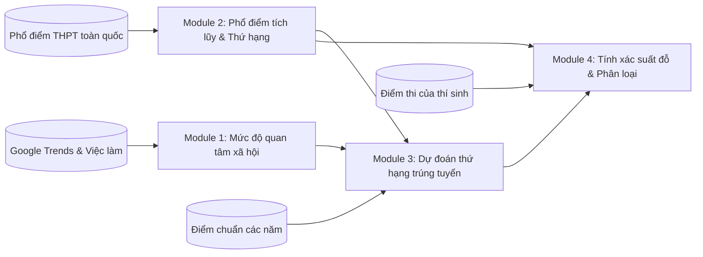

# ĐỀ CƯƠNG KHÓA LUẬN TỐT NGHIỆP

**TÊN ĐỀ TÀI:** Framework dự đoán khả năng trúng tuyển Đại học tại Việt Nam dựa trên dữ liệu công khai bên ngoài nhà trường: tích hợp điểm chuẩn, phổ điểm thi và tín hiệu thị trường lao động.  

**TÊN TIẾNG ANH:** An Institution-Independent Framework for Predicting University Admission Chances in Vietnam: Integrating Public Cut-off Scores, Exam Score Distributions, and Labor Market Signals  

**Sinh viên thực hiện:**
1. 24520145 - Cao Thái Bảo.
2. 24521459 - Võ Minh Quân.

## MỤC LỤC

- [Chương I. Nội dung đề tài](#chương-i-nội-dung-đề-tài)
  - [1.1. Mục tiêu đề tài](#11-mục-tiêu-đề-tài)
    - [1.1.1. Mục tiêu tổng quát](#111-mục-tiêu-tổng-quát)
    - [1.1.2. Mục tiêu cụ thể](#112-mục-tiêu-cụ-thể)
  - [1.2. Phạm vi đề tài](#12-phạm-vi-đề-tài)
    - [1.2.1. Phạm vi dữ liệu và thời gian](#121-phạm-vi-dữ-liệu-và-thời-gian)
    - [1.2.2. Phạm vi nghiệp vụ](#122-phạm-vi-nghiệp-vụ)
    - [1.2.3. Ranh giới tiếp cận thực tế](#123-ranh-giới-tiếp-cận-thực-tế)
  - [1.3. Đối tượng nghiên cứu](#13-đối-tượng-nghiên-cứu)
  - [1.4. Phương pháp thực hiện](#14-phương-pháp-thực-hiện)
    - [1.4.1. Cấu trúc 4 module tính toán](#141-cấu-trúc-4-module-tính-toán)
    - [1.4.2. Quy trình lựa chọn đặc trưng cho mô hình](#142-quy-trình-lựa-chọn-đặc-trưng-cho-mô-hình)
  - [1.5. Kết quả mong đợi của đề tài](#15-kết-quả-mong-đợi-của-đề-tài)
  - [1.6. Một số hạn chế của đề tài](#16-một-số-hạn-chế-của-đề-tài)
- [Chương II. Kế hoạch thực hiện](#chương-ii-kế-hoạch-thực-hiện)
- [Tài liệu tham khảo](#tài-liệu-tham-khảo)

---

# Chương I. Nội dung đề tài:
*(Mô tả chi tiết mục tiêu, phạm vi, đối tượng, phương pháp thực hiện, kết quả mong đợi của đề tài)*

### 1.1. Mục tiêu đề tài

#### 1.1.1. Mục tiêu tổng quát
Xây dựng một hệ thống (framework) hoàn chỉnh **chỉ sử dụng các nguồn dữ liệu công khai bên ngoài nhà trường** nhằm **dự đoán xác suất trúng tuyển**, cũng như mức độ an toàn cho từng nguyện vọng (trường – ngành đào tạo) của thí sinh trong kỳ thi tuyển sinh Đại học tại Việt Nam. Hệ thống được thiết kế theo dạng module linh hoạt có thể triển khai thực tế bằng nhiều công nghệ xử lý dữ liệu lớn khác nhau.

#### 1.1.2. Mục tiêu cụ thể
1. **Thu thập và làm sạch dữ liệu từ các nguồn công khai:** 
   - Điểm chuẩn tuyển sinh các trường đại học giai đoạn 2010–2025.
   - Dữ liệu phổ điểm thi tốt nghiệp THPT toàn quốc từng năm giai đoạn 2016–2025.
   - Mức độ quan tâm của xã hội trên Google Trends theo từng trường, ngành và nhóm ngành.
2. **Xây dựng mô hình tính toán gồm 4 module rõ ràng:**
   - *Module 1:* Đo lường mức độ quan tâm của xã hội đối với từng ngành và trường tính đến thời điểm tra cứu.
   - *Module 2:* Chuyển đổi điểm thi thô sang thứ hạng phân vị toàn quốc dựa trên phổ điểm tích lũy của Bộ GD&ĐT,
   - *Module 3:* Huấn luyện mô hình học máy (Machine Learning) để dự đoán thứ hạng phân vị điểm chuẩn của từng ngành, kết hợp hồi quy phân vị (Quantile Regression) để ước lượng các khoảng biến động (kịch bản điểm chuẩn tăng cao, kịch bản trung bình, kịch bản điểm chuẩn hạ nhiệt).
   - *Module 4:* Tính toán xác suất trúng tuyển cụ thể của thí sinh và phân loại mức độ rủi ro theo 3 nhóm nguyện vọng (An toàn, Cạnh tranh, Rủi ro).
3. **Quy trình chọn lọc đặc trưng bài bản (Feature Engineering):** Áp dụng các phương pháp thống kê để tìm độ trễ thời gian phù hợp, lọc bỏ các biến trùng lặp (đa cộng tuyến), đánh giá mức độ đóng góp của từng biến và kiểm định ý nghĩa thống kê bằng ANOVA F-test để chọn ra tập đặc trưng tối ưu.
4. **Triển khai trên nền tảng dữ liệu lớn:** Xây dựng hệ thống theo dạng module độc lập, cho phép chạy thử nghiệm gọn nhẹ trên máy tính cá nhân (Pandas, DuckDB,...) hoặc mở rộng chạy phân tán giả lập bằng Apache Spark (PySpark); tự động hóa việc cập nhật dữ liệu và huấn luyện định kỳ bằng Apache Airflow.
5. **Xây dựng website demo thực tế:** Phát triển dịch vụ API phản hồi nhanh và giao diện website trực quan (Next.js) giúp thí sinh tra cứu điểm, xem xác suất trúng tuyển và nhận khuyến nghị cụ thể cho từng nguyện vọng.

---

### 1.2. Phạm vi đề tài

#### 1.2.1. Phạm vi dữ liệu và thời gian
- **Dữ liệu điểm chuẩn:** Thu thập từ cổng thông tin tuyển sinh chính thức giai đoạn 2010–2025 (tập trung phân tích sâu từ năm 2016 trở đi do quy chế thi THPT Quốc gia đã tương đối ổn định).
- **Dữ liệu phổ điểm thi THPT:** Dữ liệu điểm thi thực tế của thí sinh trên toàn quốc từ năm 2016 đến năm 2025, bao gồm chương trình 2006 và chương trình 2018 (áp dụng từ năm 2025).
- **Dữ liệu Google Trends:** Chuỗi thời gian theo tháng từ khi có dữ liệu đến năm 2025 theo 3 cấp độ: Trường, Ngành và Nhóm ngành.

#### 1.2.2. Phạm vi nghiệp vụ

Tập trung vào phương thức xét tuyển bằng **Kết quả thi Tốt nghiệp THPT** (phương thức phổ biến nhất, quy mô lớn nhất và có dữ liệu công khai đầy đủ nhất).

#### 1.2.3. Ranh giới tiếp cận thực tế

- Đề tài tiếp cận hoàn toàn từ **dữ liệu bên ngoài nhà trường** (*Institution-Independent*), không đòi hỏi các dữ liệu nội bộ khó tiếp cận như số lượng hồ sơ nộp thực tế theo từng đợt, chỉ tiêu tuyển sinh điều chỉnh nội bộ hay thuật toán lọc ảo riêng của từng nhóm trường.
- Dự đoán thứ hạng phân vị (thí sinh nằm trong top bao nhiêu % cả nước) thay vì dự đoán trực tiếp con số điểm chuẩn thô, vì điểm chuẩn thô biến động rất thất thường tùy theo chính sách tuyển sinh của từng trường.

---

### 1.3. Đối tượng nghiên cứu

1. **Đối tượng khoa học - kỹ thuật:**
   - Mối quan hệ giữa điểm thi tốt nghiệp, phổ điểm tích lũy toàn quốc, lịch sử điểm chuẩn và mức độ quan tâm của xã hội đối với các ngành nghề.
   - Các thuật toán học máy dạng bảng phổ biến và hiệu quả cao (ưu tiên LightGBM do kế thừa thành tựu các nghiên cứu trước đó có liên quan).
   - Phương pháp hồi quy phân vị (Quantile Regression) và suy luận xác suất.
   - Các công cụ kỹ thuật dữ liệu lớn: Apache Spark (PySpark), DuckDB, Parquet, Apache Airflow.
2. **Đối tượng sử dụng:**
   - **Thí sinh và phụ huynh:** Tra cứu vị trí điểm thi của mình so với toàn quốc, xem xác suất đỗ cụ thể để sắp xếp thứ tự nguyện vọng hợp lý, tránh việc trượt oan do đặt sai nguyện vọng.
   - **Giáo viên và cán bộ tư vấn tuyển sinh:** Có thêm công cụ tham khảo khách quan dựa trên số liệu thực tế để định hướng cho học sinh.

---

### 1.4. Phương pháp thực hiện

Đề tài áp dụng các phương pháp kỹ thuật cụ thể theo các bước sau:

#### 1.4.1. Cấu trúc 4 module tính toán
1. **Module 1 – Đo lường mức độ quan tâm của xã hội:**
   - Thu thập chỉ số tìm kiếm Google Trends theo 3 cấp độ: Trường, Ngành và Nhóm ngành.
   - Xử lý dữ liệu theo thời điểm tra cứu (Point-in-Time): Nếu thí sinh tra cứu vào tháng 4 (trước kỳ thi), hệ thống chỉ dùng dữ liệu lũy kế từ tháng 1 đến tháng 4 và so sánh với cùng kỳ năm trước; nếu tra cứu sau tháng 7 (đã có điểm thi), hệ thống dùng dữ liệu trọn vẹn cả mùa thi.
2. **Module 2 – Xây dựng phổ điểm tích lũy và quy đổi thứ hạng:**
   - Đọc dữ liệu điểm thi toàn quốc của từng tổ hợp môn (A00, B00, D01,...) qua từng năm để tính bảng phân phối điểm tích lũy thực tế.
   - Quy đổi điểm thi thô $s$ thành **thứ hạng phân vị toàn quốc**: Thí sinh đạt điểm $s$ đang thuộc **Top mấy % cao nhất cả nước**.
3. **Module 3 – Dự đoán thứ hạng phân vị trúng tuyển:**
   - Dùng các mô hình học máy (LightGBM) để dự đoán xem ngành học năm nay sẽ lấy thí sinh ở mức Top bao nhiêu % cả nước ($R^*$).
   - Các đặc trưng đầu vào gồm: thứ hạng điểm chuẩn các năm trước của trường, của ngành trên toàn quốc, độ chênh lệch giữa ngành so với mặt bằng chung của trường, và mức độ quan tâm từ Google Trends.
   - Sử dụng kỹ thuật hồi quy phân vị (Quantile Regression) để đưa ra 3 mốc dự phòng:
     - *Kịch bản cạnh tranh tăng cao ($\tau = 0.1$):* Điểm chuẩn tăng mạnh, ngành lấy mức top cao hơn bình thường.
     - *Kịch bản trung bình ($\tau = 0.5$):* Mức điểm chuẩn khả dĩ nhất theo xu hướng các năm.
     - *Kịch bản hạ nhiệt ($\tau = 0.9$):* Điểm chuẩn giảm nhẹ, an toàn hơn.
   - **Xử lý một số tình huống đặc biệt:**
     - *Ngành mới mở:* Ước lượng mức điểm khởi điểm dựa trên điểm trung bình của trường và điểm trung bình của ngành đó trên toàn quốc: $\hat{R}^*_{j, t-1} = 0.5 R^*_{\text{school}} + 0.5 R^*_{\text{major}}$ kèm cờ `is_new_program = 1`.
     - *Ngành xét nhiều tổ hợp:* Tính toán dung hòa giữa các tổ hợp môn.
     - *Ngành có môn nhân hệ số hoặc điểm ưu tiên cao vượt 30 điểm:* Chuẩn hóa thang điểm và gắn cờ cảnh báo `is_cutoff_over_30 = 1`.
4. **Module 4 – Tính xác suất trúng tuyển và phân loại nguyện vọng:**
   - So sánh thứ hạng của thí sinh (từ Module 2) với ngưỡng phân vị dự đoán của ngành (từ Module 3) để tính ra xác suất trúng tuyển cụ thể $P \in [0, 1]$.
   - Phân loại nguyện vọng thành 3 nhóm:
     - *Vùng An toàn ($P \ge 80\%$ hoặc $r_{i} \le \hat{R}^*_{0.1}$):* Điểm thí sinh vượt hẳn ngưỡng dự báo, khả năng đỗ rất cao, dùng làm nguyện vọng lót đáy bảo đảm.
     - *Vùng Cạnh tranh ($50\% \le P < 80\%$ hoặc $\hat{R}^*_{0.1} < r_{i} \le \hat{R}^*_{0.9}$):* Điểm nằm sát ngưỡng dự báo, có cơ hội đỗ tốt nhưng cần chuẩn bị thêm nguyện vọng an toàn phía sau.
     - *Vùng Rủi ro ($P < 50\%$ hoặc $r_{i} > \hat{R}^*_{0.9}$):* Điểm thấp hơn ngưỡng dự báo, cơ hội đỗ thấp, chỉ nên đặt ở nhóm nguyện vọng mơ ước ban đầu.

#### 1.4.2. Quy trình lựa chọn đặc trưng cho mô hình
Đối với từng dạng dữ liệu, nhóm áp dụng các kỹ thuật phân tích riêng. Nhìn chung có các kỹ thuật sau đây:
1. **Phân tích độ trễ:** Khảo sát PACF trên chuỗi điểm chuẩn.
2. **Khử nhiễu:** Dùng trung bình trượt 2 năm (SMA-2) hoặc trung vị trượt (SMM-2).
3. **Lọc tương quan song song:** Tính hệ số tương quan Pearson $r$ và Spearman $\rho$.
4. **Loại bỏ biến trùng lặp (Đa cộng tuyến):** Với các cặp biến đo cùng một đại lượng mà có mức tương quan quá cao ($|r| > 0.8$), loại bỏ biến yếu hơn để tránh làm sai lệch mô hình.
5. **Đánh giá mức độ quan trọng bằng cây quyết định (Extra Trees):** Xếp hạng mức độ đóng góp theo chỉ số MDI, giữ lại nhóm biến đóng góp chính ($80\% - 90\%$).
6. **Khai triển tương tác bậc 2:** Tạo các biến tương tác chéo bậc 2.
7. **Kiểm định thống kê ANOVA F-test:** Chỉ những biến đạt ý nghĩa thống kê khắt khe ($p < 0.05$) mới được đưa vào tập đặc trưng huấn luyện cuối cùng.

---

### 1.5. Kết quả mong đợi của đề tài

1. **Về mặt phương pháp luận:** Chứng minh được tính khả thi và hiệu quả của cách tiếp cận dự đoán tuyển sinh dựa trên phân vị toàn quốc từ các nguồn dữ liệu công khai, không phụ thuộc vào dữ liệu nội bộ nhà trường.
2. **Về mặt dữ liệu & hạ tầng:** Xây dựng được kho dữ liệu tuyển sinh sạch, có cấu trúc rõ ràng (Data Lake / Data Warehouse) lưu trữ được các dạng Parquet, JSON,... tùy theo đặc điểm từng loại dữ liệu. Pipeline xử lý dữ liệu lớn hoạt động ổn định trên tập dữ liệu phổ điểm lớn.
3. **Về mặt mô hình học máy:** Mô hình học máy dự đoán thứ hạng phân vị đạt độ chính xác thực nghiệm cao.
4. **Về mặt sản phẩm ứng dụng:** Xây dựng thành công dịch vụ API và Website demo hoàn chỉnh chạy tốt trên môi trường local (Next.js), giao diện thân thiện, cho phép người dùng nhập điểm, tra cứu vị trí phân vị, xem xác suất trúng tuyển và nhận phân tầng khuyến nghị cụ thể theo từng trường/ngành.

### 1.6. Một số hạn chế của đề tài

- Chỉ mới khảo sát trên phạm vi phương thức Điểm thi THPTQG, chưa bao quát được nhiều phương thức, chưa thật sự phù hợp với tình hình tuyển sinh tại Việt Nam.
- Dữ liệu của Google Trends chưa thật sự đại diện cho sự quan tâm của xã hội hoặc xu hướng của thị trường lao động, nhưng đây là nguồn đầy đủ nhất hiện tại.

---

# Chương II. Kế hoạch thực hiện:
*(Mô tả kế hoạch làm việc)*

| Nội dung | Tên nội dung công việc | Nhiệm vụ trọng tâm | Sản phẩm đầu ra | Khối lượng | Tiến độ | Trạng thái |
| :---: | :--- | :--- | :--- | :---: | :---: | :---: |
| **Nội dung 1** | **Khảo sát đề tài** | Đọc và tổng hợp các nghiên cứu liên quan; phân tích ưu/nhược điểm các phương pháp hiện có; xác định bài toán toán học 4 module và lập tài liệu đặc tả bài toán. | Báo cáo tổng quan; tài liệu đặc tả bài toán ban đầu (`problem-specification.md`) và bản tinh gọn thực nghiệm (`refined-problem-specification.md`). | 2 | 100% | **Hoàn thành** |
| **Nội dung 2** | **Thu thập dữ liệu và luồng xử lý vào Data Lake** | Viết tài liệu đặc tả dữ liệu (Data Contract); xây dựng script cào và tiền xử lý dữ liệu từ các nguồn (điểm chuẩn, phổ điểm THPT, Google Trends, danh mục ngành); lưu trữ vào Data Lake dạng Parquet. | Tài liệu hợp đồng dữ liệu (`data-contract.md`); bộ mã nguồn thu thập và làm sạch; kho dữ liệu sạch Parquet/CSV. | 2 | 100% | **Hoàn thành** |
| **Nội dung 3** | **Xây dựng mô hình Machine Learning** | Trích xuất đặc trưng; lọc biến tương quan, khử trùng lặp và kiểm định ANOVA F-test; huấn luyện các mô hình Gradient Boosting (LightGBM, XGBoost) và Hồi quy phân vị; đánh giá sai số so với mức sàn tối thiểu. | Notebook phân tích đặc trưng và kết quả huấn luyện (`feature-analysis.ipynb`, `model-training.ipynb`); tập 16 đặc trưng tối ưu; checkpoint mô hình đã kiểm định. | 2 | 100% | **Hoàn thành** |
| **Nội dung 4** | **Triển khai framework trên hạ tầng dữ liệu lớn** | Thiết kế cấu trúc code dạng module độc lập nền tảng; viết adapter PySpark để xử lý phân tán phổ điểm và trích xuất đặc trưng; cài đặt cơ chế thử lại, bù đắp thiếu dữ liệu và kiểm soát chất lượng; lập lịch tự động với Apache Airflow. | Kế hoạch triển khai Big Data (`big-data-processing-implement-plan.md`); mã nguồn xử lý phân tán PySpark; kịch bản Airflow DAGs và tài liệu kiểm thử. | 2 | 33% | **Đang thực hiện** |
| **Nội dung 5** | **Triển khai sản phẩm website demo thực tế** | Xây dựng API phục vụ dự đoán phản hồi nhanh; phát triển giao diện website tư vấn tuyển sinh bằng Next.js hoạt động trên máy local; hỗ trợ người dùng nhập điểm, xem phân vị và nhận kết quả xác suất đỗ. | Ứng dụng web demo hoàn chỉnh (Frontend Next.js + Backend API); tài liệu hướng dẫn cài đặt và video kịch bản demo tra cứu tuyển sinh. | 2 | 0% | **Chưa bắt đầu** |

# Tài liệu tham khảo

*(Các bài báo đều xuất bản năm 2026.)*

1. [A forecast–optimization framework for data-driven university admissions](https://www.sciencedirect.com/science/article/pii/S2772503026000630).
2. [Modeling and predicting student enrolment: a meta-learning perspective](https://www.researchgate.net/publication/399556037_Modeling_and_predicting_student_enrolment_a_meta-learning_perspective).
3. [Hybrid Machine Learning and Fuzzy Inference System for University Admission Prediction](https://pure.port.ac.uk/ws/portalfiles/portal/124045814/Hybrid_Machine_Learning_and_Fuzzy_Inference_System_for_University_Admission_Prediction.pdf).
4. [The use of Artificial Intelligence in higher education admissions: a scoping review](https://www.tandfonline.com/doi/pdf/10.1080/0969594X.2026.2717193).

