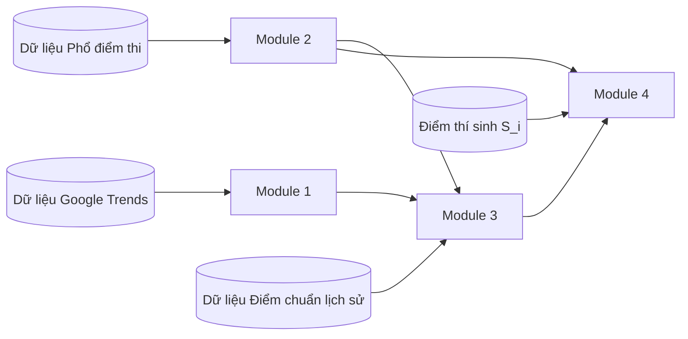
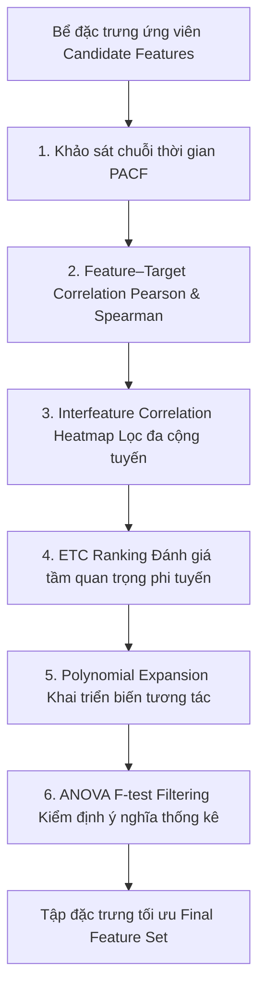

# Đặc tả bài toán: Khung mô hình ước lượng xác suất trúng tuyển đại học dựa trên phân vị cân bằng động

**Lưu ý**: Bài viết này chỉ có tác dụng _tham khảo_, thực tế cần khảo sát thông qua feature engineering để có phương án tối ưu nhất.

## 1. Định nghĩa bài toán tổng quát

### Ngôn ngữ tự nhiên

Cho một thí sinh $i$ có điểm thi $S_i$ tại **kỳ thi tốt nghiệp THPT** năm $t$, bài toán đặt ra là **ước lượng xác suất thí sinh này trúng tuyển vào một chương trình đào tạo $j$ của một trường đại học**.

Thay vì dự đoán trực tiếp điểm chuẩn dưới dạng một con số thô (vốn bị nhiễu do độ khó của đề thi thay đổi hàng năm và chính sách tuyển sinh riêng của từng trường), bài toán được phân rã thành một chuỗi các mô hình thành phần:

1. Dự báo sự thay đổi về nhu cầu xã hội (mức độ quan tâm) dựa trên Google Trends.
2. Tái tạo phổ điểm thi và phân phối tích lũy của năm hiện tại.
3. Dự báo thứ hạng phân vị (percentile rank) của thí sinh cuối cùng trúng tuyển vào chương trình đó.
4. Ước lượng xác suất để điểm của thí sinh $i$ đạt hoặc vượt qua ngưỡng phân vị trúng tuyển này.

### Mô hình hóa toán học

Gọi:

- $t \in \mathbb{N}$: Năm tuyển sinh hiện tại cần dự báo.
- $j \in \mathcal{J}$: Chương trình đào tạo cụ thể của một trường đại học.
- $k \in \mathcal{K}$: Tổ hợp môn xét tuyển áp dụng cho chương trình $j$.
- $S_{i, k, t} \in \mathbb{R}^+$: Tổng điểm thi thực tế của thí sinh $i$ theo tổ hợp $k$ ở năm $t$.
- $C_{j, k, t} \in \mathbb{R}^+$: Ngưỡng điểm chuẩn (cutoff score) thực tế của chương trình $j$, tổ hợp $k$ năm $t$.

Mục tiêu cốt lõi là ước lượng hàm xác suất:

$$P(\text{Trúng tuyển}_{i, j, t}) = \mathbb{P}(S_{i, k, t} \ge C_{j, k, t})$$

### Phạm vi của bài toán

- Chỉ xem xét các chương trình đào tạo có _phương thức xét tuyển là `Điểm thi THPT`_.
- Chỉ xem xét điểm chuẩn và phổ điểm _từ năm 2016 trở đi_ (chương trình 2006 và chương trình 2018), do chế độ đào tạo và tuyển sinh các năm trước quá khác.
- Xem xét dữ liệu Google Trends trên _toàn bộ khoảng thời gian_ khả dụng.
- Ở phạm vi nghiên cứu, chỉ tìm hiểu _đến năm 2025_.

## 2. Phân rã kiến trúc mô hình (4 thành phần)

### Module 1: Mô hình hóa xu hướng quan tâm của xã hội ($D_{j, t}$)

#### Ngôn ngữ tự nhiên

Mục tiêu của module này là **đo lường và lượng hóa lực cầu xã hội (mức độ quan tâm, tìm kiếm) đối với một chương trình đào tạo** trước và trong mùa tuyển sinh năm $t$.

Trong cơ chế thị trường tuyển sinh, độ "nóng" của một ngành học là chỉ báo sớm phản ánh áp lực cạnh tranh. Khi một ngành nghề thu hút sự chú ý đột biến của xã hội (ví dụ: làn sóng ngành Vi mạch Bán dẫn, Trí tuệ nhân tạo, Logistics), số lượng thí sinh đăng ký nguyện vọng vào ngành đó sẽ tăng vọt, tạo áp lực đẩy ngưỡng phân vị trúng tuyển lên cao hơn so với mức nền lịch sử.

Module này trích xuất chuỗi thời gian tìm kiếm từ Google Trends xoay quanh các mốc thời gian cao điểm của mùa tuyển sinh (giai đoạn tìm hiểu ngành nghề, kỳ thi tốt nghiệp THPT, và giai đoạn nộp/điều chỉnh nguyện vọng) trên 3 cấp độ phân cấp: **Trường đại học**, **Ngành cụ thể**, và **Nhóm ngành đào tạo**, từ đó xây dựng vector đặc trưng nhu cầu xã hội $\mathbf{D}_{j, t}$.

#### Mô hình hóa toán học

##### 1. Trích xuất chuỗi thời gian theo cửa sổ mùa vụ ($\mathcal{W}_t$)

Gọi $x_{u, \tau} \in [0, 100]$ là chỉ số Google Trends chuẩn hóa tại mốc thời gian $\tau$ (tuần hoặc tháng) cho thực thể $u \in \{\text{trường}, \text{ngành}, \text{nhóm ngành}\}$.

Cửa sổ thời gian quan sát trọng điểm $\mathcal{W}_t$ bao gồm chu kỳ các tháng diễn ra hoạt động hướng nghiệp và tuyển sinh của năm $t$ (từ tháng 1 đến tháng 8 hàng năm).

##### 2. Tổng hợp vector đặc trưng nhu cầu xã hội ($\mathbf{D}_{j, t}$)

Vector nhu cầu xã hội $\mathbf{D}_{j, t}$ được trích xuất thông qua hàm biến đổi đặc trưng $\phi(\cdot)$:

$$\mathbf{D}_{j, t} = \phi\Big(\big\{ x_{\text{trường}, \tau}, \, x_{\text{ngành}, \tau}, \, x_{\text{nhóm ngành}, \tau} \big\}_{\tau \in \mathcal{W}_t}\Big)$$

Các đặc trưng thành phần cốt lõi bao gồm:

- **Mức độ quan tâm trung bình trong mùa tuyển sinh (Mean Seasonal Interest):**
  $$\bar{x}_{u, t} = \frac{1}{|\mathcal{W}_t|} \sum_{\tau \in \mathcal{W}_t} x_{u, \tau}$$
  Đại diện cho sức hút nền tảng và độ nhận diện thương hiệu của ngành/trường.

- **Cường độ quan tâm tại đỉnh mùa vụ (Peak Interest):**
  $$x_{u, t}^{\max} = \max_{\tau \in \mathcal{W}_t} x_{u, \tau}$$
  Bắt giữ độ bùng nổ tìm kiếm tại thời điểm thí sinh chốt và điều chỉnh nguyện vọng (thường rơi vào tháng 7 - tháng 8).

- **Biến thiên tăng trưởng nhu cầu tìm kiếm ($\Delta \mathbf{D}_{j, t}$):**
  Phản ánh xu thế dịch chuyển dòng nguyện vọng (ngành đang có làn sóng quan tâm gia tăng hay đang hạ nhiệt so với các mùa tuyển sinh trước).

### Module 2: Ước lượng phân phối phổ điểm thi ($F_{k, t}$)

#### Ngôn ngữ tự nhiên

Mục tiêu của module này là **chuyển đổi thang đo điểm số thô ($S \in [0, 30]$) của từng tổ hợp môn sang không gian phân vị xác suất tích lũy ($r \in [0, 1]$)**.

Độ khó của đề thi tốt nghiệp THPT biến động rất lớn qua từng năm: có năm đề thi phân hóa thấp, mức 27 điểm vẫn có thể trượt các ngành hot; ngược lại có năm đề thi khó, mức 24 điểm đã đứng trong top thí sinh dẫn đầu toàn quốc. Do đó, điểm số thô không có giá trị so sánh trực tiếp qua các năm. Phổ điểm toàn quốc cho biết chính xác: một thí sinh đạt mức điểm $s$ thì đang **vượt qua bao nhiêu phần trăm thí sinh toàn quốc** cùng thi tổ hợp đó.

Module này xây dựng hàm phân phối tích lũy (CDF) cho từng tổ hợp môn $k$ ở năm $t$:

1. **Sau khi Bộ GD&ĐT công bố phổ điểm (tháng 7 hàng năm):** Hàm phân phối là hàm thực nghiệm xác định chính xác 100% dựa trên toàn bộ dữ liệu điểm thi toàn quốc.
2. **Trước khi công bố phổ điểm chính thức:** Hàm phân phối được xấp xỉ bằng phân phối tiên nghiệm dựa trên phân tích độ khó đề thi và xu hướng phổ điểm các năm liền kề.

#### Mô hình hóa toán học

##### 1. Hàm phân phối tích lũy phổ điểm thi ($F_{k, t}$)

Gọi $X_{k, t}$ là biến ngẫu nhiên đại diện cho tổng điểm thi của một thí sinh bất kỳ thi theo tổ hợp $k$ ở năm $t$.

Hàm phân phối tích lũy (Cumulative Distribution Function - CDF) $F_{k, t}(s)$ thể hiện xác suất để một thí sinh đạt điểm nhỏ hơn hoặc bằng $s$:

$$F_{k, t}(s) = \mathbb{P}(X_{k, t} \le s) = \int_0^s f_{k, t}(x) \, dx$$

Trên dữ liệu thực nghiệm toàn quốc gồm $N_{k, t}$ thí sinh đăng ký xét tuyển tổ hợp $k$, hàm CDF thực nghiệm $\hat{F}_{k, t}(s)$ được xác định bởi:

$$\hat{F}_{k, t}(s) = \frac{1}{N_{k, t}} \sum_{i=1}^{N_{k, t}} \mathbb{I}(S_{i, k, t} \le s)$$

Trong đó $\mathbb{I}(\cdot)$ là hàm chỉ thị (bằng 1 nếu $S_{i, k, t} \le s$, ngược lại bằng 0).

##### 2. Ánh xạ mức điểm sang thứ hạng phân vị ($\text{RankPct}_{k, t}$)

Thứ hạng phân vị (tỷ lệ top % thí sinh có điểm cao hơn mức $s$) được xác định bằng hàm sống sót (Survival Function):

$$\text{RankPct}_{k, t}(s) = 1 - F_{k, t}(s) = \mathbb{P}(X_{k, t} > s)$$

- Ví dụ: Mức điểm $s$ có $\text{RankPct} = 0.03$ nghĩa là thí sinh đứng trong top 3% cao nhất cả nước ở tổ hợp đó (vượt qua 97% thí sinh còn lại).
- Thang đo phân vị này khử hoàn toàn sự biến động về độ khó của đề thi, đóng vai trò là không gian chuẩn hóa trung gian để Module 3 và Module 4 vận hành.

**Tại sao không dự đoán CDF điểm thi tại năm $t$ mà dự đoán trực tiếp phân vị điểm chuẩn?**

- Trong thực tế nghiệp vụ thì đã có sẵn phổ điểm do Bộ GD&ĐT công bố rồi, ta cần tập trung dự đoán phân vị điểm chuẩn nhiều hơn.
- Sai số cao hơn dự đoán phân vị điểm chuẩn do phải dự đoán nhiều hơn.

### Module 3: Dự đoán phân vị của điểm chuẩn ($R^*_{j, t}$)

#### Ngôn ngữ tự nhiên

Mục tiêu của module này là **dự đoán ngành $j$ ở năm $t$ sẽ lấy điểm chuẩn tương ứng với top bao nhiêu phần trăm thí sinh toàn quốc** (ký hiệu là phân vị $R^*_{j, t}$).

Thay vì dự đoán trực tiếp con số điểm chuẩn thô (vốn biến động mạnh theo độ khó của đề thi), việc dự đoán thứ hạng phân vị có tính ổn định cao hơn rất nhiều vì năng lực và vị thế của một ngành học thường giữ quán tính qua các năm (ví dụ: ngành top đầu luôn thu hút top 1 - 2% thí sinh xuất sắc).

Trong thực tế tuyển sinh tại Việt Nam, module này giải quyết hai bài toán đặc thù:

1. **Một điểm chuẩn dùng chung cho nhiều tổ hợp:** Một ngành thường xét tuyển đồng thời nhiều tổ hợp (A00, A01, D01...) với cùng một mức điểm chuẩn duy nhất. Do phổ điểm mỗi tổ hợp khác nhau, cùng một mức điểm sẽ tương ứng với các phân vị khác nhau. Ta cần quy đổi về một **phân vị đại diện chuẩn hóa** cho ngành đó.
2. **Không có dữ liệu chỉ tiêu cụ thể:** Số lượng chỉ tiêu cho phương thức điểm thi THPT thường bị biến động ngầm (chuyển sang xét tuyển sớm, chứng chỉ quốc tế) hoặc không công bố đầy đủ. Vì vậy, mô hình dự đoán phân vị dựa trên **quán tính lịch sử** (phân vị các năm trước), **tín hiệu thay đổi mức độ quan tâm từ Google Trends** (Module 1), và các **đặc tính của trường/ngành**.
3. **Phù hợp với phương pháp tuyển sinh của Bộ GD&ĐT**: Trong các năm gần đây, Bộ đang dùng phương pháp quy đổi điểm chuẩn dựa trên phân vị, đây là một phương pháp tự nhiên và phù hợp với xu thế tình hình tuyển sinh tại Việt Nam.

Hơn nữa, do tâm lý thí sinh và hệ thống lọc ảo có yếu tố bất định, $R^*_{j, t}$ được xuất ra dưới dạng một **phân phối xác suất** (kỳ vọng kèm độ lệch chuẩn) thay vì một con số cố định, tạo cơ sở tính toán xác suất đỗ ở Module 4.

#### Mô hình hóa toán học

##### 1. Quy đổi điểm chuẩn lịch sử sang thang đo phân vị ($R^*_{j, \tau}$)

Gọi $\mathcal{K}_j = \{k_1, k_2, \dots, k_m\}$ là tập hợp các tổ hợp môn được xét tuyển vào ngành $j$, với điểm chuẩn chung năm $\tau$ là $C_{j, \tau}$.

Thứ hạng phân vị đại diện của ngành $j$ tại năm $\tau$ được tính bằng trung bình có trọng số phân vị trên các tổ hợp:

$$R^*_{j, \tau} = \sum_{k \in \mathcal{K}_j} w_{j, k} \cdot \big(1 - F_{k, \tau}(C_{j, \tau})\big)$$

Trong đó:

- $F_{k, \tau}(C_{j, \tau})$: Giá trị hàm phân phối tích lũy CDF của tổ hợp $k$ năm $\tau$ tại mức điểm $C_{j, \tau}$ (tính từ Module 2).
- $1 - F_{k, \tau}(C_{j, \tau})$: Thứ hạng phân vị (top %) của mức điểm $C_{j, \tau}$ theo tổ hợp $k$ (giá trị càng nhỏ thứ hạng càng cao).
- $w_{j, k} \ge 0, \sum w_{j, k} = 1$: Trọng số thí sinh trúng tuyển theo tổ hợp $k$ vào ngành $j$ (khi không có số liệu thực tế, mặc định gán trọng số đều $w_{j, k} = \frac{1}{|\mathcal{K}_j|}$).

##### 2. Dự báo phân vị năm $t$ dưới điều kiện ẩn chỉ tiêu

Ngưỡng phân vị trúng tuyển $R^*_{j, t} \in (0, 1)$ được mô hình hóa theo một phân phối xác suất có điều kiện dựa trên vector đặc trưng $\mathbf{Z}_{j, t}$:

$$R^*_{j, t} \sim \mathcal{D}\big(\mu_{j, t}, \, \sigma_{j, t}^2\big)$$

Trong đó kỳ vọng $\mu_{j, t}$ và độ bất định $\sigma_{j, t}^2$ được ước lượng từ mô hình máy học với vector đặc trưng $\mathbf{Z}_{j, t}$ gồm 3 nhóm thông tin:

$$\mathbf{Z}_{j, t} = \Big[ \mathbf{R}^*_{j, \text{hist}}, \, \sigma^2(R^*_j), \, \mathbf{D}_{j, t}, \, \Delta \mathbf{D}_{j, t}, \, \mathbf{E}_j \Big]^T$$

- **Quán tính và độ biến động phân vị lịch sử:**
  - $\mathbf{R}^*_{j, \text{hist}} = [R^*_{j, t-1}, R^*_{j, t-2}, \dots]$: Chuỗi phân vị trúng tuyển của ngành trong các năm gần nhất (các biến trễ lag).
  - $\sigma^2(R^*_j)$: Độ biến thiên lịch sử của phân vị ngành $j$, phản ánh mức độ ổn định hoặc bấp bênh của ngưỡng tuyển sinh qua các năm.
- **Tín hiệu nhu cầu xã hội (Module 1):**
  - $\mathbf{D}_{j, t}$: Mức độ quan tâm trích xuất từ Google Trends đối với trường, ngành, nhóm ngành trong mùa tuyển sinh năm $t$.
  - $\Delta \mathbf{D}_{j, t}$: Biến thiên tăng trưởng của nhu cầu tìm kiếm (chỉ báo sớm cho việc gia tăng hoặc hạ nhiệt mức độ cạnh tranh nguyện vọng so với các năm trước).
- **Đặc tính cố định của chương trình đào tạo ($\mathbf{E}_j$):**
  - $|\mathcal{K}_j|$: Số lượng tổ hợp xét tuyển chung (ngành xét càng nhiều tổ hợp thì độ cạnh tranh dồn điểm càng cao).
  - Nhóm ngành đào tạo, Phân tầng trường đại học ($\text{Tier}_{\text{trường}}$), và Khu vực địa lý.

### Module 4: Ước lượng xác suất đỗ của thí sinh ($P(\text{Pass})$)

#### Ngôn ngữ tự nhiên

Mục tiêu của module cuối cùng là **tổng hợp toàn bộ kết quả từ các module trước để tính toán xác suất trúng tuyển cụ thể ($P \in [0, 1]$)** khi thí sinh $i$ nộp hồ sơ vào ngành $j$ với mức điểm $S_i$.

Dựa vào phổ điểm năm nay (Module 2), điểm thi của thí sinh được định vị chính xác thành một thứ hạng phân vị $r_i$ (ví dụ: điểm 26.5 tương ứng top 2.1% khối A00 toàn quốc). Thí sinh sẽ trúng tuyển nếu thứ hạng của mình tốt hơn hoặc bằng ngưỡng phân vị cắt $R^*_{j, t}$ của ngành đó (tức là $r_i \le R^*_{j, t}$).

Tuy nhiên, vì ngưỡng cắt $R^*_{j, t}$ được Module 3 mô hình hóa dưới dạng một **vùng phân phối bất định** (kỳ vọng $\mu$ và độ lệch chuẩn $\sigma$) do sự dao động tâm lý thí sinh và hệ thống lọc ảo toàn quốc, nên cơ hội đỗ không thể quy về kết luận nhị phân "đỗ/trượt" cứng nhắc. Thay vào đó, mô hình cung cấp **xác suất trúng tuyển liên tục kèm theo các phân tầng khuyến nghị thiết thực** (vùng an toàn, vùng cạnh tranh, vùng rủi ro), giúp thí sinh đưa ra quyết định sắp xếp thứ tự nguyện vọng tối ưu nhất.

#### Mô hình hóa toán học

##### 1. Định vị thứ hạng phân vị của thí sinh ($r_{i, k, t}$)

Với mức điểm thi thực tế $S_{i, k, t}$ của thí sinh $i$ theo tổ hợp môn $k$, thứ hạng phân vị thực tế của thí sinh trên phổ điểm năm $t$ được xác định qua hàm CDF từ Module 2:

$$r_{i, k, t} = 1 - F_{k, t}(S_{i, k, t})$$

**Lưu ý**: Giá trị $r_{i, k, t}$ càng nhỏ thì điểm số và thứ hạng của thí sinh càng cao; ví dụ $r = 0.01$ là top 1% xuất sắc nhất.

##### 2. Công thức tính xác suất trúng tuyển theo phân phối điều kiện

Thí sinh trúng tuyển vào ngành $j$ khi điểm thi đạt hoặc vượt điểm chuẩn, tương đương thứ hạng phân vị của thí sinh nằm trong ngưỡng phân vị trúng tuyển:

$$S_{i, k, t} \ge C_{j, t} \iff r_{i, k, t} \le R^*_{j, t}$$

Gọi $g_{R^*}(r \mid \mathbf{Z}_{j, t})$ và $G_{R^*}(r \mid \mathbf{Z}_{j, t})$ lần lượt là hàm mật độ xác suất (PDF) và hàm phân phối tích lũy (CDF) của ngưỡng phân vị dự báo $R^*_{j, t}$ từ Module 3. Xác suất trúng tuyển của thí sinh $i$ theo tổ hợp $k$ là:

$$P(\text{Trúng tuyển}_{i, j, k, t}) = \mathbb{P}\big(R^*_{j, t} \ge r_{i, k, t}\big) = \int_{r_{i, k, t}}^{1} g_{R^*}(r \mid \mathbf{Z}_{j, t}) \, dr = 1 - G_{R^*}(r_{i, k, t} \mid \mathbf{Z}_{j, t})$$

- **Trường hợp xấp xỉ phân phối chuẩn:** Nếu giả định $R^*_{j, t} \sim \mathcal{N}\big(\mu_{j, t}, \, \sigma_{j, t}^2\big)$, xác suất trúng tuyển được tính toán trực tiếp thông qua hàm phân phối chuẩn tắc $\Phi(\cdot)$:

  $$P(\text{Trúng tuyển}_{i, j, k, t}) = 1 - \Phi\left(\frac{r_{i, k, t} - \mu_{j, t}}{\sigma_{j, t}}\right) = \Phi\left(\frac{\mu_{j, t} - r_{i, k, t}}{\sigma_{j, t}}\right)$$

- **Trường hợp thí sinh đăng ký xét tuyển bằng nhiều tổ hợp hợp lệ:** Xác suất đỗ chung cuộc vào ngành $j$ là xác suất cao nhất trong các tổ hợp mà thí sinh có điểm xét tuyển:

  $$P(\text{Trúng tuyển}_{i, j, t}) = \max_{k \in \mathcal{K}_j} P(\text{Trúng tuyển}_{i, j, k, t})$$

##### 3. Phân tầng khuyến nghị mức độ an toàn của nguyện vọng

Dựa trên giá trị xác suất $P$ ước lượng được, hệ thống phân loại quyết định nguyện vọng thành 3 ngưỡng trực quan hỗ trợ thí sinh:

- **Vùng An toàn ($P \ge 80\%$):** Phân vị của thí sinh vượt trội so với ngưỡng kỳ vọng $\mu_{j, t}$ và nằm ngoài dải biến động rủi ro, khả năng đỗ rất cao.
- **Vùng Cạnh tranh ($50\% \le P < 80\%$):** Phân vị của thí sinh tiệm cận ngưỡng kỳ vọng, cơ hội đỗ tốt nhưng có thể chịu rủi ro nếu ngành có đột biến dồn nguyện vọng.
- **Vùng Rủi ro cao ($P < 50\%$):** Phân vị thí sinh thấp hơn ngưỡng kỳ vọng, chỉ nên xếp ở nhóm nguyện vọng mơ ước hoặc ưu tiên phía sau.

## 3. Phương án kiểm tra đặc trưng (Feature Engineering & Selection Framework)

### 3.1 Định nghĩa Biến Mục tiêu (Target Feature) và Cơ chế Học máy theo từng Module

Trong kiến trúc tổng thể, không phải module nào cũng là một bài toán học máy có giám sát (Supervised Learning) cần có biến mục tiêu. Việc phân định rõ vai trò và Target Feature của từng module là cơ sở quyết định phạm vi áp dụng của các kỹ thuật kỹ nghệ và sàng lọc đặc trưng:

| Module                         | Bản chất bài toán                                                            |  Có Target Feature không?   | Target Feature cụ thể                                                              | Vai trò trong hệ thống                                                                                                                                                 |
| :----------------------------- | :--------------------------------------------------------------------------- | :-------------------------: | :--------------------------------------------------------------------------------- | :--------------------------------------------------------------------------------------------------------------------------------------------------------------------- |
| **Module 1 (Google Trends)**   | Trích xuất tín hiệu chuỗi thời gian (Unsupervised Feature Extraction)        |        ❌ **Không**         | _Không có_                                                                         | Đóng vai trò sinh ra **Input Features** ($\mathbf{D}_{j, t}$) phản ánh lực cầu xã hội nạp vào Module 3.                                                                |
| **Module 2 (Phổ điểm thi)**    | Thống kê mô tả / Biến đổi phân phối tích lũy (Deterministic CDF Transformer) |        ❌ **Không**         | _Không có_                                                                         | Đóng vai trò là **"nhà máy tạo nhãn"** cho Module 3 và cung cấp phân vị thí sinh $r_i$ cho Module 4.                                                                   |
| **Module 3 (Dự đoán phân vị)** | **Học máy có giám sát cốt lõi** (Supervised Probabilistic Regression)        | **CÓ (Trọng tâm duy nhất)** | **$R^*_{j, t} \in [0, 1]$** (Thứ hạng phân vị trúng tuyển chuẩn hóa của ngành $j$) | Nhãn mục tiêu: Thí sinh trúng tuyển cuối cùng của ngành $j$ thuộc **top bao nhiêu % toàn quốc**. Toàn bộ quy trình sàng lọc đặc trưng đều lấy $R^*_{j, t}$ làm Target. |
| **Module 4 (Xác suất đỗ)**     | Suy luận xác suất tích hợp (Probabilistic Inference & Calibration)           |   ⚠️ **Chỉ khi hậu kiểm**   | $Y_{i, j, t} \in \{0, 1\}$ (Trạng thái trúng tuyển thực tế: Đỗ/Trượt)              | Tính tích phân xác suất ở runtime; nhãn $Y$ chỉ dùng khi hậu kiểm độ tin cậy xác suất (Brier score, Calibration curve).                                                |

- **Ý nghĩa đối với quy trình Feature Selection:**
  - **Module 1** không có Target nên không áp dụng trực tiếp các phương pháp sàng lọc có giám sát (như Feature–Target Correlation hay ANOVA F-test) một cách độc lập; kỹ thuật duy nhất áp dụng trên Module 1 là **PACF** nhằm khảo sát chu kỳ mùa vụ và bước trễ tự thân của chuỗi tìm kiếm.
  - **Module 3** là nơi tập trung toàn bộ vector đặc trưng $\mathbf{Z}_{j, t}$ và là **nơi duy nhất sở hữu nhãn giám sát liên tục $R^*_{j, t}$**. Do đó, toàn bộ quy trình sàng lọc 6 bước dưới đây thực chất được vận hành xoay quanh biến mục tiêu $R^*_{j, t}$ của Module 3.

### 3.2 Chi tiết 6 kỹ thuật thẩm định đặc trưng

1. **Partial Autocorrelation (PACF - Hệ số tự tương quan riêng phần):**
   - **Mục đích:** Xác định chính xác độ sâu bước trễ tối ưu (Lag depth) và kiểm tra tính mùa vụ, loại bỏ các bước trễ không có ý nghĩa tự tương quan trực tiếp sau khi đã kiểm soát các độ trễ trung gian.
   - **Phạm vi áp dụng:**
     - _Module 1 (Google Trends):_ Đánh giá PACF qua 24 bước trễ tháng (Lags 1-24) để chứng minh chu kỳ mùa vụ 12 tháng và nhận diện các tháng trễ có lực dự báo nhu cầu mạnh nhất.
     - _Module 3 (Điểm chuẩn lịch sử):_ Đánh giá PACF qua các bước trễ năm (Lags 1-5) để xác định số năm quá khứ cần đưa vào chuỗi quán tính $\mathbf{R}^*_{j, \text{hist}}$ (thường lag-1 và lag-2 có ý nghĩa vượt trội).

2. **Feature–Target Correlation Heatmap (Tương quan Tuyến tính & Đơn điệu):**
   - **Mục đích:** Khảo sát độ nhạy của từng biến ứng viên đối với biến mục tiêu (phân vị điểm chuẩn $R^*_{j, t}$).
   - **Phương pháp:**
     - _Pearson $r$:_ Đo lường mối quan hệ tuyến tính thẳng đứng giữa đặc trưng và target.
     - _Spearman $\rho$:_ Đo lường mối quan hệ đơn điệu phi tuyến, đặc biệt kháng nhiễu và phù hợp với thang đo phân vị bị chặn trong đoạn $[0, 1]$.
   - **Tiêu chí sàng lọc:** Ưu tiên các đặc trưng có $|r| \ge 0.10$ hoặc $|\rho| \ge 0.10$, loại bỏ các biến hoàn toàn độc lập với điểm chuẩn.

3. **Interfeature Correlation Heatmap (Sàng lọc Đa cộng tuyến giữa các đặc trưng):**
   - **Mục đích:** Phát hiện và triệt tiêu hiện tượng đa cộng tuyến nghiêm trọng (Multicollinearity) khiến mô hình hồi quy bị bất ổn định trọng số và phình to phương sai.
   - **Quy tắc xử lý:** Lập ma trận tương quan chéo giữa toàn bộ các cặp đặc trưng. Với bất kỳ cặp $(f_1, f_2)$ nào có $|r| > 0.80$ (ví dụ: giữa biến trượt SMA-12 và EMA-12, hoặc giữa Trend trung bình và Trend tại đỉnh):
     $$\text{Giữ lại } \arg\max_{f \in \{f_1, f_2\}} |r(f, \text{Target})|, \quad \text{loại bỏ biến còn lại}.$$

4. **ETC Ranking (Xếp hạng độ quan trọng từ Extra Trees Classifier / Regressor):**
   - **Mục đích:** Bắt giữ các mối quan hệ phi tuyến tính phức tạp và tương tác đa biến mà phân tích tương quan tuyến tính đơn biến bỏ sót.
   - **Phương pháp:** Huấn luyện mô hình ensemble ngẫu nhiên cực hạn (Extra Trees) với 100 cây quyết định, tính toán chỉ số giảm độ tinh khiết trung bình MDI (Mean Decrease in Impurity).
   - **Tiêu chí:** Xếp hạng đóng góp phần trăm của từng đặc trưng; sàng lọc giữ lại nhóm đặc trưng chiếm tích lũy $80\% - 90\%$ tổng độ quan trọng toàn bộ cây.

5. **Polynomial Expansion (Khai triển Đa thức Tương tác Bậc 2):**
   - **Mục đích:** Sinh các đặc trưng tương tác chéo phi tuyến ($x_i \cdot x_j$) giữa các biến cốt lõi (Core features) để kiểm tra xem việc kết hợp giữa 2 tín hiệu có tạo ra độ nâng tương quan (Correlation Lift) so với từng biến đơn lẻ hay không.
   - **Ví dụ thực tế:** Tương tác giữa `cutoff_lag1` (quán tính điểm chuẩn) và `school_trend_mean` (lực cầu trường), hoặc giữa `num_blocks` (số tổ hợp) và `num_schools_offering_major` (quy mô ngành trên thị trường).
   - **Tiêu chí:** Chỉ giữ lại các số hạng tương tác bậc 2 có hệ số tương quan với target cao hơn cả 2 biến thành phần gốc.

6. **ANOVA F-test Filtering (Kiểm định Ý nghĩa Thống kê Phân tích Phương sai):**
   - **Mục đích:** Kiểm định giả thuyết thống kê khắt khe xem mối quan hệ giữa đặc trưng và biến mục tiêu có thực sự mang tính giải thích phương sai hay chỉ là ngẫu nhiên do cỡ mẫu.
   - **Tiêu chí sàng lọc:** Tính toán chỉ số $F$-statistic và $p$-value (thông qua `f_regression`). Chỉ những đặc trưng đạt mức ý nghĩa thống kê với $p < 0.05$ (tương đương $F > F_{\text{crit}} \approx 3.84$ hay $\log_{10}(F) > 0.584$) mới được đưa vào tập đặc trưng huấn luyện cuối cùng.

### 3.3 Ma trận Áp dụng Kỹ thuật theo từng Module

| Kỹ thuật                 | Module 1 (Trends)                             | Module 2 (Phổ điểm) | Module 3 (Dự đoán phân vị)                                 | Module 4 (Xác suất đỗ) |
| :----------------------- | :-------------------------------------------- | :------------------ | :--------------------------------------------------------- | :--------------------- |
| **PACF**                 | **Chủ đạo**                                   | _Không áp dụng_     | **Chủ đạo**                                                | _Không áp dụng_        |
| **Feature–Target Corr**  | Đánh giá tương quan thô của Trends với target | _Không áp dụng_     | **Chủ đạo** (Sàng lọc sơ bộ tuyến tính & đơn điệu)         | _Không áp dụng_        |
| **Interfeature Heatmap** | Lọc từ khóa/cửa sổ trùng lặp                  | _Không áp dụng_     | **Chủ đạo** (Triệt tiêu đa cộng tuyến $\|r\| > 0.80$)      | _Không áp dụng_        |
| **ETC Ranking**          | Đánh giá tầng Trends (Trường vs Ngành)        | _Không áp dụng_     | **Chủ đạo** (Xếp hạng độ quan trọng phi tuyến MDI)         | _Không áp dụng_        |
| **Polynomial Expansion** | Kết hợp thang đo Trends                       | _Không áp dụng_     | **Chủ đạo** (Khai triển tương tác giữa quán tính & Trends) | _Không áp dụng_        |
| **ANOVA F-test**         | Kiểm định ý nghĩa thống kê                    | _Không áp dụng_     | **Chủ đạo** (Chốt danh sách đạt $p < 0.05$)                | _Không áp dụng_        |
