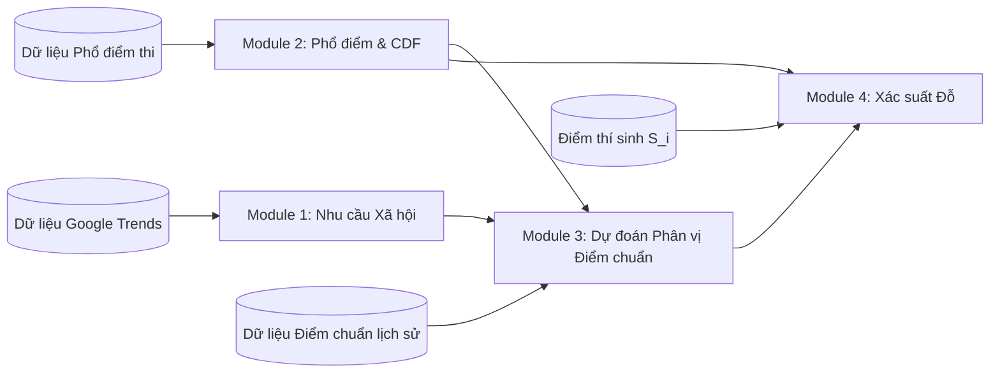
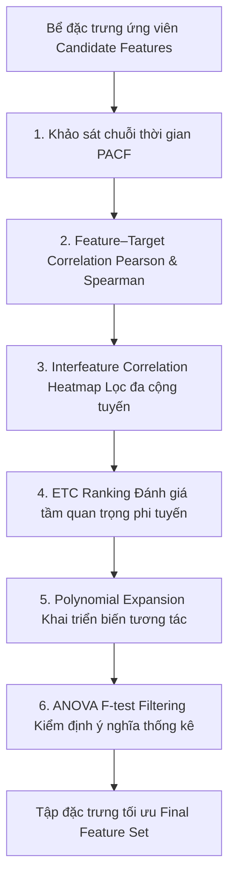

# Đặc tả bài toán: Khung mô hình ước lượng xác suất trúng tuyển đại học dựa trên phân vị cân bằng động

Tài liệu này giới thiệu bài toán cần giải quyết và gợi ý trích xuất dữ liệu để giải quyết bài toán này.

**Lưu ý**: Tài liệu này chỉ có tác dụng _tham khảo_, thực tế cần khảo sát thông qua feature engineering để có phương án tối ưu nhất.

## 0. Một vài khái niệm bạn có thể nhầm lẫn khi đọc tài liệu này

### Biến mục tiêu và đầu ra

**Biến mục tiêu (Target feature)**:

- Là giá trị hoặc nhãn (label) mà mô hình học máy được huấn luyện để dự đoán.
- Giá trị của biến mục tiêu được gọi là _Ground Truth_ hoặc _Observed Value_.

**Đầu ra (Output)**:

- Là kết quả thực tế mà mô hình tạo ra (dự đoán ra) sau khi đưa dữ liệu đầu vào qua thuật toán.
- Giá trị đầu ra được gọi là _Estimator_ hoặc _Predicted Value_, và ký hiệu biến đầu ra có dấu mũ phía trên. Ví dụ: $\hat{x}$.

## 1. Định nghĩa bài toán tổng quát

### Ngôn ngữ tự nhiên

Cho một thí sinh $i$ có điểm thi $S_i$ tại **kỳ thi tốt nghiệp THPT** năm $t$, bài toán đặt ra là **ước lượng xác suất thí sinh này trúng tuyển vào một chương trình đào tạo $j$ của một trường đại học**.

Thay vì dự đoán trực tiếp điểm chuẩn dưới dạng một con số thô (vốn bị nhiễu do độ khó của đề thi thay đổi hàng năm và chính sách tuyển sinh riêng của từng trường), bài toán được phân rã thành một chuỗi các mô hình thành phần:

1. Dự báo sự thay đổi về nhu cầu xã hội (mức độ quan tâm) dựa trên Google Trends.
2. Tái tạo phổ điểm thi và phân phối tích lũy của năm hiện tại.
3. Dự báo thứ hạng phân vị (percentile rank) của thí sinh cuối cùng trúng tuyển vào chương trình đó.
4. Ước lượng xác suất để điểm của thí sinh $i$ đạt hoặc vượt qua ngưỡng phân vị trúng tuyển này.

### Mô hình hóa toán học

Mục tiêu cốt lõi là ước lượng hàm xác suất:

$$P(\text{Trúng tuyển}_{i, j, t}) = \mathbb{P}(S_{i, k, t} \ge C_{j, k, t})$$

Trong đó:

- $t \in \mathbb{N}$: Năm tuyển sinh hiện tại cần dự báo.
- $j \in \mathcal{J}$: Chương trình đào tạo cụ thể của một trường đại học.
- $k \in \mathcal{K}$: Tổ hợp môn xét tuyển áp dụng cho chương trình $j$.
- $S_{i, k, t} \in \mathbb{R}^+$: Tổng điểm thi thực tế của thí sinh $i$ theo tổ hợp $k$ ở năm $t$.
- $C_{j, k, t} \in \mathbb{R}^+$: Ngưỡng điểm chuẩn (cutoff score) thực tế của chương trình $j$, tổ hợp $k$ năm $t$.

### Phạm vi của bài toán

- Chỉ xem xét các chương trình đào tạo có _phương thức xét tuyển là `Điểm thi THPT`_.
- Chỉ xem xét điểm chuẩn và phổ điểm _từ năm 2016 trở đi_ (chương trình 2006 và chương trình 2018), do chế độ đào tạo và tuyển sinh các năm trước quá khác.
- Xem xét dữ liệu Google Trends trên _toàn bộ khoảng thời gian_ khả dụng.
- Ở phạm vi nghiên cứu, chỉ tìm hiểu _đến năm 2025_.

## 2. Phân rã kiến trúc mô hình (4 thành phần)

### Module 1: Mô hình hóa xu hướng quan tâm của xã hội ($\mathbf{D}_{j, t}$)

#### 1. Ngôn ngữ tự nhiên & Nghiệp vụ (Natural Language & Domain Context)

- **Mục tiêu:** Đo lường và lượng hóa lực cầu xã hội (mức độ quan tâm, tìm kiếm trực tuyến) đối với một chương trình đào tạo đại học trước và trong mùa tuyển sinh năm $t$.
- **Ý nghĩa tuyển sinh thực tế:** Độ "nóng" của một ngành học là chỉ báo dẫn dắt (Leading Indicator) phản ánh áp lực cạnh tranh. Khi một ngành nghề thu hút sự chú ý đột biến của xã hội (ví dụ: làn sóng ngành Vi mạch Bán dẫn, Trí tuệ nhân tạo, Logistics), số lượng thí sinh đăng ký nguyện vọng vào ngành đó sẽ tăng vọt, tạo áp lực đẩy ngưỡng phân vị trúng tuyển lên cao hơn so với mức nền lịch sử.
- **Tổng quan luồng dữ liệu:** Trích xuất chuỗi thời gian tìm kiếm từ Google Trends xoay quanh các mốc cao điểm của mùa tuyển sinh trên 3 cấp độ phân tầng: **Trường đại học ($s$)**, **Ngành cụ thể ($m$)**, và **Nhóm ngành đào tạo ($g$)**, từ đó tổng hợp thành vector đặc trưng nhu cầu xã hội $\mathbf{D}_{j, t}$.

#### 2. Không gian Dữ liệu & Giao diện Toán học (Mathematical Interface & Data Space)

| Thành phần           | Ký hiệu / Biến số          | Kiểu dữ liệu / Miền giá trị                          | Ý nghĩa thực tế                                                                                                         | Nguồn dữ liệu                |
| -------------------- | -------------------------- | ---------------------------------------------------- | ----------------------------------------------------------------------------------------------------------------------- | ---------------------------- |
| **Đầu vào (Input)**  | $x_{u, \tau}$              | $\mathbb{R} \in [0, 100], \, \tau \in \mathcal{W}_t$ | Chỉ số Google Trends chuẩn hóa theo tuần/tháng của thực thể $u \in \{s, m, g\}$ trong cửa sổ tuyển sinh $\mathcal{W}_t$ | Google Trends API / BigQuery |
| **Đầu ra (Output)**  | $\mathbf{D}_{j, t}$        | Vector $\mathbb{R}^d$                                | Vector đặc trưng lực cầu xã hội tổng hợp tại mùa tuyển sinh năm $t$                                                     | Nạp vào Module 3             |
| **Đầu ra phái sinh** | $\Delta \mathbf{D}_{j, t}$ | Vector $\mathbb{R}^d$                                | Biến thiên tăng trưởng nhu cầu tìm kiếm so với cùng kỳ năm trước ($t-1$)                                                | Nạp vào Module 3             |

**Toán tử ánh xạ hình thức:**
$$\mathbf{D}_{j, t} = \phi\Big(\big\{ x_{u, \tau} \big\}_{u \in \{s, m, g\}, \, \tau \in \mathcal{W}_t}\Big)$$

#### 3. Mô hình Toán học Cốt lõi (Core Mathematical Formulation)

Vector nhu cầu xã hội $\mathbf{D}_{j, t}$ được trích xuất thông qua hàm biến đổi đặc trưng $\phi(\cdot)$ với các thành phần cốt lõi:

1. **Mức độ quan tâm nền tảng: Trung bình & Trung vị trong mùa tuyển sinh (Mean & Median Seasonal Interest):**
   - _Lực cầu trung bình (Mean)_ phản ánh tổng thể quy mô quan tâm:
     $$\bar{x}_{u, t} = \frac{1}{|\mathcal{W}_t|} \sum_{\tau \in \mathcal{W}_t} x_{u, \tau}$$
   - _Lực cầu trung vị (Median)_ kháng nhiễu trước các đột biến truyền thông viral ngắn hạn:
     $$\tilde{x}_{u, t} = \text{Median}\big(\{x_{u, \tau}\}_{\tau \in \mathcal{W}_t}\big)$$

2. **Cường độ quan tâm tại đỉnh mùa vụ (Peak Interest):** Bắt giữ độ bùng nổ tìm kiếm tại thời điểm thí sinh nộp và điều chỉnh nguyện vọng:
   $$x_{u, t}^{\max} = \max_{\tau \in \mathcal{W}_t} x_{u, \tau}$$

3. **Biến thiên tăng trưởng nhu cầu tìm kiếm (YoY Interest Growth):** Đo lường mức độ biến động nhu cầu so với cùng kỳ năm trước, phản ánh xu thế dịch chuyển dòng nguyện vọng:
   $$\Delta \mathbf{D}_{j, t} = \frac{\bar{x}_{u, t}^{(\mathcal{W})} - \bar{x}_{u, t-1}^{(\mathcal{W})}}{\bar{x}_{u, t-1}^{(\mathcal{W})}}$$

Vector tổng hợp nạp vào Module 3:
$$\mathbf{D}_{j, t} = \big[ \bar{x}_{s, t}, \, \tilde{x}_{s, t}, \, x_{s, t}^{\max}, \, \bar{x}_{m, t}, \, \tilde{x}_{m, t}, \, x_{m, t}^{\max}, \, \bar{x}_{g, t}, \, \tilde{x}_{g, t}, \, x_{g, t}^{\max} \big]^T$$

#### 4. Cơ chế Vận hành & Xử lý Ngoại lệ (Edge Cases & Operational Constraints)

- **Cơ chế phân kỳ theo thời điểm dự đoán (Point-in-Time Nowcasting):**
  - _Chế độ thực nghiệm (Từ tháng 7 trở đi - Đã có điểm thi & phổ điểm):_ Cửa sổ $\mathcal{W}_t$ bao trọn vẹn chu kỳ hướng nghiệp và cao điểm tuyển sinh của năm $t$ (từ tháng 1 đến tháng 8 hàng năm). Dữ liệu Trends lúc này là dữ liệu thực tế hoàn chỉnh (Observed Data).
  - _Chế độ tiên nghiệm (Trước tháng 7 - Giai đoạn thi thử & hướng nghiệp sớm):_ Cửa sổ $\mathcal{W}_t^{(1 \to m)}$ được cắt ngắn lũy kế đến tháng hiện tại $m$ ($m \le 6$). Mô hình khai thác tín hiệu sớm (Early Momentum) bằng cách đối soát tăng trưởng với cùng kỳ năm trước ($t-1$), tuyệt đối không ngoại suy dự đoán Trends tương lai.
- **Cơ chế Fallback khi từ khóa ngành quá ít lượt tìm kiếm:**
  - Khi một ngành hẹp $m$ có lượng tìm kiếm dưới ngưỡng ghi nhận của Google Trends ($x_{m, \tau} = 0$ hoặc khuyết thiếu), hệ thống tự động kích hoạt cơ chế fallback phân cấp: Thay thế $x_{m}$ bằng chỉ số của nhóm ngành cấp 1 ($x_g$), đồng thời kích hoạt cờ nhị phân `is_trend_missing = 1` để mô hình học máy nhận biết.
- **Biện luận quyết định thiết kế (Design Rationale):**
  - _Tại sao không xây dựng bài toán dự báo chuỗi thời gian Trends tương lai?_
    1. Google Trends phụ thuộc nhiều vào truyền thông, mạng xã hội, có độ nhiễu và phương sai rất lớn. Việc dự phóng xa sẽ tích lũy sai số (Error Propagation) sang Module 3 và 4.
    2. Dữ liệu Trends luôn có sẵn theo thời gian thực (hàng ngày/hàng tuần). Tại thời điểm truy vấn, hệ thống luôn có dữ liệu thực tế tính đến ngày hôm đó. Do đó, bài toán bản chất là **Feature Extraction (Nowcasting)** trên cửa sổ lũy kế thay vì Forecasting.
  - _Tại sao loại trừ từ khóa môn thi (`subject`, `subject_group`)?_ Không thu thập được dữ liệu này.

---

### Module 2: Ước lượng phân phối phổ điểm thi ($F_{k, t}$)

#### 1. Ngôn ngữ tự nhiên & Nghiệp vụ (Natural Language & Domain Context)

- **Mục tiêu:** Chuyển đổi thang đo điểm số thô ($S \in [0, 30]$) của từng tổ hợp môn sang không gian phân vị xác suất tích lũy chuẩn hóa ($r \in [0, 1]$).
- **Ý nghĩa tuyển sinh thực tế:** Độ khó của đề thi tốt nghiệp THPT biến động rất lớn qua từng năm (có năm đề dễ, 27 điểm vẫn trượt top đầu; có năm đề khó, 24 điểm đã đứng trong top 1% toàn quốc). Do đó, điểm số thô không có giá trị so sánh trực tiếp qua các năm. Phổ điểm toàn quốc cho biết chính xác: một thí sinh đạt mức điểm $s$ thì đang **vượt qua bao nhiêu phần trăm thí sinh toàn quốc** cùng thi tổ hợp đó.
- **Tổng quan luồng dữ liệu:** Module 2 đóng vai trò là **"nhà máy tạo nhãn"** cho Module 3 (chuyển đổi điểm chuẩn $C_{j, t}$ sang nhãn phân vị mục tiêu $R^*_{j, t}$) và cung cấp vị trí phân vị thực tế $r_{i, k, t}$ của thí sinh cho Module 4.

#### 2. Không gian Dữ liệu & Giao diện Toán học (Mathematical Interface & Data Space)

| Thành phần           | Ký hiệu / Biến số          | Kiểu dữ liệu / Miền giá trị                         | Ý nghĩa thực tế                                                               | Nguồn dữ liệu             |
| -------------------- | -------------------------- | --------------------------------------------------- | ----------------------------------------------------------------------------- | ------------------------- |
| **Đầu vào (Input)**  | $S_{i, k, t}$              | $\mathbb{R} \in [0, 30], \, i = 1, \dots, N_{k, t}$ | Mảng điểm thi thực tế của toàn bộ $N_{k, t}$ thí sinh thi tổ hợp $k$ năm $t$  | Dữ liệu điểm thi Bộ GD&ĐT |
| **Đầu ra (Output)**  | $F_{k, t}(s)$              | Hàm số: $[0, 30] \to [0, 1]$                        | Hàm phân phối tích lũy (CDF) xác suất đạt điểm $\le s$ của tổ hợp $k$ năm $t$ | Phổ điểm tích lũy         |
| **Đầu ra phái sinh** | $\text{RankPct}_{k, t}(s)$ | Hàm số: $[0, 30] \to [0, 1]$                        | Hàm sống sót (Survival Function) — tỷ lệ top % thí sinh có điểm $> s$         | Tra cứu nhãn phân vị      |

**Toán tử ánh xạ hình thức:**
$$\text{RankPct}_{k, t}: [0, 30] \to [0, 1], \quad s \mapsto r = 1 - F_{k, t}(s)$$

#### 3. Mô hình Toán học Cốt lõi (Core Mathematical Formulation)

1. **Hàm phân phối tích lũy thực nghiệm (Empirical CDF):**
   Gọi $X_{k, t}$ là biến ngẫu nhiên đại diện cho tổng điểm thi của một thí sinh bất kỳ thi theo tổ hợp $k$ ở năm $t$:
   $$F_{k, t}(s) = \mathbb{P}(X_{k, t} \le s) = \int_0^s f_{k, t}(x) \, dx$$
   Trên dữ liệu thực tế gồm $N_{k, t}$ thí sinh, hàm CDF thực nghiệm $\hat{F}_{k, t}(s)$ được xác định bởi:
   $$\hat{F}_{k, t}(s) = \frac{1}{N_{k, t}} \sum_{i=1}^{N_{k, t}} \mathbb{I}(S_{i, k, t} \le s)$$
   với $\mathbb{I}(\cdot)$ là hàm chỉ báo (Indicator function) (bằng 1 nếu $S_{i, k, t} \le s$, ngược lại bằng 0).

2. **Ánh xạ mức điểm sang thứ hạng phân vị chuẩn hóa (Survival Rank Percentile):**
   Thứ hạng phân vị (tỷ lệ top % thí sinh có điểm cao hơn mức $s$) được xác định bằng hàm sống sót:
   $$\text{RankPct}_{k, t}(s) = 1 - \hat{F}_{k, t}(s) = \mathbb{P}(X_{k, t} > s)$$
   - _Quy ước:_ Mức điểm $s$ có $\text{RankPct} = 0.03$ nghĩa là thí sinh đứng trong top 3% cao nhất cả nước ở tổ hợp đó (vượt qua 97% thí sinh còn lại). Thang đo này khử hoàn toàn sự biến động về độ khó đề thi giữa các năm.

#### 4. Cơ chế Vận hành & Xử lý Ngoại lệ (Edge Cases & Operational Constraints)

- **Cơ chế phân kỳ theo thời điểm:**
  - _Chế độ thực nghiệm (Từ tháng 7 trở đi):_ Khi Bộ GD&ĐT đã công bố phổ điểm chính thức, hàm $\hat{F}_{k, t}$ được xác định chính xác 100% từ dữ liệu thực tế. Tra cứu bằng thuật toán tìm kiếm nhị phân (`np.searchsorted`) với độ phức tạp $O(\log N)$, thời gian phản hồi $< 1\mu s$.
  - _Chế độ tiên nghiệm (Trước tháng 7):_ Khi chưa có phổ điểm thực tế, hàm phân phối được xấp xỉ bằng phân phối tiên nghiệm dựa trên đối soát ma trận đề thi thử và xu hướng dịch chuyển phổ điểm 2 năm liền kề.
- **Xử lý các thang điểm dị biệt và quy chế mới (2025 trở đi):**
  - Hệ thống tự động hỗ trợ song song định dạng chương trình cũ CT2006 (thí sinh tự do) và chương trình mới CT2018 (thí sinh thi lần đầu) với các mã tổ hợp mới mà không làm xung đột cấu trúc dữ liệu.
- **Xấp xỉ Tham số (Parametric Normal Approximation) khi tổ hợp khuyết thiếu phổ điểm:**
  - Đối với các tổ hợp môn mới mở hoặc tổ hợp có quy mô thí sinh quá nhỏ không đủ xây dựng bảng tần suất thực nghiệm $\hat{F}_{k, t}$, hàm phân phối tích lũy được xấp xỉ bằng Phân phối Chuẩn: $\hat{F}_k(s) \approx \Phi\left(\frac{s - \mu_k}{\sigma_k}\right)$ dựa trên kỳ vọng và phương sai điểm thi tổng hợp của 3 môn thành phần theo Định lý Giới hạn Trung tâm ($S = X_1 + X_2 + X_3$).
- **Biện luận quyết định thiết kế (Design Rationale):**
  - _Tại sao không dự đoán toàn bộ đường cong CDF tương lai mà dự đoán trực tiếp phân vị điểm chuẩn ở Module 3?_
    1. Trong thực tế nghiệp vụ tuyển sinh, khi thí sinh bắt đầu nộp/điều chỉnh nguyện vọng (cuối tháng 7) thì phổ điểm thực tế đã được Bộ GD&ĐT công bố hoàn chỉnh.
    2. Dự đoán toàn bộ một phân phối liên tục của hàng triệu thí sinh có sai số phương sai lớn hơn rất nhiều so với việc chỉ dự đoán một giá trị phân vị điểm chuẩn của từng ngành học tại Module 3.

---

### Module 3: Dự đoán phân vị của điểm chuẩn ($R^*_{j, t}$)

#### 1. Ngôn ngữ tự nhiên & Nghiệp vụ (Natural Language & Domain Context)

- **Mục tiêu:** Dự đoán ngành đào tạo $j$ trong mùa tuyển sinh năm $t$ sẽ lấy điểm chuẩn tương ứng với **top bao nhiêu phần trăm thí sinh toàn quốc** (ký hiệu là phân vị chuẩn hóa $R^*_{j, t} \in [0, 1]$).
- **Ý nghĩa tuyển sinh thực tế:** Thay vì dự đoán con số điểm chuẩn thô $C_{j, t}$ (vốn biến động rất mạnh và thất thường theo đề thi từng năm), việc dự đoán thứ hạng phân vị sở hữu tính ổn định cao vì vị thế xã hội và năng lực thu hút của một ngành học luôn duy trì quán tính bền vững qua các năm (ví dụ: các ngành công nghệ đỉnh cao luôn ổn định thu hút top 1–2% thí sinh giỏi nhất cả nước).
- **Tổng quan luồng dữ liệu:** Module 3 là **lõi học máy có giám sát duy nhất của hệ thống**, tiếp nhận lực cầu tìm kiếm $\mathbf{D}_{j, t}$ từ Module 1, nhãn phân vị lịch sử từ Module 2, dữ liệu điểm chuẩn quá khứ và đề án trường để xuất ra **phân phối xác suất của phân vị trúng tuyển** $R^*_{j, t} \sim \mathcal{D}(\mu_{j, t}, \sigma_{j, t}^2)$, làm đầu vào trực tiếp để Module 4 tính xác suất đỗ $P(\text{Pass})$.
- **Giải quyết các bài toán đặc thù tuyển sinh Việt Nam:**
  1. _Một điểm chuẩn dùng chung cho nhiều tổ hợp môn:_ Ngành xét tuyển nhiều tổ hợp môn ($\mathcal{K}_j$), kể cả khi có tổ hợp mới chưa tính ra phân phối thực nghiệm, việc mô hình hóa $R^*_{j, t} \sim \mathcal{N}(\mu_{j, t}, \sigma_{j, t}^2)$ hoạt động như cơ chế làm mượt tham số (Parametric Regularization), tự động dung hòa sai lệch giữa các tổ hợp và hấp thụ độ bất định vào $\sigma_{j, t}^2$.
  2. _Không có dữ liệu chỉ tiêu cụ thể:_ Khắc phục triệt để bằng cách kết hợp quán tính chuỗi thời gian tự hồi quy của chính ngành và tín hiệu lực cầu xã hội thời gian thực từ Google Trends.
  3. _Tâm lý "nhất trường, nhì ngành":_ Lượng hóa đồng thời uy tín thương hiệu trường (School Reputation Floor) và sức hút tự thân của chuyên ngành trên thị trường lao động toàn quốc.
  4. _Giải quyết triệt để Khởi đầu Lạnh (Cold-Start):_ Khi mở ngành mới, ước lượng phân vị tiên nghiệm từ trường và ngành toàn quốc để dự báo ngay trong năm đầu tuyển sinh.

#### 2. Không gian Dữ liệu & Giao diện Toán học (Mathematical Interface & Data Space)

| Thành phần                | Ký hiệu / Biến số                                     | Kiểu dữ liệu / Miền giá trị       | Ý nghĩa thực tế                                                                                                          | Nguồn dữ liệu                               |
| ------------------------- | ----------------------------------------------------- | --------------------------------- | ------------------------------------------------------------------------------------------------------------------------ | ------------------------------------------- |
| **Đầu vào (Input)**       | $\mathbf{Z}_{j, t}$                                   | Vector $\mathbb{R}^K$             | Vector đặc trưng tổng hợp gồm: lịch sử phân vị ngành, trường, nhóm ngành, độ lệch vị thế tương đối và Google Trends (M1) | Module 1, Module 2, Dữ liệu điểm chuẩn      |
| **Biến mục tiêu (Label)** | $R^*_{j, t}$                                          | $\mathbb{R} \in [0, 1]$           | Thứ hạng phân vị trúng tuyển chuẩn hóa thực tế của ngành $j$ năm $t$                                                     | Module 2 tra cứu từ $C_{j, t}$              |
| **Đầu ra (Output)**       | $(\mu_{j, t}, \, \sigma_{j, t}^2)$                    | $\mu \in [0, 1], \, \sigma^2 > 0$ | Kỳ vọng và phương sai của phân phối phân vị trúng tuyển dự báo                                                           | LightGBM / CatBoost Probabilistic Regressor |
| **Đầu ra phát sinh**      | $[\hat{R}^*_{0.1}, \hat{R}^*_{0.5}, \hat{R}^*_{0.9}]$ | Tuple $\in [0, 1]^3$              | Bộ 3 khoảng tin cậy: Kịch bản hạ nhiệt, trung vị kỳ vọng, kịch bản cạnh tranh khốc liệt                                  | Quantile Regression                         |

**Toán tử ánh xạ hình thức:**
$$f: \mathbf{Z}_{j, t} \mapsto \big(\mu_{j, t}, \, \sigma_{j, t}^2\big) \quad \text{hoặc} \quad R^*_{j, t} \sim \mathcal{D}\big(\mu_{j, t}, \, \sigma_{j, t}^2\big)$$

#### 3. Mô hình Toán học Cốt lõi (Core Mathematical Formulation)

1. **Định nghĩa Biến mục tiêu Phân vị Trúng tuyển Chuẩn hóa ($R^*_{j, t}$):**
   $$R^*_{j, t} = \sum_{k \in \mathcal{K}_j} w_{j, k} \cdot \text{RankPct}_{k, t}(C_{j, t}) = \sum_{k \in \mathcal{K}_j} w_{j, k} \big(1 - F_{k, t}(C_{j, t})\big)$$
   với $w_{j, k} = \frac{1}{|\mathcal{K}_j|}$ là trọng số tổ hợp hợp lệ của ngành $j$.

2. **Mô hình Dự báo Phân phối Xác suất & Cấu trúc Hồi quy Phân cấp:**

   Ngưỡng phân vị trúng tuyển dự báo $R^*_{j, t}$ được mô hình hóa dưới dạng một **biến ngẫu nhiên tuân theo phân phối có điều kiện** (Conditional Distribution) dựa trên vector đặc trưng $\mathbf{Z}_{j, t}$:
   $$R^*_{j, t} \mid \mathbf{Z}_{j, t} \sim \mathcal{N}\big(\mu_{j, t}, \, \sigma_{j, t}^2\big) \quad \text{hay tổng quát:} \quad R^*_{j, t} = \mu_{j, t} + \epsilon_{j, t}, \quad \epsilon_{j, t} \sim \mathcal{N}\big(0, \, \sigma_{j, t}^2\big)$$
   _(Trong miền bị chặn $[0, 1]$, phân phối được ràng buộc chuẩn xác dưới dạng Phân phối Chuẩn cắt cụt - Truncated Normal $\mathcal{N}_{[0, 1]}(\mu*{j, t}, \sigma*{j, t}^2)$ hoặc qua hàm liên kết $\text{clip}(\cdot, 0, 1)$).\_

   Trong đó, **kỳ vọng phân vị trúng tuyển** $\mu_{j, t} = \mathbb{E}[R^*_{j, t} \mid \mathbf{Z}_{j, t}]$ được xác định thông qua cấu trúc phân cấp đa tầng:

   $$
   \begin{align}
   \mu_{j, t} = \mu_0 &+ \sum_{l=1}^p \alpha_l R^*_{\text{school}, s, t-l} + \alpha_{\text{min}} R^*_{\text{school\_min}, s, t-1} && \text{(Hiệu ứng Danh tiếng \& Ngưỡng sàn Trường học)} \notag \\
   &+ \sum_{l=1}^p \beta_l R^*_{\text{major}, m, t-l} && \text{(Sức hút Tự thân Ngành Đào tạo Toàn quốc)} \notag \\
   &+ \gamma R^*_{\text{group}, g, t-1} && \text{(Mỏ neo Nhóm ngành Vĩ mô \& Fallback)} \notag \\
   &+ \sum_{l=1}^p \theta_l R^*_{j, t-l} && \text{(Quán tính Nội tại của Chính Chương trình)} \notag \\
   &+ \mathbf{\delta}^T \mathbf{\Delta R}^*_{\text{rel}, j, t-1} && \text{(Vị thế Tương đối Ngành vs Trường, Ngành vs Cả nước)} \notag \\
   &+ \mathbf{\psi}^T \mathbf{D}_{j, t} && \text{(Lực cầu Thời gian thực từ Google Trends)} \notag
   \end{align}
   $$

   > **Quy ước Thang đo Phân vị ($R^*$):**
   > $R^*_{j, t} = 1 - F(C_{j, t}) \in [0, 1]$ là **tỷ lệ top % thí sinh toàn quốc có điểm thi cao hơn hoặc bằng điểm chuẩn**.
   >
   > - $R^*$ **càng nhỏ (tiến về 0)**: Ngành càng tinh hoa, điểm chuẩn càng cao (ví dụ: top 0.5%, top 1% toàn quốc).
   > - Do đó, một hệ số mang dấu âm trong phương trình có tác dụng thắt chặt phân vị (đẩy điểm chuẩn lên nhóm dẫn đầu).

3. **Chi tiết các hạng tử trong mô hình:**
   - **Hằng số tự do ($\mu_0$):** Mặt bằng phân vị nền tảng trung bình toàn quốc.
   - **Hiệu ứng Danh tiếng & Ngưỡng sàn Trường học:**
     - _Phân vị đại diện của trường đại học $s$_: Là trung bình hoặc trung vị phân vị các chương trình tuyển sinh vào trường đó.
       $$
       \begin{align}
         R^*_{\text{school}, s, \tau} &= \frac{1}{|\mathcal{J}_{s, \tau}|} \sum_{j \in \mathcal{J}_{s, \tau}} R^*_{j, \tau} \notag\\
         R^*_{\text{school\_med}, s, \tau} &= \text{Median}\big(\{R^*_{j, \tau}\}_{j \in \mathcal{J}_{s, \tau}}\big) \notag
       \end{align}
       $$
     - _Ngưỡng sàn danh tiếng_: Là ngành đỉnh của trường năm trước, tạo Halo Effect (hiệu ứng tâm lý tác động đến việc đặt nguyện vọng của thí sinh, ví dụ như nếu trường có danh tiếng cao thì thí sinh có xu hướng đặt nguyện vọng nhiều vào trường đó).
       $$R^*_{\text{school\_min}, s, \tau} = \min_{j \in \mathcal{J}_{s, \tau}} R^*_{j, \tau}$$
   - **Sức hút Tự thân Ngành Đào tạo Toàn quốc:**
     - Phân vị đại diện trên cả nước của chuyên ngành $m$ (khảo sát đồng thời cả trung vị và trung bình để đối soát tính bền vững trước ngoại lai):
       $$
       \begin{align}
         R^*_{\text{major\_mean}, m, \tau} &= \frac{1}{|\mathcal{J}_{m, \tau}|} \sum_{j \in \mathcal{J}_{m, \tau}} R^*_{j, \tau} \notag\\
         R^*_{\text{major\_med}, m, \tau} &= \text{Median}\big(\{R^*_{j, \tau}\}_{j \in \mathcal{J}_{m, \tau}}\big) \notag
       \end{align}
       $$
   - **Mỏ neo Nhóm ngành Vĩ mô & Fallback:**
     - Phân vị đại diện của 37 nhóm ngành lớn cấp 1 (kết hợp đồng thời trung vị và trung bình):
       $$
       \begin{align}
         R^*_{\text{group\_mean}, g, \tau} &= \frac{1}{|\mathcal{J}_{g, \tau}|} \sum_{j \in \mathcal{J}_{g, \tau}} R^*_{j, \tau} \notag\\
         R^*_{\text{group\_med}, g, \tau} &= \text{Median}\big(\{R^*_{j, \tau}\}_{j \in \mathcal{J}_{g, \tau}}\big) \notag
       \end{align}
       $$
   - **Quán tính Nội tại của Chương trình ($\sum_{l=1}^p \theta_l R^*_{j, t-l}$):** Chuỗi trễ tự hồi quy của chính ngành $j$.
   - **Vị thế Tương đối Ngành vs Trường, Ngành vs Cả nước ($\mathbf{\delta}^T \mathbf{\Delta R}^*_{\text{rel}, j, t-1}$):**
     Vector chênh lệch phân vị $\mathbf{\Delta R}^*_{\text{rel}, j, t-1} = \big[ \Delta R^*_{\text{prog\_vs\_school}, j, t-1}, \, \Delta R^*_{\text{prog\_vs\_major}, j, t-1} \big]^T$ đi kèm vector trọng số $\mathbf{\delta} = [\delta_{\text{school}}, \, \delta_{\text{major}}]^T$:
     - _Độ lệch so với trường_: Khảo sát cả độ lệch so với trung vị $$\Delta R^*_{\text{prog\_vs\_school\_med}} = R^*_{j, t-1} - R^*_{\text{school\_med}, s, t-1}$$ và độ lệch so với trung bình $$\Delta R^*_{\text{prog\_vs\_school\_mean}} = R^*_{j, t-1} - R^*_{\text{school\_mean}, s, t-1}$$.
     - _Độ lệch so với toàn quốc_: Khảo sát cả độ lệch so với trung vị ngành $$\Delta R^*_{\text{prog\_vs\_major\_med}} = R^*_{j, t-1} - R^*_{\text{major\_med}, m, t-1}$$ và so với trung bình ngành $$\Delta R^*_{\text{prog\_vs\_major\_mean}} = R^*_{j, t-1} - R^*_{\text{major\_mean}, m, t-1}$$.
   - **Lực cầu Thời gian thực từ Google Trends ($\mathbf{\psi}^T \mathbf{D}_{j, t}$):** Tín hiệu Nowcasting từ Module 1.
   - **Độ bất định & Biến động Lọc ảo ($\sigma_{j, t}^2$):** Phương sai thể hiện mức độ không chắc chắn của phân phối $R^*_{j, t} \sim \mathcal{N}(\mu_{j, t}, \sigma_{j, t}^2)$, được điều chỉnh động theo thời điểm dự báo (trước hay sau tháng 7).

#### 4. Cơ chế Vận hành & Xử lý Ngoại lệ (Edge Cases & Operational Constraints)

- **Cơ chế Tiên nghiệm Giải quyết Khởi đầu Lạnh (Cold-Start Resolution):** Khi trường $s$ mở một chương trình mới $j$ vào năm $t$ ($R^*_{j, t-1}$ bị khuyết), mô hình ước lượng phân vị khởi điểm bằng tổ hợp lồi có trọng số:
  $$\hat{R}^*_{j, t-1} = \lambda \cdot R^*_{\text{school}, s, t-1} + (1 - \lambda) \cdot R^*_{\text{major}, m, t-1}, \quad \lambda \in [0.4, 0.6]$$
  kết hợp kích hoạt cờ nhị phân `is_new_program = 1` giúp dự báo chuẩn xác ngay năm đầu mà không cần loại bỏ bản ghi.
- **Cơ chế Xử lý Ngành Đa Tổ hợp và Tổ hợp Khuyết thiếu Phổ điểm (Multi-Block & Missing Distribution Robustness):**
  Khi một ngành xét tuyển bằng nhiều tổ hợp môn mà có tổ hợp chưa kịp tính ra bảng phân phối thực nghiệm (CDF) hoặc quy mô mẫu quá nhỏ, mô hình xác suất của Module 3 vẫn vận hành bền bỉ nhờ 2 cơ chế:
  - _Củng cố tính Chuẩn tắc qua Tổ hợp lồi:_ Phân vị chuẩn hóa của ngành là trung bình có trọng số các tổ hợp $R^*_{j, t} = \sum_{k \in \mathcal{K}_j} w_{j, k} R^*_{j, k, t}$. Theo Định lý Giới hạn Trung tâm, tổng tuyến tính của các biến ngẫu nhiên thành phần sẽ tự động triệt tiêu các độ lệch cục bộ và thúc đẩy biến tổng $R^*_{j, t}$ hội tụ mạnh mẽ hơn về Phân phối Chuẩn $\mathcal{N}(\mu_{j, t}, \sigma_{j, t}^2)$.
  - _Hấp thụ độ bất định vào phương sai $\sigma_{j, t}^2$:_ Thiếu hụt thông tin phân phối của một tổ hợp thành phần không làm gãy vỡ hệ thống mà được hấp thụ an toàn vào độ bất định phương sai $\sigma_{j, t}^2$, giúp Module 4 vẫn suy luận xác suất dạng đóng bình thường.
- **Xử lý biên cho điểm chuẩn vượt trần 30 điểm:** Với các ngành có điểm chuẩn công bố $> 30.0$, hàm CDF được kẹp trần tại $30.0$ ($R^*_{j, t} = 0.0$), đồng thời kích hoạt cờ nhị phân `is_cutoff_over_30 = 1`.
- **Triển khai Học máy Phi tuyến & Điều chỉnh độ bất định ($\sigma_{j, t}^2$):**
  - Toàn bộ các hạng tử được đóng gói vào vector tổng hợp:
    $$\mathbf{Z}_{j, t} = \Big[ \mathbf{R}^*_{j, \text{hist}}, \, \mathbf{R}^*_{\text{school}, s, \text{hist}}, \, \mathbf{R}^*_{\text{major}, m, \text{hist}}, \, \mathbf{R}^*_{\text{group}, g, \text{hist}}, \, \Delta \mathbf{R}^*_{\text{rel}}, \, \mathbf{D}_{j, t}, \, \Delta \mathbf{D}_{j, t}, \, \text{is\_new\_program} \Big]^T$$
  - Huấn luyện mô hình phi tuyến LightGBM / CatBoost kết hợp Quantile Regression hoặc NGBoost để ước lượng $\mu_{j, t}$ và $\sigma_{j, t}^2$.
  - _Chế độ trước tháng 7:_ $\sigma_{j, t}^2$ tự động nới rộng (khoảng tin cậy mở rộng).
  - _Chế độ từ tháng 7 trở đi:_ $\sigma_{j, t}^2$ co hẹp lại khi đã có phổ điểm thực tế và Trends hội tụ đầy đủ.
- **Vai trò và Ý nghĩa của Đầu ra Phái sinh Kịch bản $[\hat{R}^*_{0.1}, \hat{R}^*_{0.5}, \hat{R}^*_{0.9}]$ (Quantile Regression):**
  Song song với việc ước lượng kỳ vọng và phương sai $(\mu_{j, t}, \sigma_{j, t}^2)$, mô hình tối ưu hóa hàm mất mát phân vị (Pinball Loss) để dự báo 3 mốc phân vị kịch bản then chốt:
  1. _Kịch bản hóa đa chiều cho thí sinh:_
     - $\hat{R}^*_{0.1}$ (**Kịch bản Cạnh tranh Khốc liệt**): Ngưỡng phân vị thắt chặt nhất (điểm chuẩn vọt lên cao tương ứng top 10% tinh hoa nhất trong dải tin cậy 80%), xuất hiện khi ngành đào tạo bất ngờ thu hút làn sóng nguyện vọng dồn về.
     - $\hat{R}^*_{0.5}$ (**Kịch bản Cơ sở / Trung vị kỳ vọng**): Điểm cân bằng phân vị có xác suất xảy ra cao nhất trong điều kiện tuyển sinh thông thường.
     - $\hat{R}^*_{0.9}$ (**Kịch bản Hạ nhiệt**): Ngưỡng phân vị nới lỏng nhất (điểm chuẩn giảm xuống mức an toàn nhất trong dải tin cậy 80%), xuất hiện khi thị hiếu xã hội phân tán sang các ngành khác.
  2. _Đo lường độ bất định phi tham số (Non-parametric Uncertainty):_ Dải khoảng cách $[\hat{R}^*_{0.1}, \hat{R}^*_{0.9}]$ cung cấp khoảng tin cậy 80% mà không bị phụ thuộc vào giả định phân phối chuẩn đối xứng (khắc phục trường hợp phân phối bị lệch do thuật toán lọc ảo).
  3. _Cung cấp mốc ranh giới kịch bản cho Module 4:_ Đóng vai trò là các mốc ranh giới trực quan hỗ trợ Module 4 phân tầng khuyến nghị nguyện vọng 2 lớp.

---

### Module 4: Ước lượng xác suất đỗ của thí sinh ($P(\text{Pass})$)

#### 1. Ngôn ngữ tự nhiên & Nghiệp vụ (Natural Language & Domain Context)

- **Mục tiêu:** Tính toán xác suất trúng tuyển liên tục ($P \in [0, 1]$) khi thí sinh $i$ nộp hồ sơ vào ngành $j$ với mức điểm thi $S_i$.
- **Ý nghĩa tuyển sinh thực tế:** Do điểm chuẩn thực tế bị chi phối bởi tâm lý đám đông thí sinh nộp/rút nguyện vọng và thuật toán lọc ảo toàn quốc của Bộ GD&ĐT, cơ hội đỗ không thể quy về kết luận nhị phân "đỗ/trượt" cứng nhắc. Việc cung cấp xác suất trúng tuyển liên tục kèm các phân tầng khuyến nghị (Vùng An toàn, Vùng Cạnh tranh, Vùng Rủi ro) giúp thí sinh đưa ra quyết định sắp xếp thứ tự nguyện vọng tối ưu nhất.
- **Tổng quan luồng dữ liệu:** Module 4 tích hợp phân vị thí sinh $r_{i, k, t}$ từ Module 2 và vùng phân phối phân vị trúng tuyển $R^*_{j, t} \sim \mathcal{D}(\mu_{j, t}, \sigma_{j, t}^2)$ từ Module 3 để tính tích phân xác suất có điều kiện.

#### 2. Không gian Dữ liệu & Giao diện Toán học (Mathematical Interface & Data Space)

| Thành phần           | Ký hiệu / Biến số                                     | Kiểu dữ liệu / Miền giá trị                                       | Ý nghĩa thực tế                                                    | Nguồn dữ liệu    |
| -------------------- | ----------------------------------------------------- | ----------------------------------------------------------------- | ------------------------------------------------------------------ | ---------------- |
| **Đầu vào 1**        | $r_{i, k, t}$                                         | $\mathbb{R} \in [0, 1]$                                           | Thứ hạng phân vị điểm thi thực tế của thí sinh $i$ theo tổ hợp $k$ | Module 2         |
| **Đầu vào 2**        | $(\mu_{j, t}, \, \sigma_{j, t}^2)$                    | $\mu \in [0, 1], \, \sigma^2 > 0$                                 | Kỳ vọng và phương sai của phân vị trúng tuyển dự báo cho ngành $j$ | Module 3         |
| **Đầu vào bổ trợ**   | $[\hat{R}^*_{0.1}, \hat{R}^*_{0.5}, \hat{R}^*_{0.9}]$ | Tuple $\in [0, 1]^3$                                              | Bộ 3 phân vị kịch bản phục vụ phân tầng khuyến nghị chiến lược     | Module 3         |
| **Đầu ra (Output)**  | $P(\text{Trúng tuyển}_{i, j, t})$                     | $\mathbb{R} \in [0, 1]$                                           | Xác suất trúng tuyển tổng hợp của thí sinh $i$ vào ngành $j$       | Kết quả suy luận |
| **Đầu ra phân tầng** | $\text{DecisionTier}$                                 | Phân loại: $\{\text{An toàn}, \text{Cạnh tranh}, \text{Rủi ro}\}$ | Khuyến nghị chiến lược đặt nguyện vọng cho thí sinh                | Hệ thống luật    |

**Toán tử ánh xạ hình thức:**
$$P: (r_{i, k, t}, \, \mu_{j, t}, \, \sigma_{j, t}^2) \mapsto [0, 1]$$

#### 3. Mô hình Toán học Cốt lõi (Core Mathematical Formulation)

1. **Điều kiện trúng tuyển theo không gian phân vị:**
   Thí sinh trúng tuyển khi điểm thi đạt hoặc vượt điểm chuẩn, tương đương thứ hạng phân vị của thí sinh nằm trong ngưỡng phân vị trúng tuyển:
   $$S_{i, k, t} \ge C_{j, t} \iff r_{i, k, t} \le R^*_{j, t}$$
   **Lưu ý**: $r_{i, k, t}$ càng nhỏ thì thứ hạng thí sinh càng cao; ví dụ $r = 0.01$ là top 1%.

2. **Công thức tính xác suất trúng tuyển theo phân phối điều kiện:**
   Gọi $g_{R^*}(r \mid \mathbf{Z}_{j, t})$ và $G_{R^*}(r \mid \mathbf{Z}_{j, t})$ lần lượt là hàm mật độ xác suất (PDF) và hàm phân phối tích lũy (CDF) của ngưỡng phân vị dự báo $R^*_{j, t}$ từ Module 3. Xác suất trúng tuyển của thí sinh $i$ theo tổ hợp $k$ là:
   $$P(\text{Trúng tuyển}_{i, j, k, t}) = \mathbb{P}\big(R^*_{j, t} \ge r_{i, k, t}\big) = \int_{r_{i, k, t}}^{1} g_{R^*}(r \mid \mathbf{Z}_{j, t}) \, dr = 1 - G_{R^*}(r_{i, k, t} \mid \mathbf{Z}_{j, t})$$

3. **Trường hợp xấp xỉ phân phối chuẩn tắc:**
   Nếu giả định $R^*_{j, t} \sim \mathcal{N}\big(\mu_{j, t}, \, \sigma_{j, t}^2\big)$, xác suất trúng tuyển được tính toán trực tiếp thông qua hàm phân phối chuẩn tắc $\Phi(\cdot)$:
   $$P(\text{Trúng tuyển}_{i, j, k, t}) = 1 - \Phi\left(\frac{r_{i, k, t} - \mu_{j, t}}{\sigma_{j, t}}\right) = \Phi\left(\frac{\mu_{j, t} - r_{i, k, t}}{\sigma_{j, t}}\right)$$

#### 4. Cơ chế Vận hành & Xử lý Ngoại lệ (Edge Cases & Operational Constraints)

- **Trường hợp thí sinh đăng ký xét tuyển bằng nhiều tổ hợp hợp lệ:**
  Xác suất đỗ chung cuộc vào ngành $j$ là xác suất cao nhất trong các tổ hợp mà thí sinh có điểm xét tuyển:
  $$P(\text{Trúng tuyển}_{i, j, t}) = \max_{k \in \mathcal{K}_j} P(\text{Trúng tuyển}_{i, j, k, t})$$
- **Xử lý ngành có chính sách vượt trần 30 điểm (`is_cutoff_over_30 = 1`):**
  Khi ngành có điểm chuẩn lịch sử $> 30$, hệ thống hiển thị thông báo hướng dẫn: Mức điểm thi thô của thí sinh cần kết hợp thêm điểm ưu tiên/chứng chỉ ngoại ngữ quy đổi mới đạt điều kiện cạnh tranh thực tế.
- **Phân tầng khuyến nghị mức độ an toàn của nguyện vọng (Decision Tiering):**
  Hệ thống kết hợp đồng thời giá trị xác suất liên tục $P$ và bộ 3 kịch bản phân vị $[\hat{R}^*_{0.1}, \hat{R}^*_{0.5}, \hat{R}^*_{0.9}]$ từ Module 3 để phân chia chiến lược chọn trường 2 lớp (xác suất định lượng kết hợp kịch bản trực quan):
  - _Vùng An toàn ($P \ge 80\%$ hoặc $r_{i, k, t} \le \hat{R}^*_{0.1}$):_ Phân vị của thí sinh vượt qua cả kịch bản cạnh tranh khốc liệt nhất, khả năng trúng tuyển áp đảo, đóng vai trò là chốt chặn an toàn vững chắc.
  - _Vùng Cạnh tranh ($50\% \le P < 80\%$ hoặc $\hat{R}^*_{0.1} < r\_{i, k, t} \le \hat{R}^*{0.9}$): Phân vị thí sinh nằm trong dải kịch bản bình thường đến hạ nhiệt, cơ hội đỗ khả quan nhưng chịu tác động của thuật toán lọc ảo, cần chuẩn bị các nguyện vọng an toàn phía sau.
  - _Vùng Rủi ro cao ($P < 50\%$ hoặc $r_{i, k, t} > \hat{R}^*_{0.9}$):_ Phân vị thí sinh thấp hơn cả kịch bản hạ nhiệt nới lỏng nhất, tỷ lệ trúng tuyển thấp, chỉ nên xếp ở nhóm nguyện vọng ưu tiên cao nhất (nguyện vọng mơ ước).

## 3. Phương án kiểm tra đặc trưng (Feature Engineering & Selection Framework)

### 3.1 Định nghĩa Biến Mục tiêu (Target Feature) và Cơ chế Học máy theo từng Module

Trong kiến trúc tổng thể, không phải module nào cũng là một bài toán học máy có giám sát (Supervised Learning) cần có biến mục tiêu. Việc phân định rõ vai trò và Target Feature của từng module là cơ sở quyết định phạm vi áp dụng của các kỹ thuật xây dựng và sàng lọc đặc trưng:

| Module                         | Bản chất bài toán                                                            |  Có Target Feature không?   | Target Feature cụ thể                                                              | Vai trò trong hệ thống                                                                                                                                                 |
| :----------------------------- | :--------------------------------------------------------------------------- | :-------------------------: | :--------------------------------------------------------------------------------- | :--------------------------------------------------------------------------------------------------------------------------------------------------------------------- |
| **Module 1 (Google Trends)**   | Trích xuất tín hiệu chuỗi thời gian (Unsupervised Feature Extraction)        |        ❌ **Không**         | _Không có_                                                                         | Đóng vai trò sinh ra **Input Features** ($\mathbf{D}_{j, t}$) phản ánh lực cầu xã hội nạp vào Module 3.                                                                |
| **Module 2 (Phổ điểm thi)**    | Thống kê mô tả / Biến đổi phân phối tích lũy (Deterministic CDF Transformer) |        ❌ **Không**         | _Không có_                                                                         | Đóng vai trò là **"nhà máy tạo nhãn"** cho Module 3 và cung cấp phân vị thí sinh $r_i$ cho Module 4.                                                                   |
| **Module 3 (Dự đoán phân vị)** | **Học máy có giám sát cốt lõi** (Supervised Probabilistic Regression)        | **CÓ (Trọng tâm duy nhất)** | **$R^*_{j, t} \in [0, 1]$** (Thứ hạng phân vị trúng tuyển chuẩn hóa của ngành $j$) | Nhãn mục tiêu: Thí sinh trúng tuyển cuối cùng của ngành $j$ thuộc **top bao nhiêu % toàn quốc**. Toàn bộ quy trình sàng lọc đặc trưng đều lấy $R^*_{j, t}$ làm Target. |
| **Module 4 (Xác suất đỗ)**     | Suy luận xác suất tích hợp (Probabilistic Inference & Calibration)           |   ⚠️ **Chỉ khi hậu kiểm**   | $Y_{i, j, t} \in \{0, 1\}$ (Trạng thái trúng tuyển thực tế: Đỗ/Trượt)              | Tính tích phân xác suất ở runtime; nhãn $Y$ chỉ dùng khi hậu kiểm độ tin cậy xác suất (Brier score, Calibration curve).                                                |

- **Ý nghĩa đối với quy trình Feature Selection và Thời điểm dự báo:**
  - **Module 1** không có Target nên không áp dụng trực tiếp các phương pháp sàng lọc có giám sát độc lập; kỹ thuật duy nhất áp dụng trên Module 1 là **PACF** nhằm khảo sát chu kỳ mùa vụ 12 tháng và nhận diện các tháng trễ có lực dự báo nhu cầu mạnh nhất (đặc biệt chứng minh các tháng sớm 3–4 đã mang tín hiệu dẫn dắt nhu cầu).
  - Không xây dựng bài toán dự báo chuỗi thời gian (Forecasting) cho Google Trends vì nguy cơ tích lũy sai số cao; thay vào đó áp dụng cơ chế **Nowcasting theo cửa sổ cắt ngắn Point-in-time** tùy theo thời điểm thực hiện dự đoán (trước hay sau tháng 7).
  - **Module 3** là nơi tập trung toàn bộ vector đặc trưng $\mathbf{Z}_{j, t}$ và là **nơi duy nhất sở hữu nhãn giám sát liên tục $R^*_{j, t}$**. Do đó, toàn bộ quy trình sàng lọc 6 bước dưới đây thực chất được vận hành xoay quanh biến mục tiêu $R^*_{j, t}$ của Module 3.

### 3.2 Khung kỹ thuật và Thẩm định Đặc trưng Hợp nhất (Unified Feature Engineering & Validation Pipeline)

Để xây dựng tập đặc trưng tối ưu mà không gặp phải các sai lầm suy diễn thống kê, hệ thống quy hoạch toàn bộ chiến lược kỹ thuật và quy trình sàng lọc đặc trưng vào một kiến trúc hợp nhất gồm 3 cấu phần: Định vị cấu trúc dữ liệu, Quy trình sàng lọc 6 bước chuẩn mực, và Ma trận tổng hợp áp dụng.

#### 1. Định vị Cấu trúc Dữ liệu & Nguyên tắc kỹ thuật Mô hình hóa

Việc áp dụng các kỹ thuật chuỗi thời gian cần bám sát bản chất toán học của từng nguồn dữ liệu trong hệ thống:

- **Dữ liệu Chuỗi Thời gian Tần suất cao (Module 1 - Google Trends):**
  - _Đặc thù cấu trúc:_ Chuỗi số liệu liên tục theo tháng với độ dài lớn ($T > 120$ tháng), thể hiện rõ tính chu kỳ mùa vụ nội năm (intra-year seasonality) trùng khớp với lịch thi và xét tuyển đại học.
  - _Nguyên tắc mô hình hóa:_ Không xây dựng bài toán dự báo chuỗi thời gian đơn lẻ dài hạn (Forecasting) do nguy cơ tích lũy sai số cao. Thay vào đó, áp dụng cơ chế **Nowcasting theo cửa sổ cắt ngắn Point-in-time** tùy theo thời điểm thực hiện dự đoán (trước hoặc sau tháng 7).
  - _Kỹ thuật phù hợp:_ Kiểm định mật độ phổ công suất (Periodogram) tại tần số $f = 1/12$ tháng, trích xuất các cặp sóng điều hòa Fourier $(\sin, \cos)$ biểu diễn hàm mùa vụ phi tuyến mềm, biến chỉ báo mùa vụ (`is_admission_peak` vào tháng 6–8), biến trễ tháng (Lags 1–24), và bộ lọc làm mượt (SMA ngắn hạn, EMA) triệt tiêu các xung đột biến do sự kiện truyền thông hoặc tin tức viral nhất thời.

- **Dữ liệu Mảng Ngắn hạn (Module 3 - Điểm chuẩn Tuyển sinh):**
  - _Đặc thù cấu trúc:_ Dữ liệu mảng ngắn hạn (Short-T Panel / Longitudinal Data) với số lượng thực thể chương trình đào tạo rất lớn ($N > 24,000$ quan sát) nhưng chiều dài chuỗi thời gian theo năm cực ngắn ($T \le 10$ năm, từ 2016 đến 2025). Điểm chuẩn mỗi năm chỉ được công bố duy nhất **1 lần vào tháng 8**, do đó **hoàn toàn không tồn tại chu kỳ mùa vụ nội năm**.
  - _Cảnh báo sai lầm thống kê:_ Tuyệt đối không xây dựng hàng nghìn mô hình chuỗi thời gian độc lập (ARIMA, SARIMA, Prophet) cho từng ngành vì chuỗi chỉ có $5–10$ điểm dữ liệu gây bất ổn định tham số. Đồng thời, tuyệt đối không áp dụng biến đổi Fourier cho chuỗi điểm chuẩn năm vì vi phạm định lý lấy mẫu Nyquist-Shannon, gây bùng nổ số chiều và dẫn đến overfit nghiêm trọng.
  - _Khung mô hình tối ưu:_ Áp dụng **Học máy Dạng bảng Đa biến (Tabular Cross-Sectional Machine Learning)** với các thuật toán cây quyết định hiện đại (LightGBM, XGBoost, CatBoost) hoặc mô hình hồi quy phân phối để học chéo tri thức (cross-learning) trên toàn thị trường tuyển sinh. Mô hình khai thác hệ thống biến trễ đa tầng, chỉ số vị thế tương đối, tín hiệu ngoại sinh từ Google Trends, và cơ chế xử lý khởi đầu lạnh.

---

#### 2. Quy trình Sàng lọc & Thẩm định Đặc trưng 6 Bước Chuẩn mực

Toàn bộ các đặc trưng ứng viên nạp vào Module 3 đều phải trải qua quy trình sàng lọc 6 bước tuần tự, bảo đảm tính giải thích thống kê và tối ưu hóa năng lực dự báo cho biến mục tiêu $R^*_{j, t}$:

##### Bước 1: Khảo sát Chuỗi Thời gian, Xác định Bước trễ Tối ưu & kỹ thuật Đặc trưng Cấu trúc

- **Khảo sát Tự tương quan (PACF & ACF):**
  - Xác định chính xác độ sâu bước trễ tối ưu (Lag depth), loại bỏ các bước trễ không mang ý nghĩa tự tương quan trực tiếp sau khi đã kiểm soát các độ trễ trung gian.
  - Áp dụng trên Module 1 qua 24 bước trễ tháng để kiểm định chu kỳ mùa vụ 12 tháng và nhận diện các tháng trễ đầu mùa mang tín hiệu dẫn dắt nhu cầu.
  - Áp dụng trên Module 3 qua các bước trễ năm để xác định độ sâu quán tính quá khứ tối ưu đưa vào vector $\mathbf{Z}_{j, t}$.
- **Trích xuất Biến trễ Đa tầng (Hierarchical Lags):**
  - Đặc trưng Trường học ($R^*_{\text{school}}$):* $R^*_{\text{school}, s, t-1}, R^*_{\text{school}, s, t-2}$ lượng hóa truyền thống tuyển sinh khắt khe và uy tín thương hiệu của cơ sở đào tạo; ngưỡng sàn $$ xác lập mốc an toàn tối thiểu để bước chân vào trường.
  - Đặc trưng Ngành Tuyển sinh ($R^*_{\text{major}}$):* $R^*_{\text{major}, m, t-1}, R^*_{\text{major}, m, t-2}$ lượng hóa sức hút tự thân và mặt bằng cạnh tranh của ngành nghề trên phạm vi toàn quốc.
  - Đặc trưng Nhóm ngành ($R^*_{\text{group}}$):* $R^*_{\text{group}, g, t-1}$ đóng vai trò mỏ neo vĩ mô cấp cao (37 nhóm ngành) và cung cấp cơ chế fallback an toàn.
  - Quán tính Nội tại Chương trình: $R^*_{j, t-1}, R^*_{j, t-2}$ nắm bắt quán tính thứ hạng điểm chuẩn của chính chương trình đó.
- **Giải pháp Tiên nghiệm Khởi đầu Lạnh (Cold-Start Resolution):**
  - Khi một trường mở chương trình đào tạo mới trong năm $t$, dữ liệu biến trễ $R^*_{j, t-1}$ bị khuyết thiếu (`NaN`).
  - Áp dụng công thức tiên nghiệm tổ hợp lồi:
    $$\hat{R}^*_{j, t-1} = 0.5 \cdot R^*_{\text{school}, s, t-1} + 0.5 \cdot R^*_{\text{major}, m, t-1}$$
    kết hợp kích hoạt cờ chỉ báo nhị phân `is_new_program = 1`, cho phép hệ thống suy luận xác suất cho các chương trình mới mở mà không cần loại bỏ bản ghi.
- **Độ lệch Vị thế Tương đối ($\mathbf{\Delta R}^*_{\text{rel}}$):**
  - Độ lệch so với trường ($\Delta R^*_{\text{prog\_vs\_school}}$): Đo lường vị thế của ngành so với mặt bằng chung toàn trường.
  - Độ lệch so với cả nước ($\Delta R^*_{\text{prog\_vs\_major}}$): Lượng hóa mức độ tuyển sinh khắt khe của trường đối với ngành này so với mặt bằng chung toàn quốc.

##### Bước 2: Kỹ thuật Làm mượt & Khử nhiễu Quán tính (Smoothing & Variance)

- **Bản chất kỹ thuật:** Triệt tiêu các xung đột biến (spikes) do độ khó đề thi trồi sụt bất thường giữa các năm, do trường thay đổi đột ngột đề án tuyển sinh hoặc các sự kiện truyền thông nhất thời, cô lập tín hiệu quán tính danh tiếng cốt lõi.
- **Phương pháp trích xuất:**
  - _Trung bình trượt (SMA) & Trung vị trượt (SMM):_ Khảo sát song song $\text{SMA-2}, \text{SMA-3}$ và $\text{SMM-2}$ (kháng ngoại lai do các ngành dị biệt) cho cả cấp trường, cấp ngành và cấp chương trình đào tạo.
  - _Làm mượt Số mũ (EMA):_ Áp dụng $\text{EMA}_{\alpha}$ với hệ số suy giảm để ưu tiên thông tin gần nhất mà vẫn bảo lưu xu thế lịch sử.
  - _Phương sai Lịch sử ($\sigma^2$):_ Trích xuất $\sigma^2(R^*_{\text{school}})$ lượng hóa độ ổn định danh tiếng của trường và $\sigma^2(R^*_{\text{major}})$ đo lường mức độ phân hóa điểm chuẩn của ngành giữa các trường khác nhau.

##### Bước 3: Sàng lọc Tương quan Tuyến tính & Đơn điệu (Feature–Target Correlation)

- **Mục đích:** Khảo sát độ nhạy và lực dự báo trực tiếp của từng biến ứng viên đối với biến mục tiêu phân vị trúng tuyển $R^*_{j, t}$ của Module 3.
- **Phương pháp kiểm định song song:**
  - _Pearson $r$:_ Đo lường mối quan hệ tuyến tính thẳng đứng giữa đặc trưng và target.
  - _Spearman $\rho$:_ Đo lường mối quan hệ đơn điệu phi tuyến, có tính kháng nhiễu cao và đặc biệt phù hợp với biến mục tiêu phân vị bị chặn trong đoạn $[0, 1]$.
- **Tiêu chí sàng lọc:** Ưu tiên các đặc trưng đạt $|r| \ge 0.10$ hoặc $|\rho| \ge 0.10$, loại bỏ các biến hoàn toàn độc lập với điểm chuẩn.

##### Bước 4: Sàng lọc Đa cộng tuyến giữa các Đặc trưng (Interfeature Multicollinearity Filtering)

- **Mục đích:** Phát hiện và triệt tiêu hiện tượng đa cộng tuyến nghiêm trọng (Multicollinearity) giữa các đặc trưng đầu vào (đặc biệt giữa các biến trễ và biến làm mượt của cùng một thực thể), ngăn chặn hiện tượng bất ổn định trọng số và phình to phương sai mô hình.
- **Quy tắc xử lý:** Thiết lập ma trận tương quan chéo giữa toàn bộ các cặp đặc trưng. Với bất kỳ cặp $(f_1, f_2)$ nào có hệ số tương quan $|r| > 0.80$:
  $$\text{Giữ lại } \arg\max_{f \in \{f_1, f_2\}} |r(f, \text{Target})|, \quad \text{loại bỏ biến còn lại}.$$

##### Bước 5: Đánh giá Tầm quan trọng Phi tuyến (Extra Trees Regressor - ETC Ranking)

- **Mục đích:** Khám phá các mối quan hệ phi tuyến phức tạp và tương tác đa biến mà các thước đo tương quan đơn biến bỏ sót.
- **Phương pháp:** Huấn luyện mô hình ensemble ngẫu nhiên cực hạn (Extra Trees Regressor) với 100 cây quyết định, tính toán chỉ số giảm độ tinh khiết trung bình MDI (Mean Decrease in Impurity).
- **Tiêu chí:** Xếp hạng phần trăm đóng góp của từng đặc trưng; sàng lọc giữ lại nhóm đặc trưng đóng góp tích lũy từ $80\% - 90\%$ tổng độ quan trọng toàn bộ cây.

##### Bước 6: Khai triển Tương tác Bậc 2 & Kiểm định Thống kê (Polynomial Expansion & ANOVA F-test)

- **Polynomial Expansion (Khai triển Tương tác Bậc 2):** Sinh các đặc trưng tương tác chéo phi tuyến ($x_i \cdot x_j$) giữa các biến nòng cốt; chỉ giữ lại những số hạng tương tác tạo ra độ nâng tương quan (Correlation Lift) cao hơn cả hai biến thành phần đơn lẻ.
- **ANOVA F-test Filtering (Kiểm định Ý nghĩa Thống kê Giải thích Phương sai):** Thực hiện phân tích phương sai đơn biến (`f_regression`) để kiểm định giả thuyết $H_0$. Chỉ các đặc trưng đạt mức ý nghĩa thống kê khắt khe với $p < 0.05$ (tương đương $F > F_{\text{crit}} \approx 3.84$) mới được thông qua vào tập đặc trưng huấn luyện cuối cùng.

---

#### 3. Ma trận Tổng hợp Áp dụng kỹ thuật và Thẩm định Đặc trưng

Bảng tổng hợp dưới đây phân định rõ vai trò và phạm vi áp dụng của từng kỹ thuật xuyên suốt các module và các nhóm thực thể đặc trưng:

| Kỹ thuật kỹ thuật & Thẩm định                      | Module 1 (Trends: $T > 120$)                    | Module 2 (Phổ điểm)          | Đặc trưng Trường ($R^*_{\text{school}}$)                                                                  | Đặc trưng Ngành ($R^*_{\text{major}}$)                                            | Đặc trưng Nhóm ngành ($R^*_{\text{group}}$)                      | Quán tính Chương trình ($R^*_j$)                                    | Module 4 (Xác suất đỗ) |
| :------------------------------------------------- | :---------------------------------------------- | :--------------------------- | :-------------------------------------------------------------------------------------------------------- | :-------------------------------------------------------------------------------- | :--------------------------------------------------------------- | :------------------------------------------------------------------ | :--------------------- |
| **Biến trễ (Lags & Autoregression)**               | **Chủ đạo** (Lags 1–24 tháng bắt tín hiệu sớm)  | _Không áp dụng_              | **Chủ đạo** (Lags 1–2 bắt uy tín thương hiệu)                                                             | **Chủ đạo** (Lags 1–2 bắt mặt bằng điểm ngành cả nước)                            | **Chủ đạo** (Lag 1 mỏ neo vĩ mô 37 nhóm ngành)                   | **Chủ đạo** (Lags 1–2 bắt quán tính nội tại)                        | _Không áp dụng_        |
| **Khảo sát Chuỗi Thời gian (PACF / ACF)**          | **Chủ đạo** (Khảo sát chu kỳ mùa vụ 12 tháng)   | _Không áp dụng_              | Xác định độ sâu trễ danh tiếng trường (Lag-1, Lag-2)                                                      | Xác định độ sâu trễ thị hiếu ngành cả nước (Lag-1, Lag-2)                         | Kiểm tra tự tương quan nhóm ngành cấp 1 (Lag-1)                  | Xác định độ sâu quán tính chuỗi điểm chuẩn                          | _Không áp dụng_        |
| **Làm mượt Quán tính (SMA, SMM, EMA)**             | **Chủ đạo** (SMA ngắn hạn, EMA lọc nhiễu viral) | _Không áp dụng_              | **Chủ đạo** (SMA-2, SMM-2, EMA lọc nhiễu đổi đề án)                                                       | **Chủ đạo** (SMA-2, SMM-2 làm mượt chu kỳ thị hiếu ngành)                         | SMA-2, SMM-2 làm mượt quán tính nhóm ngành                       | **Chủ đạo** (SMA-2, SMM-2 khử nhiễu đề thi lệch)                    | _Không áp dụng_        |
| **Phân tích Phổ & Sóng Fourier**                   | **Chủ đạo** (Trích xuất sóng điều hòa sin/cos)  | _Không áp dụng_              | ❌ **Tuyệt đối không** (Vi phạm Nyquist, $T \le 10$)                                                      | ❌ **Tuyệt đối không** (Vi phạm Nyquist, $T \le 10$)                              | ❌ **Tuyệt đối không** (Vi phạm Nyquist, $T \le 10$)             | ❌ **Tuyệt đối không** (Vi phạm Nyquist, $T \le 10$)                | _Không áp dụng_        |
| **Chỉ báo Mùa vụ (Seasonal Indicators)**           | **Chủ đạo** (Pha cao điểm T6–T8)                | _Không áp dụng_              | ❌ **Không áp dụng** (Dữ liệu mỗi năm chỉ 1 quan sát)                                                     | ❌ **Không áp dụng** (Dữ liệu mỗi năm chỉ 1 quan sát)                             | ❌ **Không áp dụng** (Dữ liệu mỗi năm chỉ 1 quan sát)            | ❌ **Không áp dụng** (Dữ liệu mỗi năm chỉ 1 quan sát)               | _Không áp dụng_        |
| **Độ biến thiên Lịch sử ($\sigma^2$) & Sàn/Đỉnh**  | Phương sai độ quan tâm theo tháng               | _Không áp dụng_              | **Chủ đạo** ($\sigma^2_{\text{school}}$, sàn $R^*_{\text{school\_min}}$, đỉnh $R^*_{\text{school\_max}}$) | **Chủ đạo** ($\sigma^2_{\text{major}}$ đo phân hóa điểm giữa các trường)          | Phương sai phân vị giữa các nhóm ngành                           | $\sigma^2(R^*_j)$ đo độ biến động điểm chuẩn của chính chương trình | _Không áp dụng_        |
| **Độ lệch Vị thế Tương đối ($\Delta R^*$)**        | Tốc độ tăng trưởng Trends YoY                   | _Không áp dụng_              | **Chủ đạo** ($\Delta R^*_{\text{prog\_vs\_school}}$: vị thế ngành so với trường)                          | **Chủ đạo** ($\Delta R^*_{\text{prog\_vs\_major}}$: vị thế trường so với cả nước) | Độ lệch ngành so với nhóm ngành vĩ mô                            | _Không áp dụng_                                                     | _Không áp dụng_        |
| **Tiên nghiệm Khởi đầu Lạnh (Cold-Start)**         | Điền giá trị trung bình chuỗi                   | CDF tiên nghiệm từ độ khó đề | **Chủ đạo** (Cung cấp $0.5 \times R^*_{\text{school}}$ cho ngành mới mở)                                  | **Chủ đạo** (Cung cấp $0.5 \times R^*_{\text{major}}$ cho ngành mới mở)           | Fallback cấp 2 khi ngành mới chưa có $R^*_{\text{major}}$        | Kích hoạt cờ nhị phân `is_new_program = 1`                          | _Không áp dụng_        |
| **Đo lường Xu thế Tất định (Deterministic Trend)** | Đo lường xu thế quan tâm dài hạn                | _Không áp dụng_              | Xu thế danh tiếng trường (cần phạt điều chuẩn L2)                                                         | Xu thế ngành nghề dài hạn (cần phạt điều chuẩn L2)                                | Xu thế vĩ mô nhóm ngành (cần phạt điều chuẩn L2)                 | Xu thế điểm chuẩn của chính ngành (cần điều chuẩn)                  | _Không áp dụng_        |
| **Tương quan Tuyến tính & Đơn điệu (Corr)**        | Đánh giá tương quan Trends với Target           | _Không áp dụng_              | **Chủ đạo** (Sàng lọc tương quan Pearson & Spearman với target)                                           | **Chủ đạo** (Sàng lọc tương quan Pearson & Spearman với target)                   | **Chủ đạo** (Sàng lọc tương quan với target)                     | **Chủ đạo** (Sàng lọc tương quan với target)                        | _Không áp dụng_        |
| **Sàng lọc Đa cộng tuyến (Interfeature Heatmap)**  | Lọc từ khóa/cửa sổ trùng lặp                    | _Không áp dụng_              | **Chủ đạo** (Khử đa cộng tuyến giữa các biến trễ và làm mượt của trường)                                  | **Chủ đạo** (Khử đa cộng tuyến giữa các biến ngành)                               | **Chủ đạo** (Khử đa cộng tuyến giữa các biến nhóm ngành)         | **Chủ đạo** (Khử đa cộng tuyến giữa các biến quán tính)             | _Không áp dụng_        |
| **Đánh giá Tầm quan trọng Phi tuyến (ETC)**        | Đánh giá đóng góp Trends trường/nhóm            | _Không áp dụng_              | **Chủ đạo** (Đánh giá mức độ quan trọng phi tuyến MDI)                                                    | **Chủ đạo** (Đánh giá mức độ quan trọng phi tuyến MDI)                            | Đánh giá đóng góp mỏ neo vĩ mô                                   | **Chủ đạo** (Đánh giá mức độ quan trọng phi tuyến MDI)              | _Không áp dụng_        |
| **Khai triển Tương tác Bậc 2 (Polynomial)**        | Tương tác giữa Trends và Quán tính              | _Không áp dụng_              | Tương tác giữa `school_pct_lag1` và `num_blocks`                                                          | Tương tác giữa `major_pct_lag1` và `pct_lag1`                                     | Tương tác giữa nhóm ngành và Trends                              | Tương tác giữa quán tính ngành và số tổ hợp xét tuyển               | _Không áp dụng_        |
| **Kiểm định Thống kê Ý nghĩa (ANOVA F-test)**      | Kiểm định ý nghĩa thống kê ($p < 0.05$)         | _Không áp dụng_              | **Chủ đạo** (Kiểm định ý nghĩa giải thích phương sai $p < 0.05$)                                          | **Chủ đạo** (Kiểm định ý nghĩa giải thích phương sai $p < 0.05$)                  | **Chủ đạo** (Kiểm định ý nghĩa giải thích phương sai $p < 0.05$) | **Chủ đạo** (Kiểm định ý nghĩa giải thích phương sai $p < 0.05$)    | _Không áp dụng_        |
