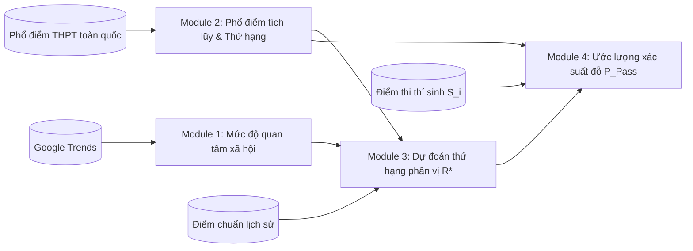

# Đặc Tả Bài Toán hiệu chỉnh: Khung Dự Đoán Khả Năng Trúng Tuyển Đại Học Dựa Trên Thứ Hạng Phân Vị & Dữ Liệu Công Khai

*(Refined Problem Specification — Cập nhật dựa trên Cơ sở lý thuyết và Kết quả thực nghiệm tại `feature-analysis.ipynb` & `model-training.ipynb`)*

---

## 1. Định nghĩa bài toán & Bối cảnh thực tế

### 1.1. Bối cảnh và khoảng trống thực tế
Trong kỳ thi tuyển sinh Đại học tại Việt Nam, việc thí sinh lựa chọn và sắp xếp thứ tự nguyện vọng thường gặp hai trở ngại lớn:
1. **Thiếu quyền tiếp cận dữ liệu nội bộ:** Hầu hết các mô hình tư vấn hiện nay đòi hỏi dữ liệu nội bộ từ phía nhà trường (như chỉ tiêu tuyển sinh chi tiết từng đợt, số lượng hồ sơ thực tế nộp vào từng ngành, dữ liệu chạy phần mềm lọc ảo nội bộ). Đây là những dữ liệu không được công khai hoặc công bố quá muộn.
2. **Điểm chuẩn thô biến động bất thường theo đề thi:** Đề thi tốt nghiệp THPT mỗi năm có độ khó dễ rất khác nhau. Có năm đề dễ, thí sinh đạt 27 điểm vẫn trượt các ngành tốp đầu; có năm đề khó, 24 điểm đã nằm trong nhóm 1% thí sinh giỏi nhất cả nước. Do đó, việc dự đoán trực tiếp con số điểm chuẩn thô (ví dụ: đoán ngành này lấy 26.5 điểm) chứa đựng rất nhiều sai số và rủi ro.

### 1.2. Hướng tiếp cận của đề tài
Đề tài xây dựng một quy trình tính toán tiếp cận hoàn toàn từ **bên ngoài nhà trường** (*Institution-Independent*), chỉ sử dụng các nguồn dữ liệu công khai (điểm chuẩn lịch sử, phổ điểm thi toàn quốc, mức độ tìm kiếm trên Google Trends và nhu cầu thị trường việc làm) nhằm:
1. **Quy đổi điểm thi sang thứ hạng phân vị toàn quốc (Survival Rank Percentile):** Xác định một thí sinh đang nằm ở **Top bao nhiêu % cao nhất cả nước** trong tổ hợp môn xét tuyển.
2. **Dự đoán thứ hạng phân vị trúng tuyển của ngành ($R^*$):** Xác định ngành học đó trong năm nay sẽ lấy thí sinh thuộc mức Top mấy % cả nước.
3. **Ước lượng xác suất trúng tuyển liên tục $P(\text{Pass})$ và phân tầng khuyến nghị:** Cung cấp xác suất đỗ cụ thể và xếp loại nguyện vọng thành 3 nhóm (An toàn, Cạnh tranh, Rủi ro) để thí sinh sắp xếp thứ tự nộp hồ sơ tối ưu nhất.

### 1.3. Mô hình hóa bài toán
Mục tiêu cốt lõi là ước lượng hàm xác suất:
$$P(\text{Trúng tuyển}_{i, j, t}) = \mathbb{P}(S_{i, k, t} \ge C_{j, k, t})$$

Trong đó:
- $t$: Năm tuyển sinh cần dự báo.
- $j$: Chương trình đào tạo / ngành của một trường đại học.
- $k$: Tổ hợp môn xét tuyển (A00, B00, D01,...).
- $S_{i, k, t}$: Tổng điểm thi thực tế của thí sinh $i$ theo tổ hợp $k$ ở năm $t$.
- $C_{j, k, t}$: Điểm chuẩn thực tế của chương trình $j$, tổ hợp $k$ ở năm $t$.

---

## 2. Kiến trúc 4 Module tính toán

### Module 1: Đo lường mức độ quan tâm của xã hội ($\mathbf{D}_{j, t}$)
- **Mục tiêu:** Định lượng sức hút của trường và ngành nghề đào tạo thông qua chuỗi thời gian tìm kiếm trên Google Trends.
- **Xử lý theo thời điểm tra cứu (Point-in-Time):**
  - *Thời điểm trước tháng 7 (trước khi có điểm thi):* Thí sinh tra cứu ở tháng $m$ ($m \le 6$), hệ thống cắt dữ liệu Trends từ tháng 1 đến tháng $m$ và so sánh tốc độ tăng trưởng với cùng kỳ năm trước. Lúc này mô hình tự động mở rộng khoảng dự phòng để phản ánh mức độ biến động còn cao.
  - *Thời điểm từ tháng 7 trở đi (đã có điểm thi chính thức):* Hệ thống sử dụng trọn vẹn dữ liệu Trends của cả mùa thi (từ tháng 1 đến tháng 8), bắt trọn mức quan tâm tại đỉnh mùa vụ ($x^{\max}$) để đưa ra dự báo chuẩn xác nhất.
- **Các đặc trưng chính:**
  - `trend_school_peak`: Mức độ tìm kiếm đỉnh điểm trong mùa tuyển sinh của trường đại học.
  - `trend_group_mean`: Mức độ quan tâm trung bình của nhóm ngành đào tạo.

### Module 2: Xây dựng phổ điểm tích lũy và quy đổi thứ hạng phân vị ($F_{k, t}$)
- **Mục tiêu:** Chuyển đổi thang điểm thô ($S \in [0, 30]$) sang thang đo thứ hạng phân vị chuẩn hóa ($r \in [0, 1]$).
- **Công thức:** Dựa trên mảng điểm thi của toàn bộ $N_{k, t}$ thí sinh thi tổ hợp $k$ năm $t$, tính hàm phân phối tích lũy thực nghiệm $\hat{F}_{k, t}(s)$ và quy đổi thứ hạng phân vị toàn quốc (tỷ lệ top % thí sinh đạt điểm cao hơn $s$):
  $$\text{RankPct}_{k, t}(s) = 1 - \hat{F}_{k, t}(s) = \mathbb{P}(X_{k, t} > s)$$
  - *Quy ước:* Thí sinh có $\text{RankPct} = 0.02$ nghĩa là đang đứng trong Top 2% thí sinh có điểm cao nhất cả nước ở tổ hợp đó. Thang đo này hoàn toàn không bị ảnh hưởng bởi việc đề thi năm đó dễ hay khó.
- **Vai trò:** Chuyển đổi điểm chuẩn các năm quá khứ ($C_{j, t}$) thành nhãn mục tiêu ($R^*_{j, t}$) để huấn luyện Module 3, đồng thời định vị thứ hạng điểm thi ($r_{i, k, t}$) của thí sinh cho Module 4.

### Module 3: Mô hình học máy dự đoán thứ hạng phân vị điểm chuẩn ($R^*_{j, t}$)
- **Mục tiêu:** Dự đoán ngành $j$ trong năm $t$ sẽ lấy điểm chuẩn tương ứng với **Top bao nhiêu % thí sinh toàn quốc** ($R^*_{j, t} \in [0, 1]$).
- **Thuật toán cốt lõi:** Sử dụng LightGBM Regressor trên tập dữ liệu dạng bảng. Cây quyết định tăng cường gradient có khả năng nắm bắt quan hệ phi tuyến và học chéo thông tin trên toàn thị trường tuyển sinh rất hiệu quả.
- **Đầu ra của Module 3 gồm 2 phần:**
  1. *Dự đoán giá trị kỳ vọng:* Ước lượng phân vị trung bình $\mu_{j, t}$ và phương sai bất định $\sigma_{j, t}^2$.
  2. *Dự đoán 3 mốc kịch bản phân vị (Hồi quy phân vị - Quantile Regression):* Huấn luyện song song 3 mô hình tối ưu hàm mất mát Pinball Loss với $\tau \in \{0.1, 0.5, 0.9\}$:
     - $\hat{R}^*_{0.1}$ (**Kịch bản Cạnh tranh Khốc liệt**): Ứng với $\tau = 0.1$, phân vị bị thắt chặt nhất (điểm chuẩn vọt lên cao nhất trong dải tin cậy 80%), xuất hiện khi ngành bất ngờ có làn sóng nộp nguyện vọng dồn về.
     - $\hat{R}^*_{0.5}$ (**Kịch bản Cơ sở / Trung vị kỳ vọng**): Mốc điểm chuẩn khả dĩ nhất trong điều kiện tuyển sinh bình thường.
     - $\hat{R}^*_{0.9}$ (**Kịch bản Hạ nhiệt An toàn**): Ứng với $\tau = 0.9$, phân vị nới lỏng nhất (điểm chuẩn giảm xuống mức an toàn nhất trong dải tin cậy 80%).

### Module 4: Tính xác suất đỗ và phân loại khuyến nghị nguyện vọng
- **Mục tiêu:** Tính toán xác suất trúng tuyển liên tục ($P \in [0, 1]$) khi thí sinh có mức điểm tương ứng với thứ hạng $r_i$ nộp vào ngành $j$.
- **Công thức xác suất:** Giả định phân phối phân vị tuân theo phân phối chuẩn $\mathcal{N}(\mu_{j, t}, \sigma_{j, t}^2)$, xác suất trúng tuyển được tính trực tiếp qua hàm phân phối chuẩn tắc $\Phi(\cdot)$:
  $$P(\text{Trúng tuyển}_{i, j, k, t}) = \Phi\left(\frac{\mu_{j, t} - r_{i, k, t}}{\sigma_{j, t}}\right)$$
  - Nếu thí sinh xét tuyển bằng nhiều tổ hợp hợp lệ, xác suất chung cuộc là xác suất cao nhất:
    $$P(\text{Trúng tuyển}_{i, j, t}) = \max_{k \in \mathcal{K}_j} P(\text{Trúng tuyển}_{i, j, k, t})$$
- **Phân loại khuyến nghị 3 nhóm nguyện vọng:**
  - **Vùng An toàn ($P \ge 80\%$ hoặc $r_{i} \le \hat{R}^*_{0.1}$):** Thứ hạng của thí sinh vượt qua cả kịch bản cạnh tranh khốc liệt nhất, khả năng đỗ rất cao, dùng làm nguyện vọng bảo đảm chắc chắn.
  - **Vùng Cạnh tranh ($50\% \le P < 80\%$ hoặc $\hat{R}^*_{0.1} < r_{i} \le \hat{R}^*_{0.9}$):** Thứ hạng thí sinh nằm trong dải dao động kỳ vọng, cơ hội đỗ khả quan nhưng chịu tác động của thuật toán lọc ảo, cần chuẩn bị thêm nguyện vọng an toàn phía sau.
  - **Vùng Rủi ro cao ($P < 50\%$ hoặc $r_{i} > \hat{R}^*_{0.9}$):** Thứ hạng thấp hơn kịch bản hạ nhiệt nới lỏng nhất, tỷ lệ đỗ thấp, chỉ nên xếp ở nhóm nguyện vọng mơ ước ban đầu.

---

## 3. Quy trình Lựa chọn và Phương pháp Tính toán Chi tiết 16 Đặc trưng

Dựa trên thực nghiệm tại [feature-analysis.ipynb](file:///d:/UNIDOCS/IS405.R11-Big-Data/scripts-processing/notebooks/feature-analysis.ipynb), từ $38,277$ quan sát ($2018–2025$), hệ thống đã sàng lọc và xác lập danh mục 16 đặc trưng tối ưu vượt qua kiểm định thống kê ANOVA F-test ($p < 0.05$).

### 3.1. Danh mục 16 đặc trưng tối ưu chính thức đã được kiểm chứng

| STT | Tên đặc trưng | Nhóm biến | Ý nghĩa thực tế | Minh chứng thống kê từ thực nghiệm |
| :-: | :--- | :--- | :--- | :--- |
| 1 | `prog_pct_lag1` | Quán tính chương trình | Thứ hạng phân vị điểm chuẩn chính ngành đó năm trước | Tương quan mạnh nhất ($r = 0.8276$), MDI cao nhất (58.98%), ANOVA $F = 72,365$ ($p = 0.0$). |
| 2 | `school_pct_mean_lag1` | Đặc trưng Trường | Thứ hạng phân vị trung bình chung toàn trường năm trước | Tương quan rất cao ($r = 0.7345$), MDI rank 2 (11.81%), ANOVA $F = 39,008$ ($p = 0.0$). |
| 3 | `school_pct_min_lag1` | Đặc trưng Trường | Thứ hạng ngành lấy điểm cao nhất trường (ngưỡng sàn danh tiếng) | Spearman $\rho = 0.6253$, MDI rank 3 (5.37%), ANOVA $F = 14,570$ ($p = 0.0$). |
| 4 | `major_pct_mean_lag1` | Đặc trưng Ngành | Thứ hạng phân vị trung bình của ngành trên cả nước năm trước | Tương quan $r = 0.4835$, MDI đóng góp 2.78%, ANOVA $F = 10,160$ ($p = 0.0$). |
| 5 | `group_pct_mean_lag1` | Đặc trưng Nhóm ngành | Thứ hạng phân vị trung bình của 37 nhóm ngành lớn cấp 1 | Tương quan $r = 0.3860$, MDI rank 6 (3.40%), ANOVA $F = 5,830$ ($p = 0.0$). |
| 6 | `delta_prog_vs_school_mean` | Vị thế tương đối | Chênh lệch thứ hạng giữa ngành so với mặt bằng chung toàn trường | Tương quan $r = 0.3191$, MDI đóng góp 3.21%, ANOVA $F = 3,760$ ($p = 0.0$). |
| 7 | `delta_prog_vs_major_mean` | Vị thế tương đối | Chênh lệch thứ hạng của trường đối với ngành này so với cả nước | Tương quan $r = 0.6536$, MDI rank 4 (5.03%), ANOVA $F = 24,325$ ($p = 0.0$). |
| 8 | `num_blocks` | Đề án tuyển sinh | Số lượng tổ hợp môn xét tuyển áp dụng cho chương trình | Spearman $\rho = 0.2975$, MDI rank 7 (3.27%), ANOVA $F = 796.09$ ($p < 1e-100$). |
| 9 | `trend_school_peak` | Google Trends (M1) | Độ tìm kiếm đỉnh điểm trong mùa tuyển sinh của trường đại học | Spearman $\rho = -0.1276$, MDI rank 5 (3.56%), ANOVA $F = 281.37$ ($p < 1e-60$). |
| 10 | `trend_group_mean` | Google Trends (M1) | Mức độ tìm kiếm trung bình của nhóm ngành đào tạo | Spearman $\rho = -0.1834$, ANOVA $F = 61.11$ ($p < 1e-14$). |
| 11 | `is_cutoff_over_30` | Cờ nhị phân | Đánh dấu các ngành có điểm chuẩn công bố vượt trần 30 điểm | Spearman $\rho = -0.1584$, ANOVA $F = 568.91$ ($p < 1e-100$). |
| 12 | `is_new_program` | Cờ nhị phân | Kích hoạt khi chương trình mới mở (áp dụng công thức ngành mới) | Giữ luồng dữ liệu liên tục, không làm gián đoạn hệ thống. |
| 13 | `inter_prog_school` | Tương tác bậc 2 | Tương tác giữa điểm ngành và điểm trường (`prog * school`) | Bắt giữ hiệu ứng cộng hưởng thương hiệu, ANOVA $F = 55,447$ ($p = 0.0$). |
| 14 | `inter_school_major` | Tương tác bậc 2 | Tương tác giữa điểm trường và điểm ngành cả nước (`school * major`) | Bắt giữ quan hệ tương hỗ, Lift $= +0.0071$, ANOVA $F = 40,703$ ($p = 0.0$). |
| 15 | `inter_prog_blocks` | Tương tác bậc 2 | Tương tác giữa điểm ngành và số lượng tổ hợp xét tuyển | ANOVA $F = 13,006$ ($p = 0.0$). |
| 16 | `inter_school_blocks` | Tương tác bậc 2 | Tương tác giữa điểm trường và số lượng tổ hợp xét tuyển | ANOVA $F = 8,392$ ($p = 0.0$). |

---

### 3.2. Phương pháp và Công thức Tính toán Chi tiết của 16 Đặc trưng

#### A. Tiền đề cơ sở: Cách tính nhãn phân vị mục tiêu ($R^*$)
Hầu hết các đặc trưng dạng trễ và phân vị đều được xây dựng dựa trên biến $R^*_{j, t}$. Với một ngành $j$ tuyển sinh trong năm $t$, có điểm chuẩn công bố $C$ và danh sách các tổ hợp môn hợp lệ $\mathcal{K}_j$ (ví dụ: A00, D01):
1. Tra cứu điểm chuẩn $C$ vào mảng điểm thi toàn quốc đã sắp xếp tăng dần của từng tổ hợp $k$ năm $t$:
   $$\text{RankPct}_k(C) = 1.0 - \frac{\text{searchsorted}(\text{Array}_{k, t}, \, \min(C, 30.0))}{N_{k, t}}$$
2. Nhãn phân vị chuẩn hóa của ngành là trung bình cộng trên tất cả các tổ hợp môn được công nhận:
   $$R^*_{j, t} = \frac{1}{|\mathcal{K}_j|} \sum_{k \in \mathcal{K}_j} \text{RankPct}_k(C)$$
   *(Quy ước: $R^*$ là tỷ lệ top % thí sinh cả nước có điểm $\ge C$. Ngành lấy điểm càng cao thì $R^*$ càng bé, ví dụ $R^* = 0.01$ là Top 1% toàn quốc).*

---

#### B. Nhóm 1: Quán tính của chính ngành đào tạo (Program Lag)

* **1. `prog_pct_lag1` (Thứ hạng phân vị ngành năm trước):**
  - **Ý nghĩa:** Điểm chuẩn của chính ngành đó năm trước lấy thí sinh thuộc Top mấy % cả nước.
  - **Công thức:**
    $$\text{prog\_pct\_lag1}_{j, t} = R^*_{j, t-1}$$
  - **Cơ chế xử lý khi ngành mới mở (Khởi đầu lạnh):** Nếu ngành mới mở trong năm $t$ (năm $t-1$ chưa có điểm chuẩn $\implies \text{NaN}$), hệ thống tự động bù đắp bằng công thức tổ hợp lồi giữa uy tín trường và sức hút ngành toàn quốc:
    $$\text{prog\_pct\_lag1} = 0.5 \times \text{school\_pct\_mean\_lag1} + 0.5 \times \text{major\_pct\_mean\_lag1}$$

---

#### C. Nhóm 2: Đặc trưng cấp Trường học (School-level Features)

Mỗi năm $t$, gom nhóm toàn bộ các ngành tuyển sinh thuộc cùng một trường đại học $s$ để tính các chỉ số phân vị đại diện của trường:

* **2. `school_pct_mean_lag1` (Mặt bằng phân vị trung bình toàn trường năm trước):**
  - **Ý nghĩa:** Uy tín thương hiệu và chất lượng tuyển sinh chung của toàn trường ở năm trước ($t-1$).
  - **Công thức:** Lấy trung bình cộng phân vị $R^*$ của tất cả các ngành mà trường $s$ tuyển sinh trong năm $t-1$:
    $$\text{school\_pct\_mean\_lag1}_{s, t} = \frac{1}{|\mathcal{J}_{s, t-1}|} \sum_{j \in \mathcal{J}_{s, t-1}} R^*_{j, t-1}$$

* **3. `school_pct_min_lag1` (Ngưỡng sàn danh tiếng / Ngành đỉnh của trường năm trước):**
  - **Ý nghĩa:** Ngành có điểm chuẩn cao nhất trường năm trước lấy thí sinh ở top mấy % (đại diện cho hiệu ứng hào quang thương hiệu trường — Halo Effect).
  - **Công thức:** Lấy giá trị nhỏ nhất của $R^*$ trong số tất cả các ngành của trường năm $t-1$ (vì $R^*$ càng nhỏ thì điểm chuẩn càng cao):
    $$\text{school\_pct\_min\_lag1}_{s, t} = \min_{j \in \mathcal{J}_{s, t-1}} R^*_{j, t-1}$$

---

#### D. Nhóm 3: Đặc trưng cấp Ngành & Nhóm ngành cả nước (Major & Group-level Features)

* **4. `major_pct_mean_lag1` (Mặt bằng phân vị ngành trên toàn quốc năm trước):**
  - **Ý nghĩa:** Sức hút tự thân của chuyên ngành đó trên phạm vi toàn quốc ở năm trước (ví dụ: ngành Kỹ thuật phần mềm trên cả nước nhìn chung thuộc top bao nhiêu %).
  - **Công thức:** Gom nhóm toàn bộ các trường trên cả nước có đào tạo cùng mã chuẩn ngành `major_name` trong năm $t-1$, tính trung bình cộng $R^*$:
    $$\text{major\_pct\_mean\_lag1}_{m, t} = \frac{1}{|\mathcal{J}_{m, t-1}|} \sum_{j \in \mathcal{J}_{m, t-1}} R^*_{j, t-1}$$

* **5. `group_pct_mean_lag1` (Mặt bằng nhóm ngành lớn vĩ mô năm trước):**
  - **Ý nghĩa:** Mỏ neo đại diện cho nhóm ngành cấp 1 (trong 37 nhóm ngành lớn như *Máy tính & CNTT*, *Kinh doanh*, *Sức khỏe*) và đóng vai trò cứu cánh khi ngành hẹp bị khuyết thiếu dữ liệu.
  - **Công thức:** Gom nhóm toàn bộ các ngành trên cả nước thuộc cùng mã `major_group_name` trong năm $t-1$, tính trung bình cộng $R^*$:
    $$\text{group\_pct\_mean\_lag1}_{g, t} = \frac{1}{|\mathcal{J}_{g, t-1}|} \sum_{j \in \mathcal{J}_{g, t-1}} R^*_{j, t-1}$$

---

#### E. Nhóm 4: Độ lệch vị thế tương đối (Relative Positioning Deltas)

* **6. `delta_prog_vs_school_mean` (Vị thế ngành so với trường):**
  - **Ý nghĩa:** Ngành này là ngành mũi nhọn (lấy điểm cao hơn mặt bằng trường) hay ngành phụ (lấy điểm thấp hơn mặt bằng trường).
  - **Công thức:**
    $$\text{delta\_prog\_vs\_school\_mean} = \text{prog\_pct\_lag1} - \text{school\_pct\_mean\_lag1}$$
    *(Nếu kết quả âm: ngành lấy điểm cao hơn trung bình trường; nếu dương: ngành lấy điểm thấp hơn).*

* **7. `delta_prog_vs_major_mean` (Vị thế trường so với mặt bằng ngành cả nước):**
  - **Ý nghĩa:** Cùng một ngành đào tạo, trường này lấy điểm khắt khe hơn hay dễ hơn so với mặt bằng chung các trường khác trên toàn quốc.
  - **Công thức:**
    $$\text{delta\_prog\_vs\_major\_mean} = \text{prog\_pct\_lag1} - \text{major\_pct\_mean\_lag1}$$

---

#### F. Nhóm 5: Đề án tuyển sinh & Các cờ trạng thái (Schemes & Binary Flags)

* **8. `num_blocks` (Số lượng tổ hợp xét tuyển):**
  - **Ý nghĩa:** Ngành xét tuyển bằng bao nhiêu tổ hợp môn. Ngành mở càng nhiều tổ hợp thì nguồn tuyển sinh càng rộng, khả năng cạnh tranh điểm chuẩn biến động hơn.
  - **Công thức:** Đếm số lượng mã tổ hợp trong chuỗi `score_blocks` phân tách bằng dấu chấm phẩy `;`:
    $$\text{num\_blocks} = \text{count}(\text{split}(\text{score\_blocks}, \, \text{';'}))$$

* **11. `is_cutoff_over_30` (Cờ điểm chuẩn vượt trần 30 điểm):**
  - **Ý nghĩa:** Đánh dấu những ngành có điểm chuẩn công bố $> 30.0$ (do môn chính nhân hệ số 2 hoặc có điểm ưu tiên quy đổi cao).
  - **Công thức:**
    $$\text{is\_cutoff\_over\_30} = \begin{cases} 1 & \text{nếu } \text{score\_mark} > 30.0 \\ 0 & \text{ngược lại} \end{cases}$$

* **12. `is_new_program` (Cờ ngành mới mở):**
  - **Ý nghĩa:** Báo cho mô hình biết ngành này năm trước chưa từng tuyển sinh, đang áp dụng công thức bù đắp điểm tiên nghiệm.
  - **Công thức:**
    $$\text{is\_new\_program} = \begin{cases} 1 & \text{nếu } R^*_{j, t-1} \text{ ban đầu bị khuyết (NaN)} \\ 0 & \text{ngược lại} \end{cases}$$

---

#### G. Nhóm 6: Tín hiệu xã hội từ Google Trends

Dữ liệu chuỗi thời gian tìm kiếm từ Google Trends được chuẩn hóa thang đo $[0, 100]$:

* **9. `trend_school_peak` (Đỉnh điểm tìm kiếm về trường trong mùa thi):**
  - **Ý nghĩa:** Mức độ phủ sóng truyền thông và sự quan tâm bùng nổ của thí sinh đối với trường đại học trong mùa tuyển sinh.
  - **Công thức:** Lấy giá trị tìm kiếm cao nhất ($\max$) của từ khóa tên trường trong các tháng cao điểm mùa thi (tháng 6 đến tháng 8) của năm tuyển sinh $t$:
    $$\text{trend\_school\_peak}_{s, t} = \max_{\tau \in \{\text{T6, T7, T8}\}} (\text{Interest}_{s, \tau, t})$$

* **10. `trend_group_mean` (Mức độ tìm kiếm trung bình của nhóm ngành):**
  - **Ý nghĩa:** Xu hướng và lực cầu xã hội đối với toàn bộ lĩnh vực nghề nghiệp trong năm đó.
  - **Công thức:** Lấy trung bình cộng chỉ số tìm kiếm của từ khóa nhóm ngành đào tạo vĩ mô lũy kế trong năm tuyển sinh $t$:
    $$\text{trend\_group\_mean}_{g, t} = \frac{1}{M} \sum_{\tau=1}^M \text{Interest}_{g, \tau, t}$$

---

#### H. Nhóm 7: Khai triển Tương tác bậc 2 (Polynomial Interactions)

Các biến này được tạo thành từ tích chéo giữa 2 biến thành phần ($x_1 \times x_2$), bắt giữ mối quan hệ phi tuyến tương hỗ đã được chứng minh qua thực nghiệm tạo ra độ nâng tương quan (Correlation Lift) và vượt qua kiểm định ANOVA F-test ($p = 0.0$):

* **13. `inter_prog_school` (Cộng hưởng giữa điểm ngành và điểm trường):**
  - **Công thức:**
    $$\text{inter\_prog\_school} = \text{prog\_pct\_lag1} \times \text{school\_pct\_mean\_lag1}$$
  - **Ý nghĩa:** Bắt giữ hiệu ứng cộng hưởng thương hiệu: một ngành "hot" nằm trong một trường đại học danh tiếng thì phân vị trúng tuyển sẽ thắt chặt ở mức rất cao.

* **14. `inter_school_major` (Tương tác giữa uy tín trường và độ hot của ngành cả nước):**
  - **Công thức:**
    $$\text{inter\_school\_major} = \text{school\_pct\_mean\_lag1} \times \text{major\_pct\_mean\_lag1}$$
  - **Ý nghĩa:** Đo lường độ cộng hưởng khi một trường có danh tiếng quyết định mở hoặc đào tạo một ngành nghề đang có nhu cầu cao trên cả nước.

* **15. `inter_prog_blocks` (Tương tác giữa điểm ngành và quy mô tổ hợp):**
  - **Công thức:**
    $$\text{inter\_prog\_blocks} = \text{prog\_pct\_lag1} \times \text{num\_blocks}$$
  - **Ý nghĩa:** Lượng hóa tác động của việc mở rộng khối thi đối với các ngành có điểm chuẩn cao.

* **16. `inter_school_blocks` (Tương tác giữa uy tín trường và quy mô tổ hợp):**
  - **Công thức:**
    $$\text{inter\_school\_blocks} = \text{school\_pct\_mean\_lag1} \times \text{num\_blocks}$$
  - **Ý nghĩa:** Phản ánh chính sách tuyển sinh đa dạng hóa nguồn tuyển của các cơ sở đào tạo lớn.

---

## 4. Kết quả thực nghiệm Huấn luyện và Đánh giá Mô hình

### 4.1. Khảo sát hiện tượng Overfit / Underfit và Điểm dừng tối ưu
- Thực nghiệm trên đường cong học tập (Learning Curves) từ $N = 50$ đến $N = 26,637$ mẫu chứng minh: Khi mẫu nhỏ ($N \le 200$), mô hình bị quá khớp nặng (Validation MSE lên tới $0.12 - 0.13$). Khi tăng quy mô dữ liệu lên trên $10,000$ mẫu, sai số kiểm định giảm mạnh và hội tụ tiệm cận mức sai số tối thiểu tham chiếu (Sàn sai số Bayes $\sigma^2_{\text{Bayes}} \approx 0.02539$).
- Điểm dừng tối ưu của cấu trúc cây quyết định được xác lập tại: `max_depth = 7`, `num_leaves = 31 - 45`, `n_estimators = 150`, `learning_rate = 0.05` kết hợp điều chuẩn $L_1/L_2$ (`reg_alpha = 0.1`, `reg_lambda = 0.1`) nhằm triệt tiêu các dao động ngẫu nhiên biên độ nhỏ.

### 4.2. Hiệu năng kiểm định chéo phân tầng (Stratified 5-Fold Cross-Validation)
Mô hình LightGBM duy trì chất lượng dự báo cao và đồng đều trên cả 5 Folds kiểm định độc lập:
- **Sai số bình phương trung bình căn (RMSE):** $0.1534 \pm 0.0021$
- **Sai số tuyệt đối trung bình (MAE):** $0.1048 \pm 0.0016$
- **Hệ số xác định ($R^2$):** $0.8016 \pm 0.0048$ (giải thích hơn $80.1\%$ phương sai phân vị tuyển sinh)
- **Hệ số tương quan thứ hạng Spearman ($\rho$):** $0.8955 \pm 0.0028$ (tiệm cận mức 0.90, chứng minh mô hình bảo toàn trật tự ưu tiên giữa các ngành cực kỳ chính xác)
- **Độ phân tán giữa các Folds cực thấp:** Độ lệch chuẩn giữa các Folds chỉ quanh mức $\approx 0.002$, khẳng định mô hình có tính tổng quát hóa cao, không phụ thuộc vào cách chia mẫu ngẫu nhiên.

### 4.3. Đánh giá chỉ số ra quyết định tuyển sinh (Decision Metrics)
Chuyển đổi phân vị dự báo sang bài toán quyết định xét tuyển thực tế cho thí sinh cho kết quả xuất sắc:
- **Độ chính xác tổng thể (Accuracy):** Đạt **$88.88\% - 89.26\%$** ổn định trên toàn bộ các dải điểm thi khảo sát (từ học sinh giỏi top 15% đến học sinh trung bình 80%).
- **Độ chuẩn xác (Precision):** Đạt **$89.28\%$**, nghĩa là khi mô hình dự báo thí sinh đủ điều kiện trúng tuyển thì có gần $90\%$ khả năng thực tế thí sinh sẽ đỗ, hạn chế tối đa việc đưa ra lời khuyên sai lầm khiến thí sinh bị trượt.
- **Độ nhạy (Recall):** Đạt **$73.94\%$** (F1-score = $0.8089$).
- **Diện tích dưới đường cong ROC (ROC-AUC):** Đạt **$0.9535$** (trên dải kiểm tra duy trì từ $0.947 - 0.955$), chứng minh năng lực phân tách xác suất trúng tuyển giữa nhóm đỗ và nhóm trượt vượt trội.

---

## 5. Xử lý các tình huống thực tế đặc thù

1. **Giải quyết tình huống ngành mới mở (Khởi đầu lạnh - Cold-Start):**
   - Khi trường mở ngành đào tạo mới trong năm $t$, dữ liệu năm trước ($R^*_{j, t-1}$) bị khuyết thiếu.
   - Hệ thống ước lượng mức phân vị khởi điểm bằng tổ hợp có trọng số giữa điểm của trường và điểm của ngành trên cả nước:
     $$\hat{R}^*_{j, t-1} = 0.5 \cdot R^*_{\text{school}, s, t-1} + 0.5 \cdot R^*_{\text{major}, m, t-1}$$
     đồng thời bật cờ nhị phân `is_new_program = 1`. Nhờ đó hệ thống vẫn đưa ra dự đoán bình thường mà không cần loại bỏ bản ghi.
2. **Xử lý ngành xét tuyển nhiều tổ hợp môn:**
   - Điểm chuẩn ngành được dung hòa từ các tổ hợp môn thành phần. Với thí sinh nộp nhiều tổ hợp, Module 4 tính xác suất theo từng tổ hợp và lấy xác suất cao nhất: $P = \max_{k} P_k$.
3. **Xử lý ngành có điểm chuẩn vượt trần 30 điểm (`is_cutoff_over_30 = 1`):**
   - Với những ngành nhân hệ số 2 môn chính hoặc có điểm ưu tiên cao dẫn đến điểm công bố $> 30.0$, phân vị được kẹp chuẩn tại $R^* = 0$ (mức trần) và gắn cờ cảnh báo để thí sinh biết cần cộng thêm điểm ưu tiên/chứng chỉ quy đổi mới đủ điều kiện cạnh tranh.

---

## 6. Lưu trữ và Tái sử dụng Mô hình trong Thực tế

Toàn bộ các mô hình sau khi huấn luyện và kiểm định đạt chuẩn được lưu trữ thành các tệp đóng gói tại thư mục `models/` gồm:
- `models/model_metadata.json`: Chứa phiên bản, danh sách 16 đặc trưng chuẩn, siêu tham số và các ngưỡng kiểm định chất lượng.
- `models/best_lightgbm_regressor.joblib`: Mô hình dự đoán phân vị kỳ vọng ($\mu$).
- `models/lightgbm_quantile_0.1.joblib`: Mô hình dự đoán kịch bản cạnh tranh tăng cao ($\hat{R}^*_{0.1}$).
- `models/lightgbm_quantile_0.9.joblib`: Mô hình dự đoán kịch bản hạ nhiệt an toàn ($\hat{R}^*_{0.9}$).

Khi hệ thống vận hành phục vụ trực tuyến (Model Serving API), dịch vụ chỉ cần nạp các tệp này lên bộ nhớ để thực hiện phép suy luận mà không cần chạy lại bất kỳ thuật toán phân tán nặng nề nào.
